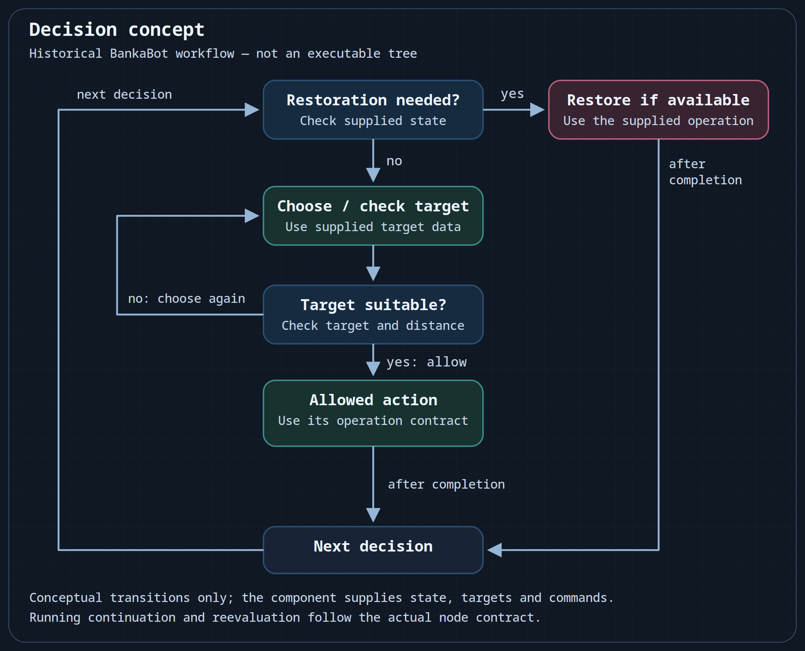

# Plan a BankaBot behavior tree

Describe one small behavior before mapping it to the nodes supplied by your BankaBot edition. A useful first branch checks whether a target is suitable and whether an action is allowed.

The historical BankaBot description included visual behavior trees, conditions, actions, delays, cooldowns, selectors and branches. A matching distribution must provide the character state, target data and operations used by a particular tree. Generic EyeAuras nodes do not create that game data. In the documented layout, a root contains conditions, actions and utility nodes; their concrete editor controls belong to the matching distribution.

## Describe one branch

1. Choose a single task, such as selecting a suitable nearby target while the character is alive. Identify which part of the distribution supplies target validity and distance.
2. Separate the checks from the reaction: first establish suitability and range, then permit the corresponding operation.
3. Give restoration its own condition and priority. Low HP may justify a restoration branch when the edition provides that state and operation; healing is not an unconditional next step after every fight.
4. Define what ends, rejects or continues each operation before translating the plan into the edition's actual nodes.

| Decision | Data or operation required |
| --- | --- |
| Is there a suitable target? | Supplied target identity, validity and selection rules |
| Is it within the required distance? | A distance value and the operation's range |
| May the action run now? | Its availability, conditions and cooldown state |
| Does restoration take priority? | Supplied character state, a threshold and an available restoration operation |
| When should selection resume? | The actual operation's completion and continuation contract |

The result is one explainable branch with known inputs and outcomes. Use the matching edition's editor and examples to turn it into an executable tree; a conceptual plan is not an importable program.

## Selection and conditional restoration

This conceptual diagram checks whether restoration is needed, otherwise checks a target and permits an allowed action. An unsuitable target returns to selection; completed work returns to the next decision. The distribution must supply state, targets, distance and commands. This is not an editor screenshot or an executable BankaBot tree. [SVG source](/assets/wiki-media/m058-concept.svg).

The arrows describe decision transitions. They do not promise that every condition is continuously rechecked while work is running, or that an operation can be interrupted immediately. Continuation, reevaluation and cancellation depend on the actual node and operation.

When to combine a tree with C#

A small tree is useful when you want to see the order of checks and reactions. [C# scripting](/en/BankaBot/scripting/getting-started) can organize custom calculations, several event sources or timers when the supplied interfaces support them. Keep the boundary clear: the script provides a defined operation, and the tree decides when to call it.

For general EyeAuras concepts, see the [node index](/en/behavior-trees/nodes) and [scripting integration](/en/behavior-trees/scripting). Their node contracts are a separate learning resource, not a catalog of BankaBot-specific nodes.

