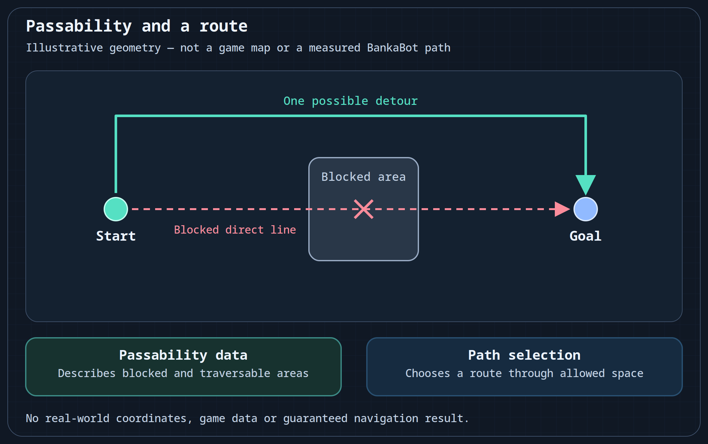

# Prepare BankaBot geodata

Prepare data that describes traversable space before asking a BankaBot behavior to move around an obstacle. A target position alone does not explain which side of a wall is passable.

Geodata was documented as a separate input to BankaBot navigation. Use a dataset intended for the client, chronicles and world supported by your matching distribution. The edition's instructions must specify its accepted formats, directory structure and selection controls.

## Select a matching dataset

1. Identify the client and world for which the dataset was prepared. Resolve a mismatch before changing behavior logic.
2. Choose one of the historically documented sources: a prepared source offered by the program, an existing geodata folder, or an archive for import.
3. Open the matching edition's geodata settings and follow its download or import procedure. Large datasets can be stored and updated separately; do not guess a path or archive format from the feature name.
4. Confirm which source the edition has selected before using it for a route, point movement or a work area.
5. If a route crosses an obstacle, check the dataset's world/version match and passability information before changing target-selection or combat conditions.

The preparation result is an identified, selected dataset. Successful import alone does not prove that a route can be followed in the current environment.

## Passability and route selection

The red dashed line crosses a blocked area; the turquoise line shows one possible detour. Geodata describes passable and blocked space. A path-selection algorithm uses that data to choose a route. These are illustrative positions, not a game minimap, measured BankaBot coordinates or a guarantee of an optimal or executable route. [SVG source](/assets/wiki-media/m060-concept.svg).

| Task or symptom | What geodata contributes |
| --- | --- |
| Movement around walls and other obstacles | Information about blocked and traversable space |
| Navigation across heights or complex layouts | The dataset's representation of the matching world |
| A strange route or movement through an obstacle | A reason to check the selected dataset and its version |
| A character's HP, MP, nearby players or target state | Those require separate BankaBot data sources; geodata does not supply them |

The historical use cases included routes, movement to points, farming areas and minimap display. Their concrete controls and behavior belong to the matching distribution. Importing a folder does not itself create a route or a behavior.

Continue with [behavior trees](/en/BankaBot/behavior-trees) once the navigation input is understood, or return to [Getting started](/en/BankaBot/getting-started) to check the edition and environment.
