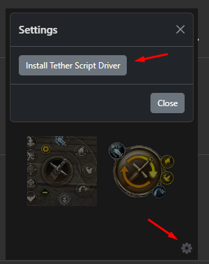

# Prepare the Essence auto-flags pack

**Essence auto flags** describes returning to flags through client key assignments. The author specifies random selection among **F8–F12**, so those keys must already be assigned to the intended flags in your own client. EyeAuras does not discover flag locations from hidden game data automatically.

The [publication](https://eu.eyeauras.net/share/S20240325120506y5CPVmuwLvC3) identifies **revision 3**, released on **28 March 2024** by **linqse**, using **EyeAuras 1.4.6657.0**. The following is a historical pack workflow requiring a matching client and compatible EyeAuras environment. The public description does not establish current pack availability or support for every server.

## Match the pack to your keys

1. Obtain EyeAuras from the [official download page](https://eu.eyeauras.net/download) and, when needed, use [your account](https://eu.eyeauras.net/login). Check feature and license access for the distribution you intend to use.
2. Open **Essence auto flags** by **linqse**. In a compatible build, choose **Import → Source**, paste the link and click **Download**. Inspect **Preview** and [import modes](/en/features/export-import) before adding it. A download redirect to a web page is not the pack artifact.
3. Prepare **F8–F12** in your own client. The author allows assigning the same flag to each key if you want one destination. This is client preparation, not selection of a built-in EyeAuras “flag” object.
4. Check the pack's recipient window and input settings. Before enabling it, check that **Insert** does not conflict with another menu and **Shift+Alt+Z** with another automation.
5. In the matching environment, **Insert** opens the pack menu and **Shift+Alt+Z** toggles its work. First compare the menu with that revision's settings. Any return action should follow your key assignments, rather than assumptions copied from a different configuration.

The earlier screenshot belongs to this pack guide. Compare bindings and controls with the description of your revision.

| Setting or prerequisite | What to check |
| --- | --- |
| `Insert` | Opens the published pack's menu, not a universal EyeAuras menu. |
| `Shift+Alt+Z` | Toggles its work according to the author; inspect the window and actions first. |
| `F8–F12` | Prepared flag keys from which the pack may choose. |
| One destination | Assign it to every key used, if your client permits that configuration. |
| Input mechanism | Acceptance depends on the client, focus, recipient and environment. |

[Normal input limits](/en/actions/sendinput/options) still apply. The historical [HVDK Standard 2.1](https://s3.eyeauras.net/media/2024/10/HVDK%20Standard%202.1.exe) route requires compatibility checks; an install button is not a universal one-click game setup. See [TetherScript Driver](/en/actions/sendinput/tetherscript) for the relevant preparation.

For older clients with unwanted camera rotation, the guide suggested turning off `Enable Controller` under `Settings → Configuration`. The old `C:\Program Files (x86)\ControlMyJoystick 5.5.78.50\Driver\Joystick` path belongs to one installation; it is not an instruction to uninstall devices on any computer. Input mechanisms should not be selected on the assumption that an anti-cheat name guarantees compatibility or server permission.

Earlier installation and import videos

The first EyeSquad recording, “Установка EyeAuras шаг-за-шагом” (step-by-step EyeAuras installation), shows the environment of its time. Compare driver and application versions before following it.

[Watch the installation recording](https://www.youtube.com/watch?v=bNJ4rGeqNoE)

The second EyeSquad recording, “Установка набора аур из библиотеки EyeAuras Essence” (installing the Essence aura set from the library), covers importing the auto-return pack and its earlier interface.

[Watch the Essence pack import recording](https://www.youtube.com/watch?v=S1lQF56-AIA)

