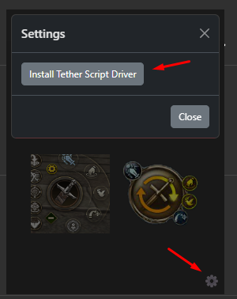

# Prepare the Essence auto-flags pack

The **Essence auto flags** pack returns your character to flags by pressing client keys. According to the author it picks at random among **F8–F12**, so you must assign the flags to those keys in the game beforehand.

The [publication](https://eu.eyeauras.net/share/S20240325120506y5CPVmuwLvC3) is **revision 3**, released on **28 March 2024** by **linqse** and made in **EyeAuras 1.4.6657.0**. It may not work on every server or with the current client.

## Match the pack to your keys

1. Download EyeAuras from the [official download page](https://eu.eyeauras.net/download). If needed, sign in to [your account](https://eu.eyeauras.net/login).
2. Open **Essence auto flags** by **linqse**. In EyeAuras, choose **Import → Source**, paste the link and click **Download**. Check **Preview** and the import options before adding the pack. The [import modes](/en/features/export-import) page helps you avoid replacing a copy you already have.
3. Assign the flags to **F8–F12** in your own client. If you have one flag, the author allows assigning it to each of these keys.
4. In the pack settings, check which window the input goes to. Before enabling the pack, make sure **Insert** is not taken by another menu of yours and **Shift+Alt+Z** by another automation.
5. In a matching environment, **Insert** opens the pack menu and **Shift+Alt+Z** turns the pack on and off. The first thing you should see is the menu with this revision's settings.

| Setting or prerequisite | What to check |
| --- | --- |
| `Insert` | Opens this pack's menu, not a universal EyeAuras menu. |
| `Shift+Alt+Z` | Turns the pack on and off, according to the author. Check the window and actions first. |
| `F8–F12` | Flag keys. The pack may pick different keys from this range. |
| One destination | Assign it to every key used, if your client allows that. |
| Input mechanism | Whether a key press arrives depends on the client, focus, chosen mechanism and environment. |

The [usual input limits](/en/actions/sendinput/options) apply. Check the old [HVDK Standard 2.1](https://s3.eyeauras.net/media/2024/10/HVDK%20Standard%202.1.exe) route for compatibility before using it. The [TetherScript Driver](/en/actions/sendinput/tetherscript) page explains how to prepare the driver.

If the camera spins by itself in an older client, the old advice was to turn off `Enable Controller` under `Settings → Configuration`. The `C:\Program Files (x86)\ControlMyJoystick 5.5.78.50\Driver\Joystick` path belongs to one old installation. Do not uninstall devices on another computer by that path.

Earlier installation and import videos

[EyeSquad: “Установка EyeAuras шаг-за-шагом” (step-by-step EyeAuras installation)](https://www.youtube.com/watch?v=bNJ4rGeqNoE)

[EyeSquad: “Установка набора аур из библиотеки EyeAuras Essence” (installing the Essence aura set from the library)](https://www.youtube.com/watch?v=S1lQF56-AIA)

