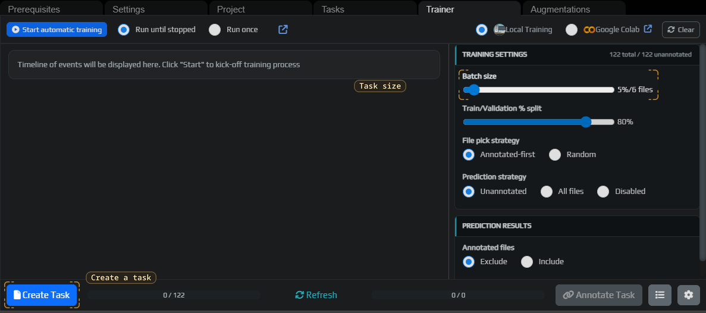
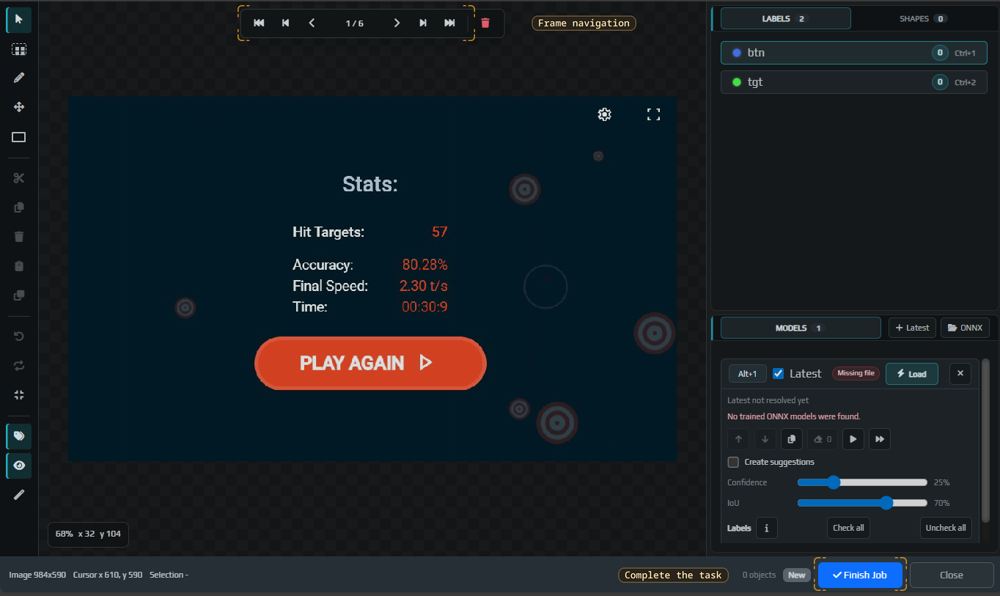
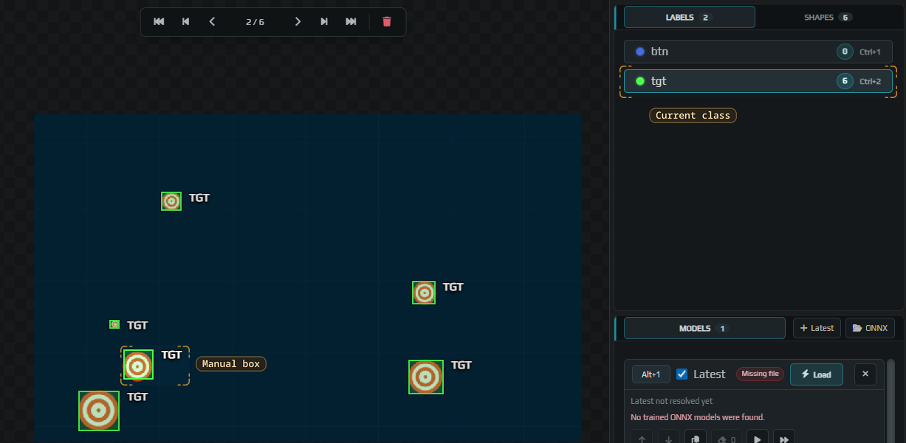
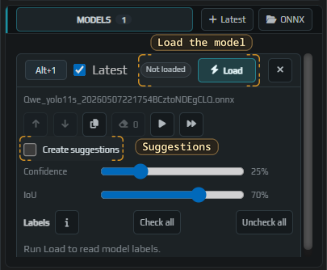
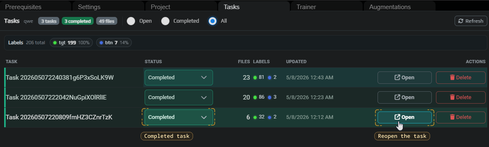
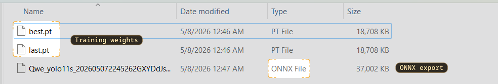

# Train once, review the next task, then repeat

This page walks through one full round. You label five frames by hand and train the first model. The model then suggests boxes on the next batch, you fix them and train again. Training can run while you label a later task, but a run only uses the tasks that were completed when its dataset was built.

You need [installed components](/en/YoloEase/prerequisites), a [project with labels and real images](/en/YoloEase/prepare-data), and write access to the project's working folder. The example uses 10 PNG frames and two classes of your own, `tgt` and `btn`. Pick varied examples of each object and some plain background.

## Make the first task

1. Open **Trainer**, click **Refresh** and set **Batch size = 50%**. With 10 unassigned files the count next to it should be **5**. Click **Create Task**. There is no model yet, so the prediction step is skipped.

2. In the editor, select the class and press **N**. Click two opposite corners of each object you need. Go through all five frames. A background frame you have looked at can stay empty.

3. Click **Finish Job**. It saves the annotation and completes the task. Just closing the editor does not complete it. [Editor shortcuts and saving](/en/YoloEase/features/annotation-editor).

## Train and locate a real output

4. In **Settings → Training settings**, choose `yolo11s.pt`, **Epochs = 50**, **Model Size = 640**. In Trainer select **Local Training**, **Run once** and **Train/Validation % split = 80%**, then click **Start automatic training**. The dataset needs at least one training image and one validation image. On a small set, rounding changes the actual counts.

5. Watch the stage output until you see a successful training result and an ONNX export. **Cycle completed** also appears after an error or a cancel, so look at the stages themselves. Then open the metrics for this run.

6. Click **open...** next to a successful training result to find the file it produced. Keep the `.pt` weights for further training. The `.onnx` file is for recognition in a compatible program. Settings and output paths are described in [Trainer](/en/YoloEase/features/trainer).

## Review predictions and the next task

7. Click Refresh once a model is available. Look through its predictions and the class thresholds to pick useful new frames. **Annotated-first** takes unassigned files that have predictions first, then fills the rest at random.

8. Create the next task and add **Latest** in **Models**. Click **Load** and check the class mapping. Turn on **Create suggestions**, then click **Run current** or **Run all**.

9. Accept the correct suggestions, fix boxes and classes, draw the objects the model missed and delete the false ones. Suggestions stay temporary until you click **Accept** or **Accept all**. With **Create suggestions** off, boxes are added right away, and you still need to check them.

10. Click **Finish Job**, then start another **Run once**. It collects the completed tasks again. It does not continue from the previous run's checkpoint. To fine-tune an earlier run, select its compatible `.pt` as the base model yourself.

| Stage | What to check before continuing |
| --- | --- |
| First manual task | Every object you need has a box and the same class each time. Empty frames are empty on purpose. |
| Training and export | The stage itself succeeded and an ONNX file exists. A started process or a finished cycle is not enough. |
| Predictions | The right model, classes and thresholds are selected. Missed and extra boxes still need your review. |
| Next completed task | You saved the accepted and corrected boxes with **Finish Job**. Only then can they enter the next dataset. |

## Decide whether another cycle helps

Compare models on images that were not used for training. Another cycle does not always make the model better, especially when the new frames are near-duplicates or wrong boxes were accepted. Make tasks bigger only when the suggestions already save you manual work.

Choose **All tasks** to reopen completed tasks and fix earlier annotation. You can run a newer model there too. Check what it changed before you finish the task again.

Each run keeps its weights, reports and export in the working folder. **open...** takes you to its model file.

File formats and the model size and opset limits are in [YOLO ONNX](/en/YoloEase/features/yolo-onnx). [Augmentations](/en/YoloEase/features/augmentations) add controlled variations of your images. To try a compatible model on your window, see [EyeAuras](/en/YoloEase/use-in-eyeauras). If a stage failed, see [diagnostics](/en/YoloEase/features/diagnostics).
