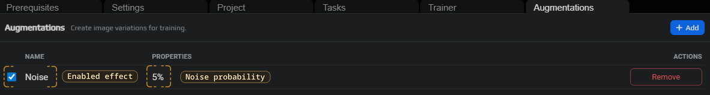

# Decide whether your dataset needs image variations

Augmentations are changed copies of frames you have already annotated: slightly blurred, noisy or rotated. You set them up on the **Augmentations** tab. The full steps are in [the detailed augmentations guide](/en/YoloEase/features/augmentations). This page helps you decide whether you need them.

Start when your project already has a completed annotation task and a first training result without effects.

1. See where the model goes wrong on new real frames. If the objects or window states themselves are missing, first [add and annotate those images](/en/YoloEase/features/annotation-editor).
2. If the problem really is in the pixels, try one mild effect such as **Box Blur → Radius: 1px**, following the [detailed procedure](/en/YoloEase/features/augmentations). Read its note about saved images first: the current generator draws coloured annotation outlines into the PNG itself.
3. Before the next [Trainer](/en/YoloEase/features/trainer) cycle, check which rows are enabled. Clearing a row's checkbox leaves it out but keeps its setting.

   

Adding a row does not change any images by itself. The new files are made when the dataset is built before training, and the original annotations are kept.

| Your situation | Next step |
| --- | --- |
| No baseline model yet | Leave the list empty and get a first result to compare with. |
| Need variations of existing annotated frames | Check the generated images and transformed boxes as the detailed guide describes. The saved images can contain the drawn outlines. |
| Need to change the pixels before every recognition call | Use [EyeAuras effects](/en/triggers/images/effects). Set them up the same way for recording and for recognition. This is a separate mechanism. |

The exported model and the difference between `.pt` and `.onnx` are covered in [YOLO ONNX](/en/YoloEase/features/yolo-onnx).
