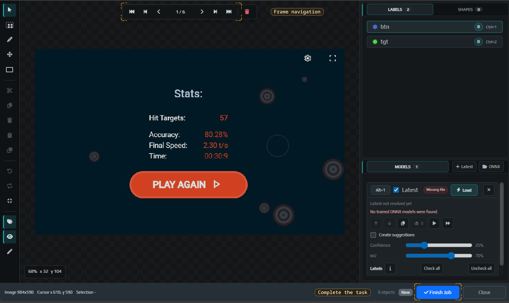
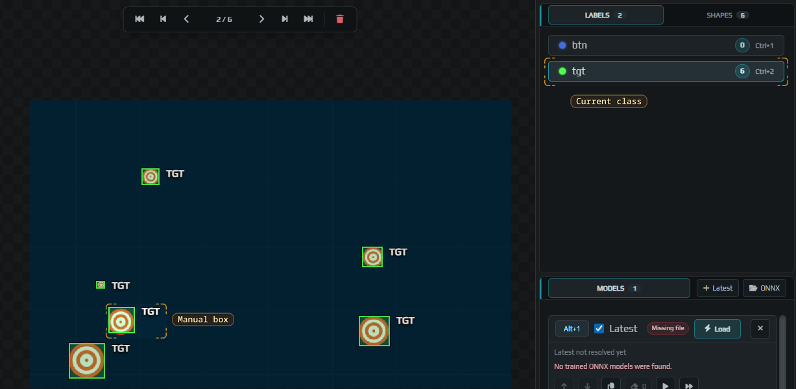
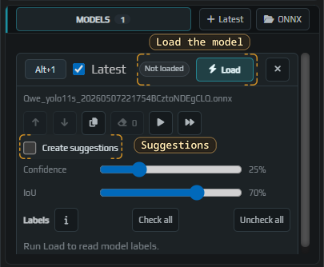

# Draw and save the boxes for one task

In the editor you draw boxes around objects, give them classes and complete the task so Trainer can use the saved boxes. You do not need a trained model to annotate by hand.

You need a [project with class labels and images](/en/YoloEase/prepare-data). **Trainer → Create Task** opens the editor with the selected batch. To reopen an unfinished task, click **Annotate Task** or choose it in the task list.

| Area | Purpose |
| --- | --- |
| Centre canvas | Look at the frame, draw boxes, move and resize them. |
| Left toolbar / top navigation | Drawing, selection and edit tools. Show or hide annotation and suggestions. Move between frames. |
| Right `Labels`, `Shapes`, `Models` | Choose classes, look through objects, load and run a model. |
| Bottom status | Image size, cursor position, object count, save state and task state. |

## Complete a manual task

1. Select `tgt` in **Labels** and press **N**. Click two opposite corners of a visible target. A box must be at least 4 image pixels in size.
2. Draw every target you need on the frame. Select `btn` for a button. Move or resize boxes so they cover the object the same way each time, without extra background.

3. Press **D/F** to go to the previous or next frame. Draw missing objects and fix boxes that are in the wrong place or have the wrong class. If a frame really has no objects, leave it empty. Do not draw a made-up object.
4. Watch the save state: **Unsaved changes → Saving... → Saved**. The editor saves by itself about every 5 seconds while it is idle. It waits while you draw, while it is saving or while a model is running.
5. When you have checked the whole task, click **Finish Job**. It saves, marks the task completed and closes the editor. Closing the window also saves your changes but does not complete a new task.
6. Reopen the task from **All tasks** to check the saved boxes. Trainer uses completed tasks only. An unfinished task with some saved boxes does not count.

Annotations are stored as CVAT-style XML in `assets/training/annotations.project.<projectId>.task.<taskId>.xml`. When the dataset is built, boxes are clipped to the image and written as normalised centre, width and height. Boxes with zero area are skipped. An empty frame in a completed task is exported as a negative image with an empty YOLO label file. Source files that were never in a completed task are not treated as negatives. See [Trainer](/en/YoloEase/features/trainer) for splitting and class indices.

Shortcuts and a faster manual workflow

| Shortcut or gesture | Effect |
| --- | --- |
| `N` | Draw a rectangle with two corner clicks. |
| `M` / `L` | Rectangular selection / free selection. |
| `Escape` | Cancel the current operation and clear the selection. |
| `Q`, `Delete`, `Backspace` | Delete the selected boxes or suggestions. Removing a whole frame is a separate operation with a confirmation, and undo does not bring it back. |
| `Ctrl+A` / `Ctrl+click` | Select all objects on this frame / add or remove one object from the group. |
| `Ctrl+C`, `Ctrl+X`, `Ctrl+V` | Copy, cut and paste inside the task. Pasted boxes follow the mouse. A left click places them, Escape cancels. |
| `Ctrl+B` | Copy the previous frame's boxes as manual annotation. Then fix the positions and delete objects that are gone. |
| `Ctrl+1…9` / `Ctrl+N` | Choose a label or change the label of the selection / switch to the next label. |
| `Ctrl+Z` / `Ctrl+Y`, `Ctrl+Shift+Z` | Undo / redo an edit. |
| `D/F` / `C/V` | Previous or next frame / jump by the configured frame step. |
| `R`, mouse wheel, drag empty canvas | Reset the view, zoom around the cursor, pan. |
| `Shift` during transform | Keep proportions while resizing or rotate in 15° steps. A group is transformed around its common bounds. |
| `Alt+N` / `Shift+Alt+N` | Run the first available model on the current frame / on the whole task. |
| `Alt+1…9` / `Shift+Alt+1…9` | Run that model entry on the current frame / on the whole task. |

You can annotate one class at a time if that means less switching. Mark every visible object of that class. To fix a wrong class, change the label of the box instead of redrawing it. Copy and paste works well for similar shapes. On neighbouring frames, copying the previous boxes saves drawing time, but you still have to check the new frame. Annotate the same way every time: decide how you treat overlapping targets, partial objects and lookalikes, and stick to it. For a similar-looking object you do not want to pick, either create a separate class or always leave it as background.

Simple objects with clear edges are easier to check. Even a solid-colour object needs something that sets it apart, so add negative images with similar colours to catch false detections. Leave enough surroundings in the frame to tell objects apart. Very small objects can lose detail at the training size. In that case try a tighter capture region, a different image size or the same effects everywhere, then test on frames the model has not seen. The **ML Find Class** size and area filters in EyeAuras only pick among detections. They do not fix training labels. Detection export uses boxes without tilt, so do not rotate boxes in your first task.

## Use a model to propose the next boxes

If you have no trained model yet, keep annotating by hand.

1. In **Models**, add **Latest** to use the project's newest trained ONNX, or import your own compatible ONNX. **Latest** needs a real training result.
2. Click **Load**. The model does not start by itself when you open the editor or change its settings. Check the labels the model reports.
3. Map each enabled model class to the right project label. Disabled rows are skipped. The model's class numbers are not the project's `LabelId` values.
4. Turn on **Create suggestions**. For a first look, set confidence to **25%** and IoU to **70%**, then click **Run current**. **Run all** runs this one model on every frame of the task. It does not run all the models in the list.

5. Check the classes and the box sizes. Click **Accept** or **Accept all** to turn correct suggestions into annotation. Delete false detections with **Q**, **Delete** or **Backspace**, and draw the objects the model missed.

6. When the review is done, click **Finish Job**. Suggestions you did not accept are temporary and are not saved for training. With **Create suggestions** off, results become boxes right away, and you still need to check them.

Model ownership and reruns

Imported models are copied to `models/auto-annotation/<sha256>/`. The editor runs models with its own YoloDotNet CPU engine. It is separate from the Python training environment and from the EyeAuras ONNX parser, so a file that loads in one may not work in another.

A successful rerun replaces the automatic boxes that this model entry made on the processed frame. Manual boxes and boxes from other model entries stay. An automatic box you edit becomes manual. Cancel stops the model. Editing and autosave are paused while it runs. Results that were already added can be undone like any other edit. Always look at predictions before you accept them.

Continue with [Trainer](/en/YoloEase/features/trainer), [YOLO ONNX](/en/YoloEase/features/yolo-onnx) or [EyeAuras integration](/en/YoloEase/features/eyeauras-integration).
