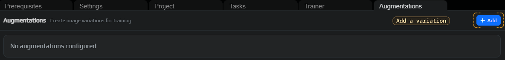
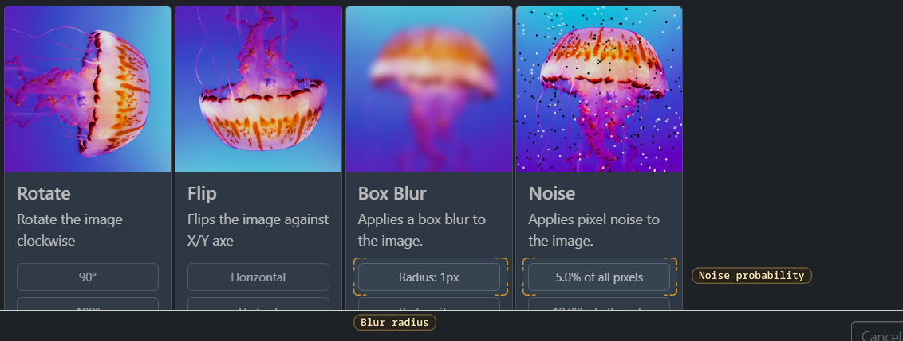
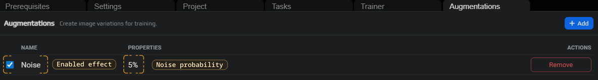

# Add a controlled variation of annotated images

The **Augmentations** tab adds variants of your annotated frames when the dataset is built. For rotation and reflection the boxes are recalculated too. For blur and noise they stay where they were. Pick only changes that your real source can produce: a rotated text button does not replace an ordinary button.

Train a model without effects first. After that you need your own YoloEase 2 project, completed tasks with rectangle annotation and the [prerequisites installed](/en/YoloEase/prerequisites).

**Saved-image limitation:** in v2.0.90 (source revision `946be263`) the generator draws the original boxes in red and the transformed boxes in cyan **into the saved PNG pixels**. This is not a preview layer. The model can learn these outlines as a hint. For ordinary clean frames keep augmentations off until you have looked at the generated images and decided they suit your input.

## Configure one variant

1. Open **Augmentations**. An empty list shows **No augmentations configured**.

2. Click **Add**. In **Add new Augmentation**, select **Box Blur → Radius: 1px**. A new row appears. You cannot add the same setting twice.

3. Check the row's checkbox and its **Properties** value. To change the parameter, click **Remove**, confirm, and add the variant you want. To switch an effect off for a while, clear its checkbox.

4. To look at the generated data, select **Trainer → Local Training**, **Run once** and click **Start automatic training**. While the dataset is built you will see **Applying … augmentation…** and the dataset counts. There is no separate preview command: this runs the whole training cycle.
5. In the project storage, look in `augmentations/<id>/` and `assets/training_with_effects/`, and find the XML ending in `_augmented.xml`. Open a generated PNG and compare the object, the coloured outlines and the saved box. If the pixels or the change do not look like your real source, clear the row's checkbox before the next ordinary run.

New files alone do not make detection better. Keep new real frames for a separate comparison.

| Effect or control | Parameters and behaviour |
| --- | --- |
| `Rotate` | Clockwise **90°**, **180°**, **270°**. At 90° and 270° the width and height of the image and of the box swap. Use only orientations that really occur. |
| `Flip` | **Horizontal** mirrors left and right, **Vertical** mirrors top and bottom. Class names stay the same. A mirrored interface may never occur in real use. |
| `Box Blur` | **Radius: 1px**, **3px**, **5px**, **10px**. Boxes do not change. A large radius can hide a small object. |
| `Noise` | **5**, **10**, **20**, **50%** is the chance that each pixel is changed. It is not a share of frames or an exact number of pixels. The chosen pixels get small random changes in RGB. Alpha and boxes are kept. |
| Row checkbox | Include this variant in the next build. There is no general setting for how likely an effect is applied to a frame. |
| `Remove` | Delete the setting after a confirmation. To switch it off for a while, the checkbox is enough. |

## Understand counts, order and cache

Each enabled effect is applied to the source image on its own. With `N` annotated frames and `K` enabled effects you get `N × K` extra variants plus the originals. **Noise** and **Box Blur** give two separate variants, not one **Noise + Blur** image. Changing the order of rows does not chain them either.

Original images and XML are not overwritten. Generated PNGs are cached in `assets/training_with_effects/`. Intermediate links and XML are in `augmentations/`. Windows must allow you to create symbolic links. Noise with the same settings can come from the cache, so a new cycle does not always produce a new random pattern.

Boxes, classes and validation

| Preparation stage | What happens |
| --- | --- |
| Rotate / Flip | Boxes are recalculated for the transformed image. Their classes are kept. |
| Blur / Noise | Box coordinates stay the same. |
| YOLO conversion | Coordinates are clipped to the image and normalised. Boxes with zero area after clipping are skipped. |
| Class names | Written to `data.yaml`. Indices are assigned during conversion. They are not the project's internal label IDs. |
| `Train/Validation % split` | Runs after the variants are added. Augmented images are not limited to training: an original and its near copy can land in different parts. |

If the validation set holds near copies of training frames, its score is not an independent measure of accuracy. Check on new real captures as well. Augmentations work with rectangle annotation. They do not turn arbitrary rotated shapes into a supported OBB export.

If whole states of the object are missing, [add real data](/en/YoloEase/features/data-sources) first. Continue with [annotation and training](/en/YoloEase/annotate-and-train), [Trainer](/en/YoloEase/features/trainer), [YOLO ONNX](/en/YoloEase/features/yolo-onnx), [EyeAuras integration](/en/YoloEase/features/eyeauras-integration) or [diagnostics](/en/YoloEase/features/diagnostics).
