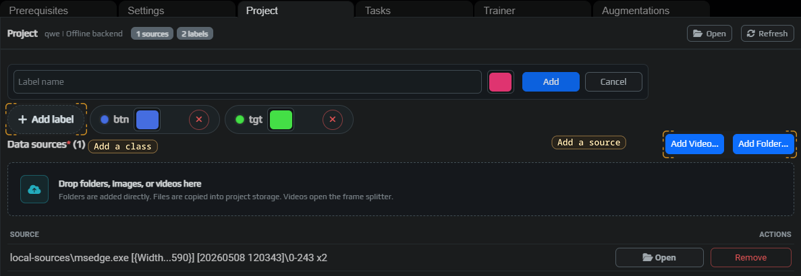
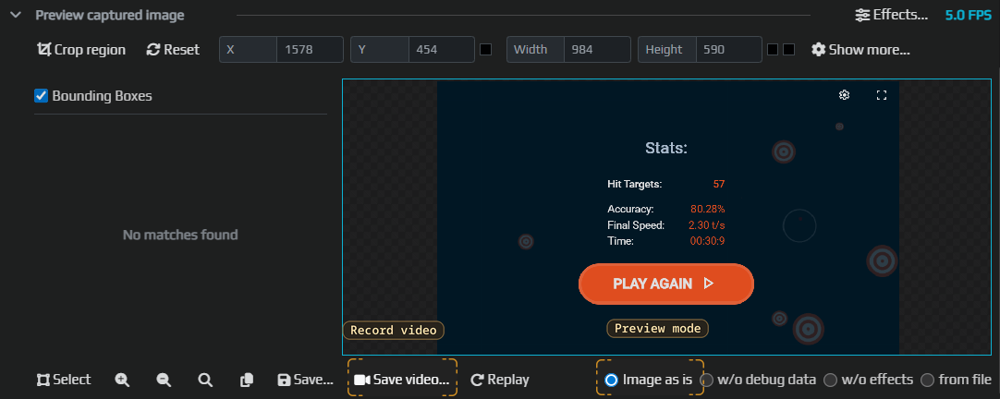

# Add your own images and keep their sources available

A source is the place YoloEase takes images from, for example a folder of PNG files. Working copies and annotations are kept separately, in the project storage. This page shows how to connect a folder, refresh the project and check which images are available for tasks.

You need a saved YoloEase 2 `.yeproj` and images that can be read. Predictions and training also need the [prepared environment](/en/YoloEase/prerequisites).

## Connect a folder

1. In **Project**, click **Add Folder...** and choose your folder of PNG/JPG/BMP files. Its path appears in **Data sources**.
2. Click **Open** next to the source to check that it is the right folder. Then click **Trainer → Refresh** to update the file list and the working copies.
3. Check the available count in Trainer. To see the frames themselves, click **Create Task**: it opens the selected batch in the [annotation editor](/en/YoloEase/features/annotation-editor).

| Input or control | Storage and effect |
| --- | --- |
| `Add Folder...` or a dropped folder | Keeps the path to the external folder. Synchronisation copies supported images from it and its subfolders to `assets/training`. |
| Dropped individual images | Copies them to `local-sources/<date-time>` and adds that folder as a source. |
| `Add Video...` or a dropped video | Opens **Extract frames**. PNGs go to `local-sources/<video-name>/<range> x<step>`, and that folder becomes a source. The video file itself is not training data. |
| `Remove` | Removes the source from the list after a confirmation. The external folder is not deleted, but the next synchronisation runs without it. |
| `Missing` | The path is not available and is skipped. If you still need the images, restore it before **Refresh**. |

Folder synchronisation takes only `.png`, `.jpg` and `.bmp`. Other image types are not imported. The video picker accepts MP4/M4V/MOV/AVI/MKV/WMV/WEBM/MPG/MPEG, but whether a file opens depends on the codecs installed in Windows. See [video extraction](/en/YoloEase/features/video-splitter).

## Match the detector's eventual input

In EyeAuras, **Save Video** records the CV preview you selected. Open that file through **Add Video...**. This way you train on the region that recognition will use, not on the whole desktop.

Use the same effects for recognition as for recording. Background, scale, borders and overlays change the pixels. To compare different setups, keep separate recordings or projects. Do not apply an effect a second time to a recording that already has it.

In this older example, effects remove unwanted background. Colour replacement, contrast or channel selection also change the pixels. Pick the [effect](/en/triggers/images/effects) that suits your input and look at its output.

A few varied, clear frames are better than many near-duplicates. Use separate labels for objects that need different handling. Look through empty scenes, menus and similar colours without the target: they are useful negative examples. A negative frame gets into training only as part of a completed task, with no made-up boxes.

Copies, deduplication and moving a project

| Location | Contents |
| --- | --- |
| `.yeproj` | Project settings and source references. |
| Neighbouring working folder | Tasks, annotations, models, prepared datasets and local sources. |
| `local-sources` | Imported individual images and extracted frames. Move it together with the project. |
| `assets/training` | Working images. Their names include a source prefix and the flattened relative path. |

Synchronisation compares the working files with the sources it finds now and deletes working copies that are no longer listed. So if an external folder is removed, renamed or lost, the project does not keep its copies as an archive. And if a source file changes but keeps its name, the existing copy is not overwritten automatically.

Duplicates are detected by storage name, not by image content. Near-identical video frames can still end up in both training and validation. Refresh is something you click yourself: external changes are not picked up automatically.

To make a project portable, import individual images or keep extracted frames in `local-sources`, and keep the `.yeproj` and the working folder together. External sources do not move with the project, so keep them reachable. **Settings → Workspace/Resolved storage** shows where the project really is. If a source disappears, restore its path before you refresh. See [diagnostics](/en/YoloEase/features/diagnostics).

