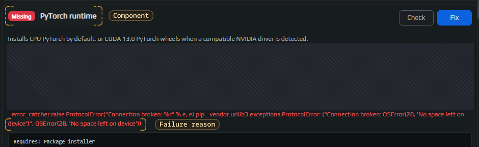

# Find the first failing stage

If YoloEase does not produce a model, or EyeAuras detects something different, find the first stage that went wrong: source images, annotation, dataset, training, export or inference. Your project and the error text are enough for that. Do not start by reinstalling the environment or relabelling everything.

## Keep local evidence of one failure

1. Open the project that has the problem. Write down the YoloEase version, the selected base model and the action that failed.
2. For an environment error, open **Prerequisites → Check all** and expand the failing row. For a Trainer error, expand **output** on the failed stage. It shows the command, the process output and the exit result.
3. To copy the text, click the icon with the tooltip **Copy output**. The timeline keeps only the last **1000 lines per stage**.
4. For the application log, click the file icon at the bottom right of the main window. It opens the application data folder. Look in `logs/`. Environment preparation can also write logs to `tools/logs/`. Copy the file to your own folder before the next launch replaces it.
5. Compare the last successful result with the tables below. Keep the images, annotations and weights while you look for the cause.

**Copy output** only copies text. **Report a problem** opens a separate dialog for preparing a report. Neither of them sends anything by itself. Before you attach or send anything, check it for paths, images and access details.

## Environment and source files

| Symptom | Next check |
| --- | --- |
| `No space left on device` | Free space both in the project storage and in the application data folder, which holds Python, the environment and `tools/downloads`. |
| Required prerequisite fails | **Check all**, then the repair action in the failing row or **Install missing**. See [prerequisites](/en/YoloEase/prerequisites). Optional GPU information does not block CPU training by itself. |
| CUDA is unused | The **PyTorch runtime** and **GPU acceleration** results. `device=cpu` in **Additional arguments** explicitly selects CPU training. EyeAuras ONNX providers are set up separately. |
| Video does not open | The metadata error in **Extract frames** and Windows codec support. FFmpeg and the Python training packages are not involved. |
| Expected images are missing | The source path and **Refresh**. If a source is unavailable, synchronisation can delete its working copies, so restore the source first. |
| Too many near-identical frames | Narrow **Range of frames to extract** or increase **Frame step** in [video extraction](/en/YoloEase/features/video-splitter). |

This installation error is not the same as running out of video memory during training. The application log is `logs/<APPNAME>.<CONFIGURATION>.log` plus its rolled-over copies. The application data folder you opened shows where it is for your build.

## Annotation and dataset

| Symptom | Next check |
| --- | --- |
| No training data | Completed tasks and their XML in `assets/training/`. Imported images alone are not annotation. |
| Missing `data.yaml` | The dataset preparation output, symbolic-link permissions and `datasets/<run-id>/`. The YAML is created during conversion, before training. |
| `train`/`valid` error | Each part needs at least one image. The split percentage does not make sure a rare class appears in both. |
| Suggestions absent from training | Suggestions are temporary until you click **Accept** or **Accept all** on the frame. Check the saved boxes and that you clicked **Finish Job**. |
| Misses or inconsistent classes | In the [editor](/en/YoloEase/features/annotation-editor), add real positive examples, tighten the boxes and annotate each class the same way everywhere. |
| False positives | Look through real negative frames: empty backgrounds, menus, similar colours. Leave them without boxes and complete the task. |
| Coloured contours in generated frames | The [augmentation generator](/en/YoloEase/features/augmentations) draws them into the saved PNGs. They are not part of the real object. |

## Training and export

| Symptom | Next check |
| --- | --- |
| No `best.pt` | The training stage output. A `runs` folder is created even when training fails. |
| `best.pt` exists but ONNX does not | The separate export output. The weights can be saved even when the conversion fails. |
| Not enough VRAM | Reduce **Model Size** or use a smaller compatible base such as `yolo11n.pt`. You can also lower the training `batch` or set `device=cpu`. |
| Windows memory grows sharply | Keep the default `workers=0` unless you have a reason to change it. |
| Ultralytics requests an update and a stage fails | Write down the installed version and the error, then check **Prerequisites**. The application's environment is managed there. A global `pip` install does not update it. |
| Good metrics, poor new-frame predictions | Whether validation repeats training, whether rare classes have examples, and whether augmentation added near copies. |
| Cloud ZIP lacks usable image data | Look at its files and source links. The later `946be263` archive code differs from released v2.0.90 and may not be what you have installed. [Trainer](/en/YoloEase/features/trainer) explains the difference. |

## ONNX and EyeAuras

| Symptom | Next check |
| --- | --- |
| A `.pt` was selected | EyeAuras needs the exported `.onnx`. See [model files](/en/YoloEase/features/yolo-onnx). |
| ONNX fails to load | The `detect` task, the input and output layout, the opset, and the parser and provider of the program that loads it. The file extension and opset 17 alone are not enough. |
| Wrong or missing class names | The `names` metadata, the index order and the editor label mapping. The mapping in YoloEase does not rewrite the model metadata for EyeAuras. |
| Good in the editor, poor in EyeAuras | Same ONNX file, window or region, size and effects. The editor uses YoloDotNet, while EyeAuras runs and preprocesses the model its own way. |
| Offset boxes | First compare the preview pixels, the crop and the effects. Then check how the reaction converts coordinates. Raising confidence does not fix geometry. |
| Wrong click position | Keep input off while you check the boxes and OSD. Set up the selected object's coordinates and the input target before you add movement and a click. |
| Tiny false detections in a tree | Once the model is checked, use **Width**, **Height** or **Area** in **ML Find Class**. |

If detection is correct but slow in EyeAuras, look at **Processing time** in the FPS tooltip and the available **Provider** in [AI Search](/en/triggers/images/ai-search-trigger). For your own script loop, [CV pipeline profiling](/en/scripting/examples/advanced/profiling-cv) shows warm-up separately from later capture and search.

If the model fails on a new real case, record that input, add it to the project and fix its annotation before the next [Trainer](/en/YoloEase/features/trainer) cycle. [Integration](/en/YoloEase/features/eyeauras-integration) explains how to compare the capture with the result.
