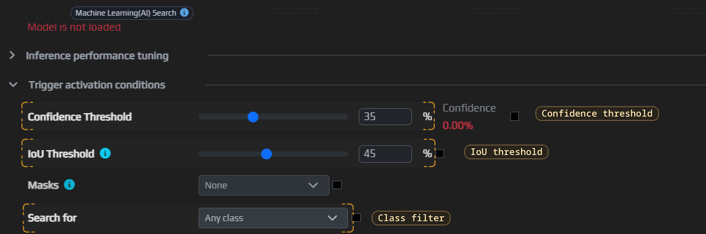
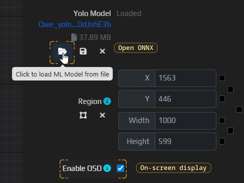

# Check a detector against the actual EyeAuras capture

Before you add any clicks, check that the model finds the right boxes in your own window. YoloEase gives you the weights and the ONNX export. EyeAuras only looks at captured pixels. It does not see the application's internal objects and does not know what you want to do with a detection.

You need a compatible `detect` ONNX, its class names, desktop EyeAuras with the capture and ONNX components it needs, and your own window with the objects you annotated. Keep aura reactions and input nodes off for this first check.

## Reproduce the training input

1. Set up [capture](/en/triggers/images/imagecapturetriggers) for your window and region. Note the image size, crop, window border and effects.
2. If you need new data, click **Save Video** in the preview and record the states of your window. Then go to **YoloEase → Project → Add Video... → Extract frames**. [Annotate and train](/en/YoloEase/annotate-and-train) on those frames.
3. When training and export succeed, click **open...** on the Trainer result and take the `.onnx`. Keep the `.pt` for training.
4. Add **Machine Learning(AI) Search** to your aura. Choose your window in **Capture settings → Target Window** and set the same region and effects. Select the file through **Yolo Model → Load from file...**.
5. In **Search for**, choose a class the model really has. To begin with, set **Confidence Threshold = 30** and **IoU Threshold = 40**, then open **Preview captured image**. These are only starting values.

   

6. Show the object in the window, then remove it. Check the class and the box each time. **Active** means the findings passed the filter. An empty result and a load or search error are two different things.

You should see a box in the right place with the right name, and the trigger state should follow it. Only then set up a reaction. The trigger editor is described in detail in [AI Search](/en/triggers/images/ai-search-trigger).

| Compare | Why it matters |
| --- | --- |
| Window and `Crop region` | The model needs the same kind of image area as in its annotated data. |
| Window border, title and size | They change the geometry and the scale of objects. |
| `Effects...` | Use the same effects for recording and recognition. Do not apply an effect a second time to a recording that already has it. |
| `Search for` | Select a name from this model. **Any class** is wider than a check for one object. |
| `Confidence Threshold` | Filters by model score. It is not the object's area and not the chance that an action will be right. |
| `IoU Threshold` | Removes overlapping boxes. It cannot fix a wrong capture region. |

Auto-annotation in the YoloEase editor runs YoloDotNet on CPU. EyeAuras uses its own ONNX Runtime and parser. For ordinary detection it stretches the frame to the input size, converts RGB to 0–1 and projects the boxes back onto the processed image. Other programs may pad and scale differently, and the model-size transform must not be applied twice. If boxes are offset, check the capture geometry before you change confidence. See [export contracts](/en/YoloEase/features/yolo-onnx).

Use the result in a behavior tree

A tree uses its own **ML Search** node, not the aura trigger editor. When the node is ticked, it saves the search result into tree variables for the nodes that follow. The target window comes from the BT context or default binding. It is not taken from some aura's capture settings.

Put **ML Search** before **ML Find Class** in a **Sequence**. In **Filters → Class**, type a class the model really has and click **Add**. An empty class list does not filter by class. Use the **On-screen display** group to see the search and the selected region. The earlier editor called this option **Enable OSD**.

| ML Find Class setting | Choice and boundary |
| --- | --- |
| `Strategy` | **First in List**, **Highest Confidence**, or **Closest** to the chosen reference point. |
| `Closest To → Cursor` | Pick the box nearest to the cursor. **Center** is disabled in the current editor. |
| `Class` / `Add` | Add a filter by a real class name. `tgt` and `btn` come from the demo model. EyeAuras does not know them by itself. |
| Class confidence | An extra threshold, for example **70** for a `tgt` you have already checked. It cannot bring back detections that ML Search already dropped. |
| `Width`, `Height`, `Area` | Minimum and maximum box size in pixels of the processed image. A maximum of zero means no upper limit. |
| `On-screen display` | See the selected box before you add input. |

The earlier simple tree ended with **Mouse Move** and **Key Press MouseLeft**. They perform input, and you do not need them to check boxes.

When you add a reaction later in your own test window, pass the selected location to the coordinate settings of [Mouse Move](/en/behavior-trees/nodes/MouseMoveAbs), then set up [Key Press](/en/behavior-trees/nodes/KeyPress). Choose the input target and the simulator yourself. The capture window does not decide where input goes, and a correct detection does not mean background clicks will work.

The AimTrainer.io demo used a **Selector**. Its `btn` branch blocked actions on targets once the end button appeared. The other branch picked the closest `tgt` with confidence 70 and size filters.

The [recorded session](https://youtu.be/MdLETBZPeec) and the [demonstration pack](https://eyeauras.net/share/S20260507232328uRAOxLRumL6o) are still available. Look through a shared configuration before you enable its reactions.

How trees work is described in [behavior trees](/en/behavior-trees/gettings-started), [Selector](/en/behavior-trees/nodes/selector) and [Sequence](/en/behavior-trees/nodes/sequence).

## Feed a real error back into training

| Observation | Next step |
| --- | --- |
| False box on empty background | Add those real negative frames, with no made-up boxes. |
| Missed object | Add similar frames with the object and annotate it. |
| Confused classes | Check the labels and add counterexamples for both classes. |
| Inaccurate box | Fix similar boxes in the [editor](/en/YoloEase/features/annotation-editor), then train again. |
| Only EyeAuras differs | First check the model file, pixels, region and effects with [diagnostics](/en/YoloEase/features/diagnostics). |

After you fix the data, run [Trainer](/en/YoloEase/features/trainer) and load the new ONNX.
