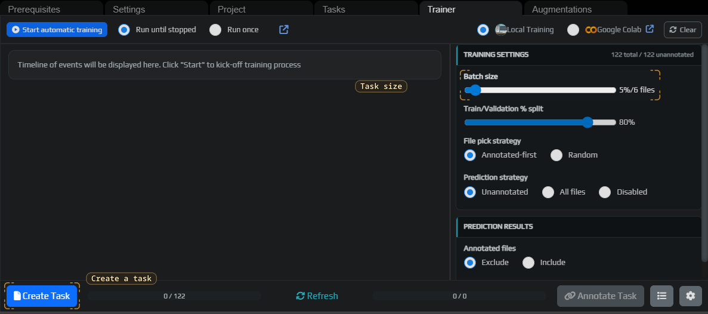
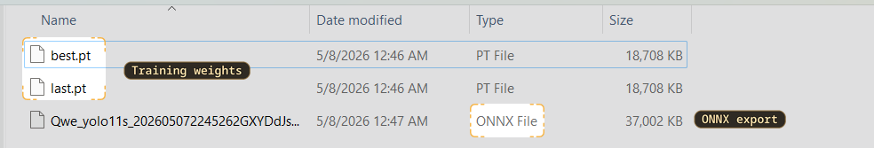

# Run one training cycle and find its ONNX export

Trainer builds a dataset from completed annotation tasks, runs YOLO and exports a model. Start with one local cycle. That way you can look at each stage and its output before you turn on repeating.

You need YoloEase 2, [prerequisites that pass the check](/en/YoloEase/prerequisites), source frames that can be read, and at least one task saved with **Finish Job**. The dataset needs at least one training image and one validation image, with real examples of your classes. Label names and unaccepted suggestions are not training data.



## Run locally

1. Open **Settings → Training settings** and check the values. The table shows the defaults of a new project. An existing project may have other values saved.

| Setting | Value and purpose |
| --- | --- |
| `Yolo8/10+ base model` | `yolo11s.pt`. It is taken from the model cache and downloaded if missing. To train from your own weights, select a compatible `.pt`. |
| `Epochs` | `50`, the number of epochs requested. |
| `Model Size` | `640`, passed as `imgsz`. |
| `Additional arguments` | Empty by default. For example, `device=cpu` explicitly selects CPU. |
| `Max CPU Cores` | Sets `NUM_THREADS` for the child process. `0` means **Any**. It does not limit the load on the whole machine. |

2. In **Trainer**, select **Local Training**, **Run once** and **Train/Validation % split = 80%**, then click **Start automatic training**. This runs the local YOLO CLI. The dataset is not uploaded to Colab.
3. Watch the timeline and expand the stage output. Trainer refreshes the data and available predictions, applies enabled augmentations, prepares the dataset, trains and exports. Before the first model exists, predictions are skipped.


4. Wait until training and export succeed. **open...** selects the model in its output folder. **Cycle completed** also appears after an error or a cancel, so it is not a sign of success.


5. Look at the `.onnx`, the `.pt` weights and `results.csv`/`results.png`. Keep the `.pt` for training and use the compatible ONNX in [EyeAuras](/en/YoloEase/use-in-eyeauras). YoloEase may rename the ONNX after the project, base model and run.



A typical result inside the working folder:

```text
datasets/<run-id>/
  data.yaml
  cvataat.json
  train/images, train/labels
  valid/images, valid/labels
  test/images, test/labels
  runs/train/weights/best.pt
  runs/train/weights/last.pt
  runs/train/results.png
  runs/train/results.csv
  runs/train/weights/<project-base-model-run>.onnx
```

The current converter gives the test split **0** images. Its folders and YAML entry are still created, but this is not a separately evaluated test set. Dataset images can be symbolic links into the working storage, so copying `data.yaml` alone does not give you a portable dataset. `best.pt` and `last.pt` are two different checkpoints, not two ready ONNX files.

## Control the next cycle and task

| Control | Effect |
| --- | --- |
| `Start automatic training` / `Stop automatic training` | Start a cycle / ask it to stop. Wait until the running work finishes before you start again. Some work does not stop at once. |
| `Run once` | Stop after one cycle, even a failed one. |
| `Run until stopped` | Repeat until you stop it. If the project has not changed, a pass can skip training and not make another model. |
| `Create Task` | Pick a new annotation batch and open it. |
| `Annotate Task` / task list | Open an unfinished task or choose a specific one. **All tasks** also shows completed tasks. |
| `Refresh` | Update project files, tasks, models and related state. |
| `Clear` | Clear the timeline. Weights and annotation are not deleted. |
| `Batch size` | Percentage of files not yet assigned to tasks, initially **5%**. The rounded file count is shown next to it. This is not YOLO's training `batch`. With few files, raise it until the count is above zero. |
| `Train/Validation % split` | Initially **80%** for training, the rest for validation. On small datasets the counts are rounded. |

For 10 unassigned images, **50%** gives a task of 5. Start with 5–10 frames annotated by hand. Make tasks bigger only after you have checked that suggestions help. See the [complete workflow](/en/YoloEase/annotate-and-train).

<details>
<summary>File selection, predictions and active learning</summary>

| Setting | Behaviour |
| --- | --- |
| `File pick strategy → Annotated-first` | Takes unassigned files that have predictions first, then fills the rest at random. It does not pick files by how wrong the model is. |
| `File pick strategy → Random` | Picks at random from the remaining files. |
| `Prediction strategy → Unannotated` | Predicts on files not yet assigned to any task. This is not the same as every frame without boxes. |
| `All files` | Predicts on all project files. This can take more work. |
| `Disabled` | Skips new predictions. Existing results can still be used. |
| `Annotated files → Include/Exclude` | Include or exclude files already assigned to tasks in the displayed prediction statistics. |
| `Threshold → Global/Per Label` | One confidence threshold or a separate one per class for selecting predictions. Initial confidence is **25%**, prediction IoU **70%**. |


These settings help pick frames and make annotation suggestions. They are separate from the thresholds of the model loaded in EyeAuras. A model score is not a measured chance that an action is right. Check predictions before **Finish Job**. Every training run starts from the selected base model. A new cycle does not continue from the previous checkpoint. If you want that, select that compatible `.pt` yourself.

</details>

<details>
<summary>Splits, class names and metrics</summary>

The converter splits images in the order it receives them. It does not shuffle them or balance classes. Each non-zero part first gets at least one image, then the rest is distributed. Check the real counts and keep separate scenes for validation: near-identical frames can make the result misleading.

Class names and indices in `data.yaml` come from the names found in the annotation, not from the project's `LabelId` values. An empty frame in a completed task gets an empty label file. Keep names consistent, and do not carry class indices from one model to another without checking their `names` metadata.

| Metric | Meaning |
| --- | --- |
| `precision` | Share of predicted detections that are correct on validation data. |
| `recall` | Share of labelled objects that were found. |
| `mAP50` | Detection score at IoU 0.5. |
| `mAP50-95` | Score across a stricter range of IoU thresholds. |
| `train/val loss` | Training and validation loss. It is not a percentage of failed clicks. |


Compare your models on images that were not used for training. Look at the false detections and missed objects, not only at the summary charts.

</details>

<details>
<summary>Commands, devices and cloud preparation</summary>

YoloEase builds a local command like this and fills in the paths itself. You do not need to run it by hand:

```text
yolo task=detect mode=train plots=true project="<run-folder>/runs" model="<base-weights>" data="<data.yaml>" imgsz=640 epochs=50
```

| Additional argument | Meaning |
| --- | --- |
| `device=cpu` | Explicit CPU. If you do not set a device, YoloEase checks PyTorch CUDA and adds `device=0` when it is available. |
| `workers=0` | Added when you do not set `workers`. An explicit value such as `workers=2` wins. |
| `batch=8`, `patience=20` | Ultralytics training batch and early stopping. They have nothing to do with the annotation **Batch size**. |
| `cache=false`, `amp=false` | Ultralytics cache and mixed-precision options. |
| `seed=0` | An explicit training seed. It does not make YoloEase's dataset converter shuffle. |

Arguments can conflict with the UI settings or work differently in other Ultralytics versions. Read the actual command and the error output. After training, a separate `yolo export` runs with `format=onnx` and `opset=17`. Changing the extension of a `.pt` file does not convert it. Check the [ONNX compatibility requirements](/en/YoloEase/features/yolo-onnx).

**Google Colab** prepares a dataset ZIP and a notebook link. You upload the data, run the notebook and bring the model back yourself. Choosing this mode does not start cloud training. Check that the ZIP holds real images and labels, not just local links. Archive preparation changed after **v2.0.90**: the later source revision `946be263` writes file contents into the archive. If you run the released v2.0.90 build, look inside the ZIP before you transfer it.

[Integration](/en/YoloEase/features/eyeauras-integration) · [Diagnostics](/en/YoloEase/features/diagnostics)

</details>
