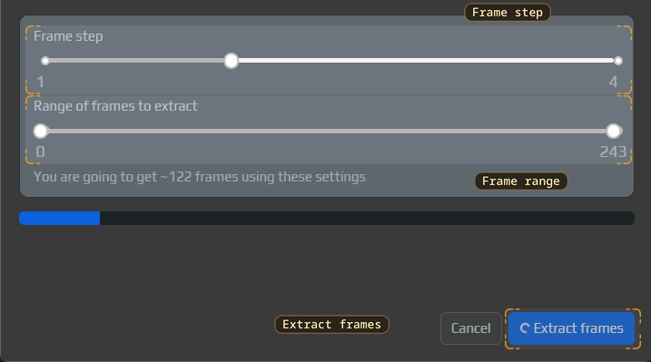

# Extract a small set of PNG frames from your own video

YoloEase can cut a video into PNG frames by itself. Record a short video of your test window, and YoloEase saves the frames to the project storage and adds their folder as a source. You do not need a separate Python or FFmpeg script.

You need an open project and a video that the installed Windows codecs can read. The picker accepts `.mp4`, `.m4v`, `.mov`, `.avi`, `.mkv`, `.wmv`, `.webm`, `.mpg` and `.mpeg`. An accepted extension can still fail to decode. The video is read through Windows Media.

## Prepare the first task's frames

1. In **Project**, click **Add Video...** or drop your video onto the source area. Each video opens its own **Extract frames** window.
2. Wait for **Reading video metadata...** to finish. If decoding fails, check the file and the codec. The Python training components have nothing to do with this decoder.
3. Use the sliders to set **Frame step = 5** and a short **Range of frames to extract**. For a recording of at least **300 frames**, the range **0–45** gives **10** frames: `0, 5, …, 45`. On a shorter video the slider may not go up to 5.

4. Check the hint **You are going to get ~… frames using these settings**, then click **Extract frames**.
5. When extraction succeeds, the output folder opens and appears as a project source. Open a few PNGs. You want clearly visible objects and different states.
6. Click **Trainer → Refresh**, then create a small task as described in [data preparation](/en/YoloEase/prepare-data). The frames have no annotation yet. You draw the boxes in the [editor](/en/YoloEase/features/annotation-editor).

| Setting or result | Meaning |
| --- | --- |
| `Range of frames to extract` | Frames are counted from 0. Both ends are included. The last frame is taken only if the step lands on it. |
| `Frame step` | Every Nth frame from the start of the range. It is frames, not seconds. Minimum 1, initial value 5. The slider maximum is `max(1, floor(frameCount / 60))`. A step of 1 takes every frame in the range. |
| Estimated count | For a valid non-empty range, `floor((end − start) / step) + 1`. Fewer new files may be added if some already exist or match by name. |
| Full range | `0` to `frameCount − 1`. The frame count is estimated from duration and frame rate. The frames are not all decoded first. |
| `Cancel` or closing | Cancels extraction. Files already written can stay on disk. The series may be incomplete, and nothing is rolled back. |

On a short recording, use a smaller range or whatever step is available. More neighbouring frames means more duplicates to look through. Do not throw away menus, pauses or empty backgrounds without thinking. If the model has to tell them apart, keep them as negative examples or annotate them with the right class.

## Locate files and understand repeats

The frames are saved to:

`local-sources/<video-name>/<start>-<end> x<step>/<video-name> #<index>.png`

The video file itself is not copied there. Windows Media returns the frame nearest to the time `index / FPS`. With a variable frame rate or inexact metadata, the frame may not match its number exactly.

Files that already exist are skipped. The window then compares names with the project files and deletes the output files it considers already added. The match is by file name, not by image content. So do not give different videos the same name, and do not count on a repeated extraction as a separate archive. If nothing is left, the message suggests changing the range or the step.

A successful new series becomes a source. [Source synchronisation](/en/YoloEase/features/data-sources) then copies the images to `assets/training`. If extraction fails, read the error in the window and the `logs/` files in the application data folder, as described in [diagnostics](/en/YoloEase/features/diagnostics).

Start with 5–20 varied frames that you can check by hand. Move to dozens or hundreds only when the model's suggestions already help. Add real error cases, not more near-identical frames. Continue with [Trainer](/en/YoloEase/features/trainer).
