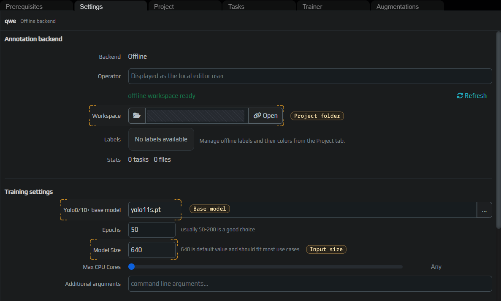
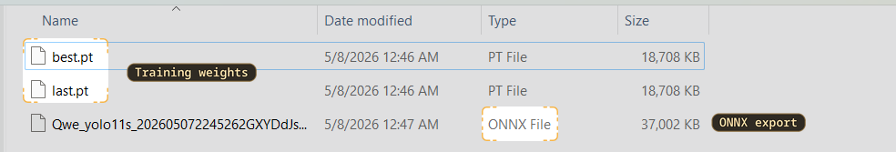

# Keep training weights and a compatible ONNX export

To use a model in EyeAuras you need the `.onnx` file produced after a successful training. Keep the `.pt` weights for further training. Renaming a file's extension does not convert it.

This workflow trains **detect** models: an image goes in, and boxes, classes and scores come out. YOLO models for pose, segmentation, classification and OBB have different outputs. Class names such as `tgt`, `btn`, `enemy`, `loot` or `hp_bar` are names you gave in annotation. They give no access to an application's internal data.

## Find your training result

You need completed tasks, [prepared prerequisites](/en/YoloEase/prerequisites), at least one training image and one validation image, and compatible base weights.

1. In **Settings → Training settings → Yolo8/10+ base model**, select `yolo11s.pt` or your own compatible detect `.pt`. Set **Model Size = 640** and the **Epochs** you want, for example **50**.



2. In **Trainer**, select **Local Training** and **Run once**, then click **Start automatic training**. Check the training **output** and the export **output** separately. A `best.pt` does not mean the ONNX export succeeded.
3. Click **open...** next to a successful result. The run is in `datasets/<run-id>/`, normally under `runs/train/weights`. If the run is named differently, follow the path from the output.
4. Keep `best.pt`, `last.pt` and the exported ONNX. YoloEase renames the ONNX after the project, model and run. The `.pt` names stay as they are.



5. In **Machine Learning(AI) Search → Load from file...**, load the ONNX and check a real class in your own window, as described in [integration](/en/YoloEase/features/eyeauras-integration).

The epoch count, an existing file and a successful load say nothing yet about quality on new images.

| File or setting | Purpose |
| --- | --- |
| `best.pt` | The checkpoint Ultralytics validation picked as the best. You can use it for further compatible training. |
| `last.pt` | Weights from the last epoch. Keep them for later experiments. |
| `.onnx` | Exported graph and metadata for a compatible runtime. EyeAuras does not need the Python training environment to use it. |
| `Yolo8/10+ base model` | A base model name or a local path. What is available depends on the actual files and the managed Ultralytics version. |
| `Model Size` | Training image size, such as 640. It is not the architecture letter. |
| `n`, `s`, `m`, `l`, `x` | Nano, small, medium, large and extra-large variants of one model family. Compare memory, speed and accuracy on your own data. Larger is not always better, and small does not always beat nano. |

## What the local wrapper requests

YoloEase runs these commands in its managed environment and fills in the paths. You do not need to run a second training command yourself:

```text
yolo task=detect mode=train plots=true project="<run-folder>/runs" model="<base-weights>" data="<data.yaml>" imgsz=640 epochs=50
yolo export model="<path-to-best.pt>" format=onnx opset=17
```

Other training arguments come from the project, see [Trainer](/en/YoloEase/features/trainer). The export call does not set `dynamic`, `nms` or a separate export size. They depend on the installed Ultralytics and the checkpoint, so today's Ultralytics defaults may not apply to your build.

`opset` is the version of the ONNX operator set. YoloEase requests **17**. That number alone does not make a file compatible: the program that loads it must also understand the input, the output and how boxes are extracted.

| Boundary | Check before transferring |
| --- | --- |
| Task | `detect` boxes. Pose, OBB and classification outputs are not interchangeable with it. |
| EyeAuras input | An input named `images` with fixed positive dimensions. Start with an ordinary square input such as **1×3×640×640**, in NCHW form. |
| Detection output | A supported three-dimensional layout of coordinates and class scores, commonly **1×(4 + classes)×candidates**. Built-in NMS or another axis order is a different format. |
| EyeAuras preprocessing | Stretch to the model input, RGB, 0–1 normalisation. It does not adapt to other preprocessing schemes. |
| `names` and class order | Each output index must match its name. Check the names after loading, not only the project's label list. |
| Engines and dependencies | Managed PyTorch/Ultralytics for training, YoloDotNet on CPU for annotation, and EyeAuras ONNX Runtime with its parser are three separate paths. The provider and native libraries still have to be installed. |

The demo ONNX for `btn`/`tgt` has input `images` **1×3×640×640**, output `output0` **1×6×8400**, opset17, `dynamic=False` and `nms=False`. These values belong to that file. Other YOLO generations and class counts will differ.

<details>
<summary>Class mapping, cloud training and external models</summary>

The converter assigns class indices in `data.yaml` in the order it meets annotation names. It does not copy project label IDs. Ultralytics can carry them into the ONNX `names`. Check the names and their order in EyeAuras. [Editor label mapping](/en/YoloEase/features/annotation-editor) works only in that editor. It does not rewrite the file for other programs.

Training through the prepared ZIP and Google Colab uses a separate environment. Bring back both the training results and a compatible ONNX, as described in the [Trainer workflow](/en/YoloEase/features/trainer). `best.pt` alone is not enough for EyeAuras. Colab export settings are not necessarily the local `opset=17` settings. Before you transfer the archive, check that it holds real images and labels. ZIP preparation in source `946be263` was changed after release v2.0.90, so the released build may behave differently.

For an external model, compare its export with the [official Ultralytics arguments](https://docs.ultralytics.com/modes/export/). Reading metadata does not run the model. An older runtime can reject newer operations. A model can also load and still produce an unsupported layout or wrong classes. Not every YOLO version or arbitrary ONNX file is supported, and there is no universal fallback parser or provider.

</details>

The earlier example comes with its [ONNX](https://s3.eyeauras.net/media/2026/05/Qwe_yolo11s_202605072245262GXYDdJshE3b.onnx), [PyTorch weights](https://s3.eyeauras.net/media/2026/05/Qwe_yolo11s_202605072245262GXYDdJshE3b.pt) and [YoloEase project](https://s3.eyeauras.net/media/2026/05/AimTrainerDemo.zip). Check the terms of the model and data owners before you reuse them. If export or loading fails, start with [diagnostics](/en/YoloEase/features/diagnostics) and the output of the failed stage.
