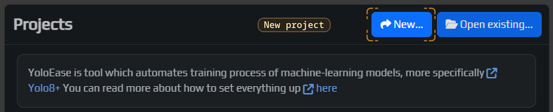

# Build your first detector with your own images

A YoloEase project holds your images, annotation tasks and training runs. Here you annotate a small first task by hand, train a first model and use its suggestions to annotate more images.

You need Windows x64, YoloEase 2 from the [author's releases](https://github.com/iXab3r/YoloEase/releases/) and the [prepared environment](/en/YoloEase/prerequisites). Collect **10 of your own PNG frames** that show targets and a button in different positions. The classes in this guide are called `tgt` and `btn`. Make sure the first task has examples of both.



## Complete the first cycle

1. Click **New...** and save `MyTargets.yeproj` in your own local folder. A `MyTargets` working folder appears next to it. Move the two together.
2. On **Project**, click **Add label** and add `tgt`, then `btn`. Drop your PNG files onto **Drop folders, images, or videos here**. Single images are copied into the project. [Folder sources](/en/YoloEase/features/data-sources) work differently. More in [Data preparation](/en/YoloEase/prepare-data).
3. In **Trainer**, set **Batch size** to **50%** for these 10 unassigned images. Check that the count shows **5**, then click **Create Task**. The task opens in the editor.
4. Select a label, press **N** and click two opposite corners of each object. Annotate every object you need on every frame, then click **Finish Job**. Closing the editor saves your work but does not complete a new task. More in [Annotation editor](/en/YoloEase/features/annotation-editor).
5. In **Settings → Training settings**, use `yolo11s.pt`, **Epochs = 50** and **Model Size = 640**. In Trainer, select **Local Training**, **Run once** and **Train/Validation % split = 80%**, then click **Start automatic training**. Completed tasks go into the dataset. Suggestions you have not accepted do not.
6. Wait for the training and export steps to finish. After a successful run, **open...** selects the new model in its output folder. Find the `.onnx` file there. The `.pt` weights are for training, and EyeAuras does not load them. More in [Trainer](/en/YoloEase/features/trainer).
7. Create the next task. In **Models**, add **Latest**, click **Load** and check the class mapping. Turn on **Create suggestions** and click **Run current**. Accept the correct boxes, fix the mistakes and click **Finish Job** before you train again. You can repeat this [annotation and training](/en/YoloEase/annotate-and-train) cycle as many times as you need.

Check the model's accuracy on separate images of your own.

```text
start: label 5-10 frames by hand -> first model
                                 |
                                 v
tens/hundreds of frames -> auto-annotation -> review and fixes
         ^                                         |
         |                                         v
         +------------ new model <- Trainer <------+
                                 |
                                 v
                  .pt/.onnx -> EyeAuras or another app
```

| Object in the workflow | What it means |
| --- | --- |
| Project | The `.yeproj` settings file plus its working folder with tasks, annotations, models and run history. External source folders are separate, so move them yourself. |
| Frame / task | One image / a batch of images to review. A task goes into training after **Finish Job**. |
| Label / box | A class name / the rectangle around one object in an image. A new label has no examples until you draw boxes. |
| Prediction / suggestion | What the model outputs / a temporary box it proposes. A suggestion becomes annotation only after you accept and save it. |
| False positive / missed object | An extra detection / an object the model did not find. Review both by hand. |
| `.pt` / `.onnx` | PyTorch weights for further training / an export for a compatible program. |

## Use the result

In [EyeAuras](/en/YoloEase/use-in-eyeauras), first load the ONNX file in **Machine Learning(AI) Search**, select your own window and check the boxes without any input actions. Only then link the found class to a reaction.

Below is an older demonstration. The model for AimTrainer.io tells `tgt` from `btn`, and a behavior tree decides when to act. A compatible program can run the ONNX export without the Python training environment, but it needs its own parser and inference runtime.


<details>
<summary>The author's example and other guides</summary>

| Your next task | Guide |
| --- | --- |
| Set up the project and labels | [Data preparation](/en/YoloEase/prepare-data) |
| Get frames from a video | [Video splitter](/en/YoloEase/features/video-splitter) |
| Understand copies and external paths | [Data sources](/en/YoloEase/features/data-sources) |
| Draw, save and review boxes | [Annotation editor](/en/YoloEase/features/annotation-editor) |
| Repeat annotation and training | [Annotation and training](/en/YoloEase/annotate-and-train) |
| Control a run and find its output | [Trainer](/en/YoloEase/features/trainer) |
| Add variety to images | [Augmentations](/en/YoloEase/features/augmentations) |
| Understand weights and export | [YOLO ONNX](/en/YoloEase/features/yolo-onnx) |
| Set up a reaction in EyeAuras | [EyeAuras integration](/en/YoloEase/features/eyeauras-integration) |
| Find the cause of a failure | [Diagnostics](/en/YoloEase/features/diagnostics) |

Instead of preparing data from scratch, you can study the author's example: a [recorded session](https://youtu.be/MdLETBZPeec), an [EyeAuras pack](https://eyeauras.net/share/S20260507232328uRAOxLRumL6o), [ONNX](https://s3.eyeauras.net/media/2026/05/Qwe_yolo11s_202605072245262GXYDdJshE3b.onnx), [PyTorch weights](https://s3.eyeauras.net/media/2026/05/Qwe_yolo11s_202605072245262GXYDdJshE3b.pt) and a [YoloEase project with run history](https://s3.eyeauras.net/media/2026/05/AimTrainerDemo.zip).

</details>
