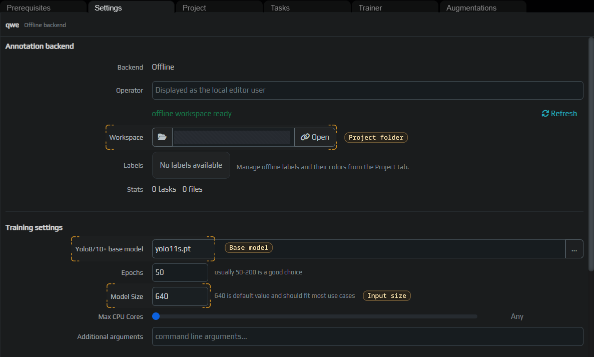
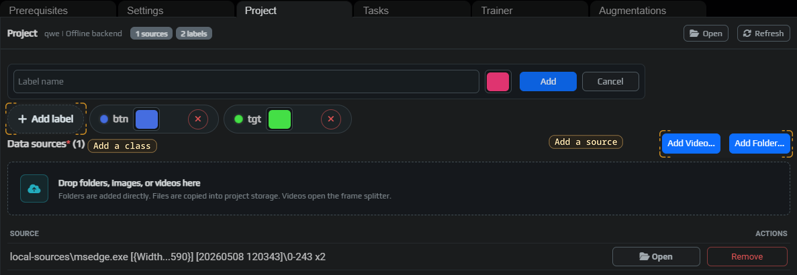
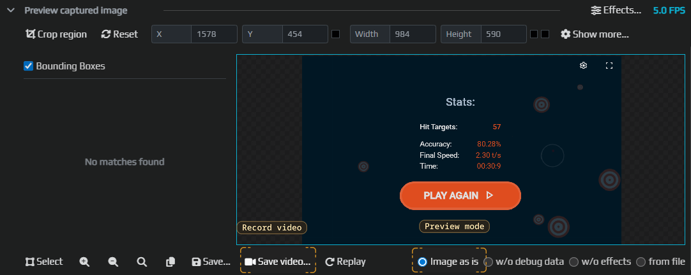
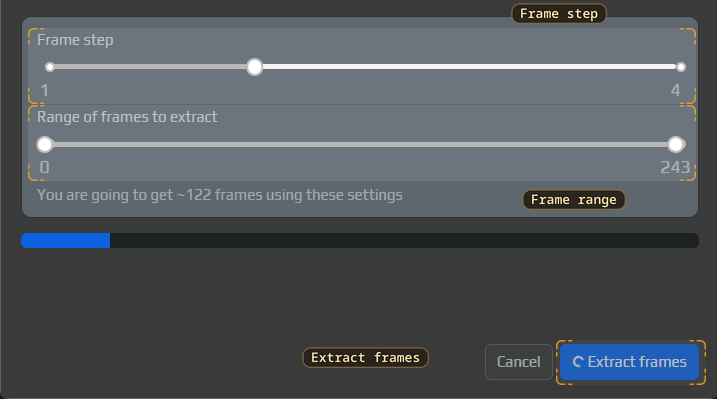

# Create a project with images and classes

Prepare images of your own targets and button, with separate `tgt` and `btn` classes. You need real PNG frames or your own video; a written object description cannot replace images and saved boxes.

Use YoloEase 2 on Windows x64. For dataset preparation and training, first complete [Prerequisites](/en/YoloEase/prerequisites). Source files must remain readable; the working folder needs write and symbolic-link permissions.

## Save the project and set the training inputs

1. Click **New...** and save `MyTargets.yeproj` in your local folder. YoloEase creates its neighbouring `MyTargets` working folder. Use **Open existing...** to reopen the project later.
2. Open **Settings**. Check **Backend = Offline** and the project's **Workspace**. This uses the built-in annotation editor, without a CVAT account.
3. Under **Training settings**, start with these values:

| Setting | Value and purpose |
| --- | --- |
| `Yolo8/10+ base model` | `yolo11s.pt`, resolved through the model cache and downloaded if absent. The `...` button selects your own compatible `.pt`. |
| `Epochs` | `50`, the requested epoch count. |
| `Model Size` | `640`, passed as `imgsz`; it is not the source video's size. |
| `Additional arguments` | Leave empty for the first setup, or use `device=cpu` for an explicit CPU run. Arguments go to Ultralytics. |
| `Storage subfolder` / `Resolved storage` | Relative storage setting and resulting path. Keep the new project's path initially. **Apply** changes configuration; it does not move all existing files. |

The local workspace path is hidden.

## Add labels and images

4. On **Project**, click **Add label**. Set **Label name** to `tgt`, choose a colour and click **Add**. Repeat for `btn`. Colours distinguish annotations; choosing a colour does not teach the model that object.
5. Drop 10 of your own PNG files onto the data area. Alternatively, **Add Folder...** connects a folder of PNG/JPG/BMP files. A folder keeps an external path and supplies working copies during synchronisation; [data sources](/en/YoloEase/features/data-sources) explains the difference.

6. Open **Trainer**, click **Refresh** and check the available file count. Those real frames can now enter **Create Task**; boxes appear only after [annotation](/en/YoloEase/features/annotation-editor).

Keep class names consistent. Internal project `LabelId` values are not automatically YOLO class numbers: export writes the encountered class names and indices to `data.yaml`. A label without annotated examples does not supply a training class.

## If your source is video

7. Record your own test window or use a video you own. In EyeAuras, **Save Video** in the CV preview records the prepared image that recognition will see, including the selected region and effects.

8. Click **Add Video...** in YoloEase and choose a recording with at least 300 frames so the slider offers a step of 5. In **Extract frames**, set a frame range and **Frame step = 5**, then click **Extract frames**. Check the displayed frame count: the step counts frame indices, not seconds.

The YoloEase 2.0.80 screenshot shows a step of 2 across frames 0–243, giving an estimate of 122 frames. The slider goes up to 4 for this recording.

Extraction opens a PNG folder and adds it as a source under `local-sources`. You can split those frames into a small initial task and later batches. Decoding uses Windows media support; a recognised extension does not guarantee an installed codec. See [video extraction](/en/YoloEase/features/video-splitter).

Include different object positions, states and empty background. Use the same box policy and image effects that the finished detector will receive. Do not annotate the system cursor or browser frame unless either is an intended class. Keep validation scenes separate from near-identical training frames.

Move the `.yeproj` together with its working folder. External source folders do not move automatically; synchronisation is not an independent archive. Next, [annotate the first task and train](/en/YoloEase/annotate-and-train).
