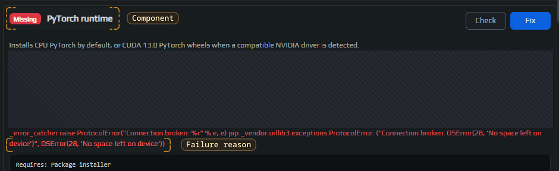

# Prepare YoloEase for local training

Here you check that YoloEase can run its own Python and YOLO. At the end, every required check on the **Prerequisites** tab should pass.

You need **YoloEase 2 for Windows x64** from the [author's releases](https://github.com/iXab3r/YoloEase/releases/). It is a separate .NET 8 Windows application, not a C# Script action inside EyeAuras. YoloEase installs its own Python. It does not use your global `PATH` and leaves your system Python alone.

| Requirement | What it is needed for |
| --- | --- |
| Write access to the application-data folder and your project folder | Environment files, logs, images and training results go there. Start with a local folder your account can write to. |
| Permission to create symbolic links | Local dataset preparation and base-weight linking use them. If Windows refuses to create links, fix the permissions before training. |
| Internet for the first setup | YoloEase may download Python, packages and missing base weights. |
| Free disk space | Packages, the environment, images and each training run take space separately. There is no fixed total size. |
| CPU; a compatible NVIDIA GPU is optional | You can train on the CPU. CUDA works only with a suitable driver and when PyTorch reports CUDA as available. |

## Check and install the required components

1. Open YoloEase, create or open your own `.yeproj` and select **Prerequisites**.
2. Click **Check all**. Expand a failed row to see its path, detected version and error.

3. Click **Install missing** and wait until it finishes. This installs the components YoloEase manages, but not a graphics driver.
4. If needed, click **Check all** again. The required checks should pass. **GPU driver helper** and **GPU acceleration** are informational, so you can still train on the CPU without a GPU.

| Check | What it checks or prepares |
| --- | --- |
| `Managed Python 3.11` | YoloEase's own CPython 3.11.9 archive, verified by SHA256. |
| `Python environment` | A virtual environment in the application-data folder. There is one for the whole YoloEase installation, not one per project. |
| `Package installer` | `pip`, `wheel` and `setuptools` in that environment. |
| `GPU driver helper` | The adapters found and driver information. **Open help** opens guidance. **Install missing** does not install drivers. |
| `PyTorch runtime` | The CPU or CUDA build of PyTorch. This version uses `torch 2.11.0` and `torchvision 0.26.0`, with CUDA 13.0 wheels when the NVIDIA driver is suitable. |
| `Python packages` | Ultralytics, OpenCV, NumPy, Matplotlib, Shapely, ONNX and ONNX Runtime. Several versions are not pinned, so look at the check output for what is installed. |
| `Yolo CLI` | Whether `yolo checks` runs in the managed environment. |
| `GPU acceleration` | Whether PyTorch can really use CUDA. |

Next, go to [your project and images](/en/YoloEase/prepare-data).

Environment paths and installation errors

The application-data folder contains `tools/python-3.11`, `tools/venv`, `tools/downloads` and `tools/logs`. The check output shows the full paths on your machine. Project images and models are stored separately, next to the `.yeproj`.

| Control | Effect |
| --- | --- |
| `Check at startup` | Runs the checks when YoloEase starts. |
| `Copy all` | Copies the diagnostic output. Before you share it, look through the paths and other details in it. |
| `Clear all` | Clears the output shown. It does not delete Python or the project. |

If installation stops, read the error in the row that failed. For example, on **No space left on device**, free space on the disk it names, click **Clear all** and then **Install missing** again.

This page describes the toolchain of YoloEase 2.0.90. Go by the versions and the CPU/CUDA choice that your build reports. More in [YOLO ONNX](/en/YoloEase/features/yolo-onnx) and [diagnostics](/en/YoloEase/features/diagnostics).

