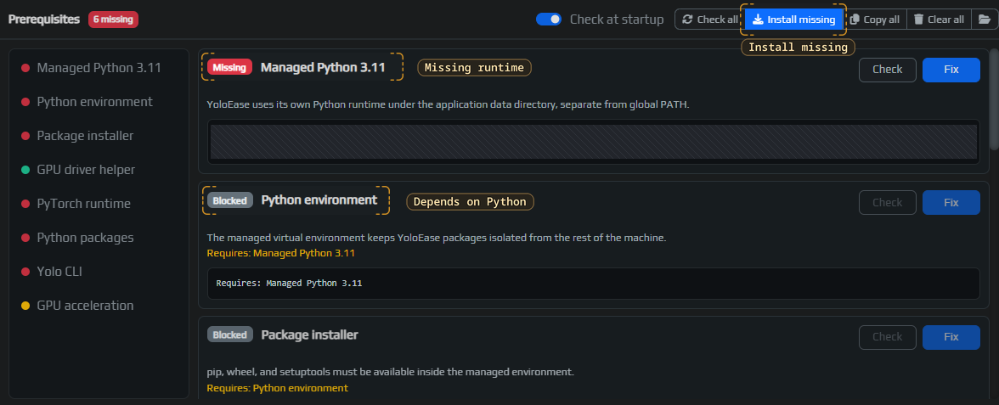
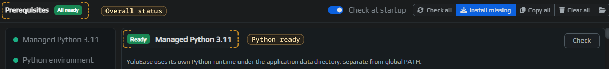

# Prepare YoloEase for local training

Check that YoloEase can run its managed Python environment and YOLO CLI before preparing a training job. The result here is a set of passing prerequisite checks, not a trained model.

Use **YoloEase 2 for Windows x64**, from the [author's releases](https://github.com/iXab3r/YoloEase/releases/). It is a separate .NET 8 Windows application, not a C# Script action inside EyeAuras. Its managed Python does not use your global `PATH` or require replacing your system Python.

| Requirement | What it is needed for |
| --- | --- |
| Writable application-data and project folders | Environment files, logs, images and training results. Start with a local folder your account can write to. |
| Permission to create symbolic links | Local dataset preparation and base-weight linking use them. Resolve a Windows permission error before training. |
| Internet for the initial setup | Python, packages and missing base weights may be downloaded. |
| Free space on the relevant disks | Packages, extracted environments, images and successive runs need separate space; there is no fixed total installation size. |
| CPU; optionally a compatible NVIDIA GPU | CPU training is supported. CUDA requires a suitable driver and CUDA actually available in PyTorch. |

## Check and install the required components

1. Open YoloEase, create or open your own `.yeproj`, and select **Prerequisites**.
2. Click **Check all**. Expand a failed row to read its actual path, detected version and error.

Local paths in the check output are hidden.

3. Click **Install missing** and wait for the operation to finish. This prepares application-managed dependencies; it does not install a graphics driver.
4. Run **Check all** again if needed. The required checks should pass. **GPU driver helper** and **GPU acceleration** are informational: a missing GPU does not prevent the CPU route.

| Check | What it checks or prepares |
| --- | --- |
| `Managed Python 3.11` | A dedicated CPython 3.11.9 archive, verified by SHA256. |
| `Python environment` | A virtual environment under application data, shared by this YoloEase installation rather than one system Python per project. |
| `Package installer` | `pip`, `wheel` and `setuptools` in that environment. |
| `GPU driver helper` | Adapter and driver information. **Open help** opens guidance; bulk installation does not install drivers. |
| `PyTorch runtime` | CPU or CUDA packages. This source line selects `torch 2.11.0` and `torchvision 0.26.0`, with CUDA 13.0 wheels for a suitable NVIDIA driver. |
| `Python packages` | Ultralytics, OpenCV, NumPy, Matplotlib, Shapely, ONNX and ONNX Runtime. Several versions are not pinned; the installed check output matters. |
| `Yolo CLI` | Whether `yolo checks` can run in the managed environment. |
| `GPU acceleration` | Whether PyTorch can actually use CUDA, beyond merely finding an adapter. |

Continue with [your project and images](/en/YoloEase/prepare-data). Passing these checks establishes environment readiness; it does not establish video-codec support, model accuracy or training speed.

Environment paths and installation errors

The application-data folder contains `tools/python-3.11`, `tools/venv`, `tools/downloads` and `tools/logs`. Read the check output for the full paths on your installation. Project images and models are stored separately, alongside the `.yeproj`.

| Control | Effect |
| --- | --- |
| `Check at startup` | Runs prerequisite checks at startup, without starting training or loading your model. |
| `Copy all` | Copies diagnostic output; it sends nothing. Review local paths and other details before sharing it. |
| `Clear all` | Clears the displayed output, without deleting Python or the project. |

For an installation failure, use the error in the affected row. For example, **No space left on device** calls for space on the indicated filesystem, then **Clear all** and **Install missing**. A failed package download and an unsupported GPU driver need different remedies.

Log lines containing local paths are hidden.

The managed toolchain described here is present in the YoloEase 2.0.90 source line. Check the versions and CPU/CUDA selection reported by your build instead of substituting newer package versions by name. See [YOLO ONNX](/en/YoloEase/features/yolo-onnx) and [diagnostics](/en/YoloEase/features/diagnostics).

