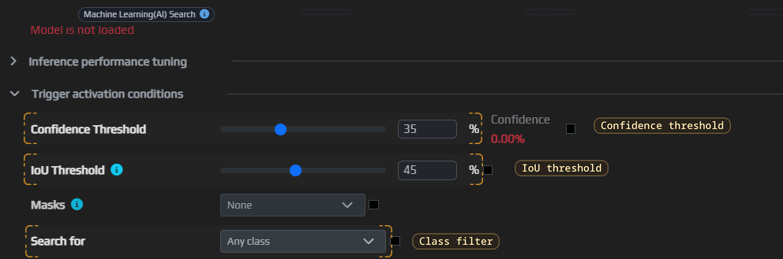
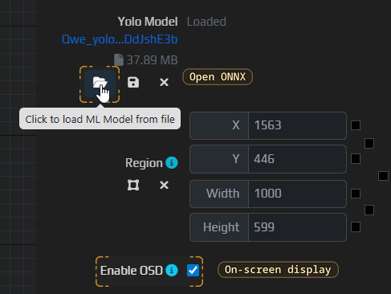

# Inspect your ONNX detector in EyeAuras without clicking

Here you load a model from YoloEase into EyeAuras and look at the boxes it finds in your own window. Check recognition first. Input actions and the behavior tree are set up separately.

You need three things: a real `.onnx` from [successful training and export](/en/YoloEase/features/trainer), desktop EyeAuras with its OpenCV/ONNX Runtime components, and your own visible window with the objects you annotated. Keep the `.pt` for training. AI Search does not load it as a ready model.

## Load and inspect the model

1. In YoloEase, click **open...** at a successful training result and find the exported ONNX. Keep it at a path that will not change. Its name can include the project and run.
2. In your own aura, add the **Machine Learning(AI) Search** trigger. The guides also call it **AI Search**. The **ML Search** behavior-tree node is a different way to use a model.
3. Click **Load from file...** and select your `.onnx`. Wait until the model information and class names appear.
4. Select your own window and capture region as described in [capture settings](/en/triggers/images/imagecapturetriggers). Keep the window visible. Apply the same effects the training frames were recorded with. Do not add an effect again if it is already in the recorded image.
5. In **Search for**, select your class, for example `tgt`. **Any class** shows all classes. Start with **Confidence Threshold = 30** and **IoU Threshold = 40**, then open **Preview captured image**.

   

6. Show a real object, then a frame without it. The preview should show the model's boxes and labels. The trigger state depends on the findings that passed the filter. Keep this test aura free of input actions. If nothing is found, do not add a click "to check".

| Setting or result | What to check |
| --- | --- |
| Class | A name from this model's metadata. `tgt` and `btn` are there only if you annotated and exported them. |
| `Confidence Threshold` | The model-score threshold, in percent. |
| `IoU Threshold` | The box-overlap threshold used to remove duplicates. |
| Window, region, effects | They decide which pixels reach the model, including cropping and scaling. |
| Empty findings / error | The model found nothing suitable, or the operation failed. These are different outcomes. Look at the preview and the error. |

## Check the export contract

In this guide YoloEase trains the `detect` task and exports ONNX with `opset=17`. EyeAuras uses its own ONNX Runtime and parser. The YoloEase annotation editor runs on a different engine, YoloDotNet.

An ordinary YOLO11 detect model needs an `images` input in NCHW form and a detection output that the parser understands. Class names come from the `names` metadata. At size 640, the teaching export has a static input of **1×3×640×640** and an output of **1×(4 + class count)×candidate count**. A different task, a dynamic layout, embedded NMS, pose or OBB needs its own compatibility check. An arbitrary ONNX file is not compatible just because it is called YOLO.

EyeAuras stretches the captured image to the model input size, then scales the boxes back to the processed image and capture region. Do not apply that scaling a second time yourself. Check the boxes with the window sizes and effects you plan to use. More in [AI Search](/en/triggers/images/ai-search-trigger) and [YOLO ONNX](/en/YoloEase/features/yolo-onnx).

Add a reaction later, or inspect the earlier example

In a behavior tree, **ML Search** produces detections. **ML Find Class** picks a class or object and can filter by width, height or area. **Mouse Move** receives its position, and **Key Press** adds the input action you configured. **Enable OSD** on the CV node helps you check the boxes first, without input. This tree is set up separately. Loading ONNX into an aura trigger does not create it.

Say `btn` is a restart button and `tgt` is a target. The tree decides what to do with them. The model only returns the classes it found. Set the input target and coordinates for that window explicitly. A found box does not yet mean a background click will work everywhere. More in [behavior trees](/en/behavior-trees/gettings-started) and [integration](/en/YoloEase/features/eyeauras-integration).

The earlier complete example has a [recorded session](https://youtu.be/MdLETBZPeec), an [EyeAuras pack](https://eyeauras.net/share/S20260507232328uRAOxLRumL6o) and [ONNX](https://s3.eyeauras.net/media/2026/05/Qwe_yolo11s_202605072245262GXYDdJshE3b.onnx). The metadata of that demonstration file: classes `btn`/`tgt`, input `images` **1×3×640×640**, output `output0` **1×6×8400**, `task=detect`, `opset=17`, no embedded NMS. Look through a shared configuration before you enable its reactions. If loading or recognition fails, open [diagnostics](/en/YoloEase/features/diagnostics).

