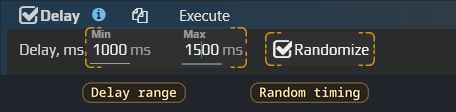

# Delay — pause between actions

Delay waits for a set time, and only then does the next action in the same group start. For example, you can use it to keep two sound notifications from playing back to back.

## Play two sounds one second apart

You need one aura and working sound on your computer. You will start it by hand with [Fixed Value](/en/triggers/fixed-value).

1. Add a Fixed Value trigger to the aura and select **Is NOT Active**. You do not need other triggers.
2. In **On Enter**, add [Play Sound](/en/actions/play-sound), select Ping and turn off **Play in background**. The pause will then start after the sound finishes.
3. Add Delay next in the same group. Turn off random timing: **Randomize** in the older editor, or the crossed-arrows button in the newer one. Set **Delay, ms** to `1000`.
4. After Delay, add another Play Sound and select Bell.
5. Change Fixed Value to **Is Active** and keep the aura on until the second sound.

You will hear Ping, then Bell about a second after it finishes. To repeat, switch Fixed Value to Is NOT Active and back to Is Active. In **While Active**, the chain would repeat for as long as the aura is active.

## Settings

| Setting | Effect |
|---|---|
| Delay, ms | Length of the pause in milliseconds. `1000` ms is one second. |
| Randomize | Picks a new pause length from the set range on each run. In the newer editor, use the crossed-arrows button. |
| Min / Max | Lower and upper bounds of the random delay. For example, `800` and `1200` give a pause of roughly 0.8 to 1.2 seconds. |

Delay waits for time to pass, not for something to happen in another application. If a window has to appear first, check for it with a separate [Window Exists](/en/triggers/window-exists) trigger. Other auras keep working during the pause.
