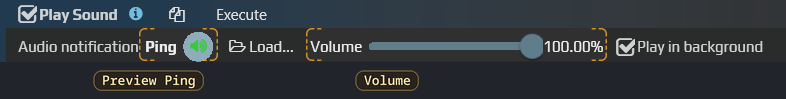

# Play Sound — hear when a condition becomes true

Play Sound plays the sound you choose. The aura's trigger decides when. In the example below the trigger is [Window Exists](/en/triggers/window-exists), so the sound plays when Notepad opens.

## Play a notification when Notepad opens

1. Create an aura with one Window Exists trigger. Enter `notepad` in **Target Window** and check that it finds your Notepad window. If other windows match too, make the expression more specific.
2. Add Play Sound to **On Enter**.
3. Select Ping in **Audio notification** and set **Volume** to `50%`. Click the preview button next to the list and make sure you can hear it.
4. Close all matching Notepad windows and wait for the aura to become inactive. Then open Notepad again.

When the window appears and the aura becomes active, the sound plays once. On Enter does not repeat while the window stays open. For the sound to play each time the window appears, the aura has to become inactive in between.

If you also want a reminder on screen, add [Text](/en/overlays/text) to the same aura and type your message in **Content**. The text is normally visible while the aura is active. Placement and locking are covered in [Common Options](/en/overlays/common-options).

## Settings

| Setting | Effect |
|---|---|
| Audio notification | A built-in sound. The older editor calls this field Notification. |
| Load... | Loads your own WAV or MP3 file. The sound is stored in the action itself, so you can rename or delete the original file afterwards. |
| Volume | Notification volume. The sound goes to the default output device. Check the system volume too. |
| Play in background | On by default: the action starts the sound and the next action begins right away. Turn it off and the next action starts after the sound finishes. |

For a pause **after** the sound ends, turn off Play in background and put [Delay](/en/actions/delay) next. With background playback, Delay starts counting while the sound may still be playing.

Use On Enter for a single notification. In While Active, the sound starts again and again while the aura is active.
