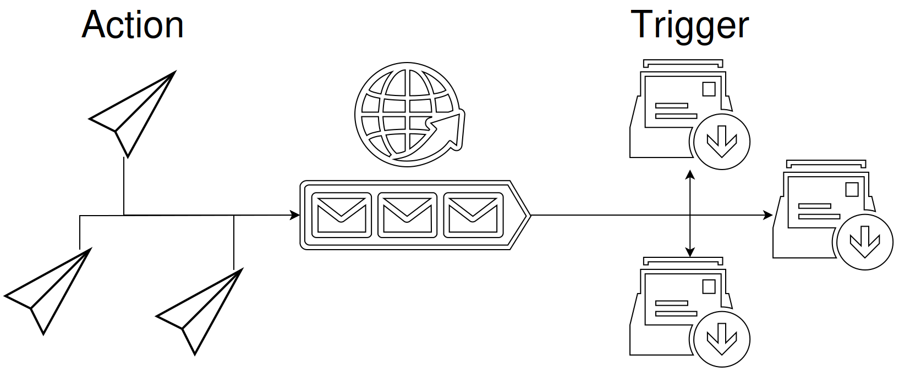
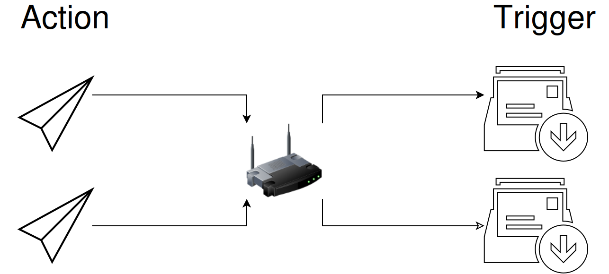

# Send a command to another aura

**Send Network Message** sends text to an EyeAuras channel. For example, a “start review” action can send `review`, and a receiving aura can show “Review in progress”. The action sends the message; the receiver and its reaction are configured separately.

Start inside one running EyeAuras. **local://review-status** connects auras in that instance without sending to another computer.

## Check a local sender and receiver

1. Create a receiving aura with [Network Message](/en/triggers/network-message). Set **Channel Id = local://review-status**.
2. Set **Activate → Regex** to `\Areview\z`. Leave **Deactivate on message** off for a short receipt signal rather than a latched state. Turn **Test mode** off after testing the expression.
3. In another aura, add **Send Network Message**. Use the same **Channel Id** and set **Message text = review**.
4. Use **Execute** on the sending action. Its history should show the send, and the receiving trigger's **Message history** should contain `review`. The trigger should briefly become active, then return to inactive.
5. For a separate visible reaction, configure the receiver as a retained state with a Text overlay using the [receiver guide](/en/triggers/network-message). For a short event, you can instead add [Play Sound](/en/actions/play-sound) to **On Enter** and select your own audio file; another send after deactivation can trigger it again.

Sending history is not confirmation that the receiver ran its reaction. If only the sender has a record, check channel spelling, receiver enablement and its history before changing the reaction.

| Setting | Purpose |
| --- | --- |
| Channel Id | Chooses the transport and channel. Sender and receiver must use the corresponding channel settings below |
| Generate new Channel Id | Creates a random channel name. Give the same name to the receiver; generating another changes the destination |
| Message text | One text command. The word `review` has no built-in behavior without a configured receiver |
| Message history | This action's recent sends. Clearing history does not undo messages |

Several receivers can listen to a channel and use different text conditions. This server-channel diagram separates the sending actions, shared channel and subscribed triggers; the first local exercise does not use that server.

Messages flow from Action to the channel, then to Trigger. The envelope symbols do not promise stored messages or guaranteed delivery. [Original source SVG](/assets/wiki-media/m077-original.svg).

## Choose the transport

| Channel Id | Where it goes |
| --- | --- |
| `local://review-status` | One EyeAuras process. A second process, even on the same PC, does not receive this local channel |
| A generated name or `eye://…` | EyeAuras' server message connection, not an arbitrary HTTP endpoint. It uses the application's configured, signed-in server session |
| `broadcast://255.255.255.255/review-status` | UDP on the local network, without the EyeAuras message server; default port 53082 |
| `broadcast://192.168.0.21:55055/review-status` | UDP to that specific IPv4 address and port. The receiver must listen on the same port and channel path |

Server sending and subscription use the shared EyeAuras hub client. The action has no separate account or per-channel sender-list editor. Keep real channel identifiers private: knowing a name is not a substitute for access control. A connection indicator is not proof that a particular command was received. The server send call has a 10-second timeout; this is neither a delivery deadline nor a latency guarantee.

Network packets use EyeAuras Protobuf messages, including the text and service fields such as timestamp and sender name. A receiver must understand that format; it is not any TCP, UDP or HTTP service expecting plain text or JSON. UDP delivery is not acknowledged or automatically guaranteed to repeat lost messages.

Connect two PCs on your local network

You need your own two reachable EyeAuras PCs and a network allowing their UDP traffic. Use short commands rather than file transfers.

1. On the receiver, set **Channel Id = broadcast://255.255.255.255:55055/review-status** and the condition for `review` from the first example.
2. Find that PC's real IPv4 address. If it is `192.168.0.21`, set the sender to **broadcast://192.168.0.21:55055/review-status**.
3. Send `review` and check the receiver's history. Replace the sample IP with your receiver's address. Change ports on both sides; choose a custom port within **49152–65535**.

The path and query after the address are matched exactly, including case. Listening at 255.255.255.255 does not accept every channel name. An address without a path, as in older screenshots below, identifies a different channel.

Multicast is also supported: for example, use **broadcast://233.0.0.33:55055/review-status** on sender and receivers when the network permits it. For broadcast to several PCs, use **broadcast://255.255.255.255/review-status** at both ends, subject to the network and interfaces.

Do not derive a broadcast address by blindly replacing the first three numbers in the old `broadcast://192.168.1.255/anychannelname` example. Subnet masks determine those addresses, and this implementation specifically enables broadcast mode for **255.255.255.255**.

The LAN diagram illustrates a network path without an EyeAuras server. Its SVG is a repaired derivative of the original diagram, rather than a byte-exact original. [Repaired source SVG](/assets/wiki-media/m016-restored.svg).

Prepare a Hyper-V example network

Only use this preparation if your VMs do not already have a suitable network path. Virtual-switch and IP changes affect their existing networking; choose values for your network rather than copying another setup.

1. In **Hyper-V Manager → Virtual Switch Manager**, create an appropriate **External** switch, such as `vLAN`, using the intended physical adapter.

2. Select that switch under **Network Adapter** for each intended VM.

3. In the guest's Windows network settings, open its **Ethernet** connection. If using static addresses, assign an unused address to each guest.

| Original example value | What to use in your network |
| --- | --- |
| IP 192.168.0.21, then .22 | Different unused addresses for the VMs |
| Mask 255.255.255.0 | Your actual subnet mask |
| Gateway 192.168.0.1 | Your real gateway, if needed; this is not the EyeAuras channel address |

4. Once connectivity is ready, use the previous sender/receiver procedure. A shared **Channel Id** can be set in [folder defaults](/en/features/default-properties). This older image has no path after the IP; append `/review-status` at both ends for the named-channel example.

5. Send one command to the intended receiver and check its history. Use a different receiver IP for another guest. Separate actions and receive expressions can represent different commands.

The receiver implements each command. For example, `next` changes a slide only if you configured that reaction in its aura.
