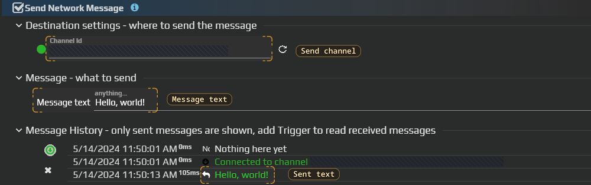
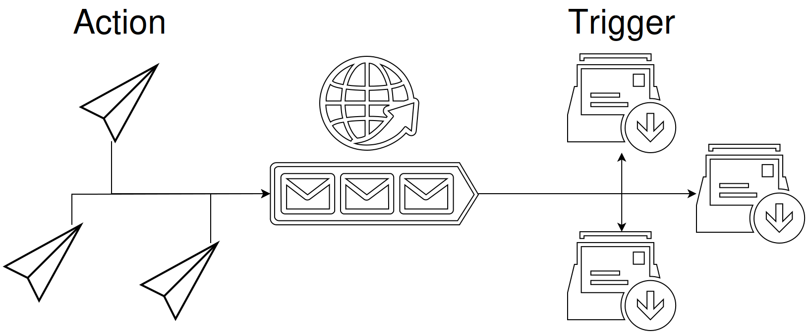
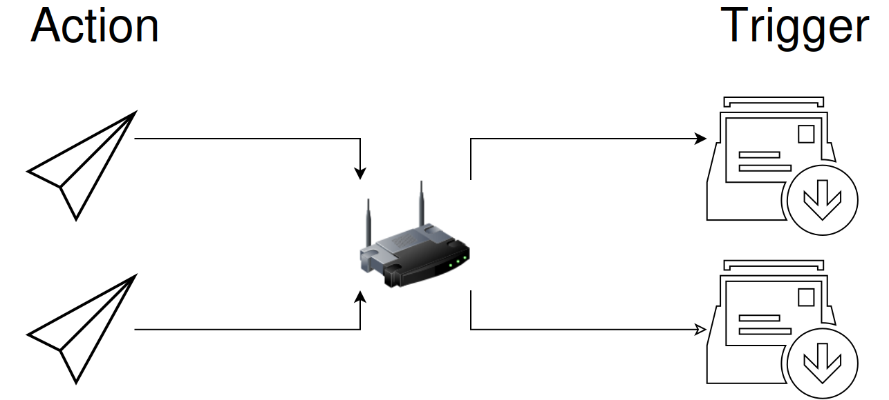

# Send a command to another aura

**Send Network Message** sends text to an EyeAuras channel. For example, one aura sends the word `review` and another shows “Review in progress” in response. The action only sends. Who receives the message and what they do with it is set up separately.

One running EyeAuras is enough to start. The `local://review-status` channel connects auras inside one program and sends nothing to another computer.

## Check a local sender and receiver

1. Create a receiving aura and add [Network Message](/en/triggers/network-message). Set **Channel Id** to `local://review-status`.
2. Set **Activate → Regex** to `\Areview\z`. Leave **Deactivate on message** off: we want a short “received” signal, not a switch that stays on. If you tested the expression by hand, turn **Test mode** off.
3. In another aura, add **Send Network Message**. Use the same **Channel Id** and set **Message text** to `review`.
4. Click **Execute** on the sending action. Its history will show the send, and the receiving trigger's **Message history** will show `review`. The trigger becomes active for a moment and goes back to inactive on its own.
5. So you do not have to watch the indicator, add [Play Sound](/en/actions/play-sound) to the receiver's **On Enter** and select your own audio file. Once the trigger is inactive again, the next send plays the sound again. If you want a state that stays on with a Text overlay instead, set the receiver up as described in the [receiver guide](/en/triggers/network-message).

The action's history shows only the send, not that the receiver reacted. If only the sender has a record, check the channel spelling, whether the receiver is enabled and what its history shows. Change the reaction last.

| Setting | Purpose |
| --- | --- |
| Channel Id | Sets the transport and the channel. Sender and receiver must match by the rules below. |
| Generate new Channel Id | Creates a random channel name. Give it to the receiver. If you generate again, the destination changes. |
| Message text | The text of one command or message. |
| Message history | This action's recent sends. |

Several receivers can listen to one channel, and each picks its own commands with its own expression.

[Diagram source (SVG)](/assets/wiki-media/m077-original.svg)

## Choose the transport

| Channel Id | Where it goes |
| --- | --- |
| `local://review-status` | Inside one running EyeAuras. Another process, even on the same PC, does not receive this channel. |
| A generated name or `eye://…` | Through the EyeAuras message server. EyeAuras must be signed in and connected to that server. |
| `broadcast://255.255.255.255/review-status` | Over UDP on the local network, without the EyeAuras message server. The default port is 53082. |
| `broadcast://192.168.0.21:55055/review-status` | Over UDP to that specific IPv4 address and port. The receiver must listen on the same port and channel path. |

Keep real channel identifiers private: nothing checks who is allowed to send commands to a channel. A send through the server times out after 10 seconds. UDP does not confirm delivery and does not resend lost messages.

What travels over the network is an EyeAuras message in Protobuf format: the text plus service fields such as the timestamp and sender name. Only a compatible EyeAuras can receive it, not any TCP, UDP or HTTP service that expects plain text or JSON.

Connect two PCs on your local network

You need two PCs with EyeAuras that can reach each other, and a network that allows UDP. Send short commands. This channel is not meant for files.

1. On the receiving PC, set the trigger's **Channel Id** to `broadcast://255.255.255.255:55055/review-status` and use the condition for `review` from the first example.
2. Find that PC's real IPv4 address. If it is `192.168.0.21`, set the sender to `broadcast://192.168.0.21:55055/review-status`.
3. Send `review` and look at the receiver's history. Change the port on both sides at once and pick it from the range **49152–65535**.

Everything after the address, including the path and query string, is compared exactly and is case-sensitive. Listening on 255.255.255.255 does not mean accepting every channel name. An address without a path, as in the older screenshots below, is a different channel.

Multicast is supported too: for example, use the same `broadcast://233.0.0.33:55055/review-status` on the sender and the receivers. The network has to pass multicast.

To send to several PCs, you can set `broadcast://255.255.255.255/review-status` on the sender and the receivers. Whether it works depends on the network interfaces and network rules.

Do not reuse the old `broadcast://192.168.1.255/anychannelname` example by just replacing the first three numbers. A broadcast address depends on the subnet mask, and broadcast mode is currently turned on only for **255.255.255.255**.

[Diagram source (SVG)](/assets/wiki-media/m016-restored.svg)

Prepare a Hyper-V example network

You need this only if your VMs cannot yet reach the sender over the network. Changing the virtual switch and IP addresses affects the VMs' networking, so use values from your own setup, not someone else's IPs.

1. In **Hyper-V Manager → Virtual Switch Manager**, create an **External** switch, such as `vLAN`, and choose the physical adapter for it.

2. In the settings of each VM, select that switch under **Network Adapter**.

3. In the guest Windows, open the network settings and the **Ethernet** connection. If the addresses are static, give each guest an unused address from your network.

| Original example value | What to use in your network |
| --- | --- |
| IP 192.168.0.21, then .22 | A different unused address for each VM. |
| Mask 255.255.255.0 | Your actual subnet mask. |
| Gateway 192.168.0.1 | Your real gateway, if you need one. |

4. Once the VMs can reach each other, set up the channels as in the previous example. You can set a shared **Channel Id** in [folder defaults](/en/features/default-properties), so you do not have to copy it into every item.

5. Send one command to the receiver you chose and check that it shows up in its history. For another guest, use that guest's own IP. It is handy to split different commands into separate actions and receive conditions.

