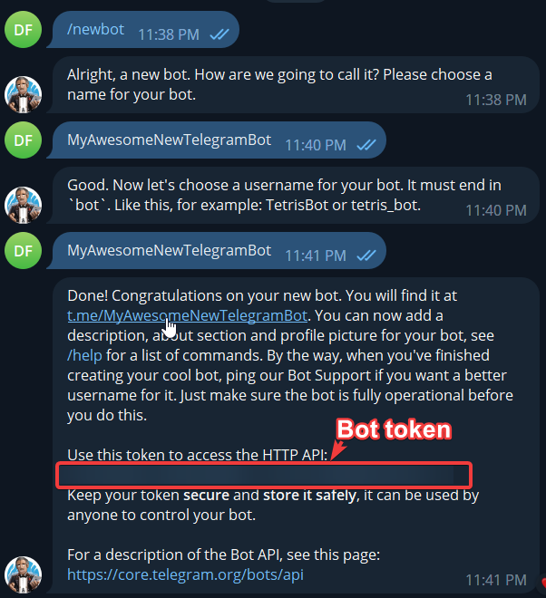
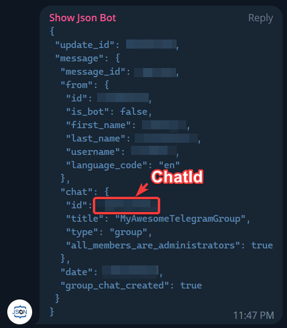

# Send To Telegram — receive one aura notification

**Send To Telegram** sends you a Telegram message, with a screenshot if you want one. That way you learn about an event even when you are away from the computer. For example, an aura spots the text `Connection lost` and messages you.

The message comes from a bot. It cannot be sent from your personal Telegram account.

## Prepare your bot and recipient

1. Create a bot with the official [BotFather](https://t.me/BotFather): send `/newbot`, then choose a display name and a unique username ending in `bot`. You can also use a bot you already own. Save the token BotFather gives you.
2. To find your chat's ID, create a temporary aura with the [Telegram Message trigger](/en/triggers/telegram-message). Enter the bot token, leave **Chat Id** empty and enable the aura.
3. Open your bot's private chat in Telegram and send `/start`. In the trigger's **Message history**, find your message and copy its Chat Id. You can now delete the temporary aura.
4. In a separate test aura, add **Send To Telegram**. Enter **Telegram Bot Token** and the **Chat Id** you copied. Set **Message text** to `Connection test` and **Message format** to **Text**, and turn **Attach screenshot (desktop/window)** off.
5. Click **Execute** on the action once. `Connection test` should appear in your chat with the bot, along with a sent entry in **Message history**. If the attempt failed, the history shows an error entry.

The token gives access to the bot, so treat it like a password. The [Telegram tutorial](https://core.telegram.org/bots/tutorial#obtain-your-bot-token) also explains how to set up a bot.

## Connect the notification to a condition

Put the action in **On Enter** of the aura. The message goes out when the aura becomes active. The condition can be, for example, a phrase found by [Text Search](/en/triggers/images/text-search).

For a one-time notification, do not put the send in **While Active**: that group repeats its actions while the aura is active.

## Settings

| Setting | What to supply |
| --- | --- |
| `Telegram Bot Token` | The bot token from BotFather. Keep it out of screenshots and exported configurations. |
| `Chat Id (optional)` | The recipient's chat ID. The label says optional, but nothing is sent without it. |
| `Message text` | The text or the photo caption. Start with `Connection test`. |
| `Message format` | Text, HTML, Markdown or MarkdownV2. Markup must follow Telegram's syntax. |
| `Attach screenshot (desktop/window)` | Adds a screenshot taken when the action runs. If no window is selected, it captures the desktop. |
| `Window to screenshot` | The window to capture. |
| `Proxy server (optional)` | Optional SOCKS5 proxy, for example `username:password@host:port`. |

The attachment is a JPEG of the selected window, or of the whole virtual desktop if no window is selected. It can include private content. The file name also contains the time, the computer name and the window title or process name when available. If the capture fails or the selected window is not available, the action can send the text without a photo.

Telegram allows up to **4096 characters for text** and **1024 for a photo caption**, counted after entity parsing. The action does not split a longer message for you. See Telegram's [formatting options](https://core.telegram.org/bots/api#formatting-options) and the [legacy Markdown rules](https://core.telegram.org/bots/api#markdown-style).

If the network fails or the action is cancelled, you cannot tell whether the message was delivered, and it may not be sent again. Sending it again by hand can produce a duplicate, so check the history and the chat first.

## If the message did not arrive

Look at the error in the action's history and check the token and the Chat Id. Make sure you have started a chat with the bot and have not blocked it. In a group, the bot must be a member and be allowed to post.

If plain text goes through but a message with markup does not, switch back to Text and check Telegram's formatting rules.

Groups and the earlier setup illustrations

For your own group, add your bot and make sure it can post there. Then take the group's ID from the incoming message history, the same way as for a private chat. A private-chat ID and a group ID are different recipients. To react to incoming messages, use the [Telegram Message](https://wiki.eyeauras.net/en/triggers/telegram-message) trigger.

The earlier guide found a group's Chat Id with a third-party bot named **Show Json Bot**: you add it through **Add Member** and it prints the group's JSON. You do not need it. A third-party bot gets access to the group according to Telegram's group permissions, so use your own bot's history when you can.

