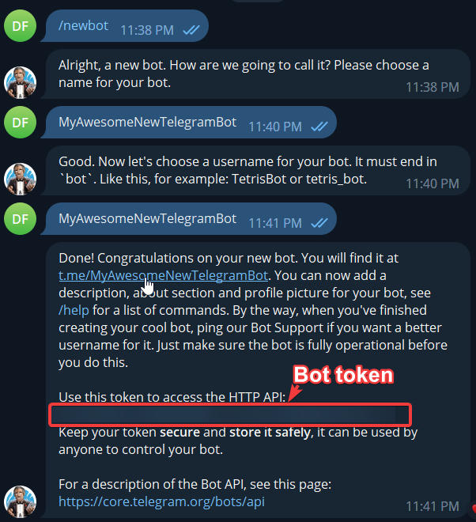
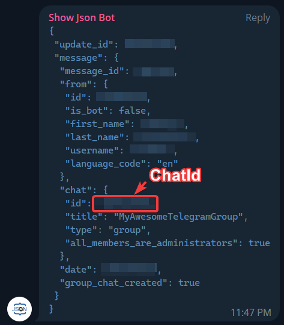

# Send To Telegram — receive one aura notification

Use **Send To Telegram** to send a bot message to your own chat when an aura detects something, such as visible `Connection lost` text. The aura's triggers supply that condition; the action does not discover game events or streaming status automatically. It sends as the bot, not as your personal Telegram user.

You need your own bot token, a chat the bot can send to, and network access to Telegram. Start with one text-only test before attaching an image or enabling repeated actions.

## Prepare your bot and recipient

1. In Telegram, use the official [BotFather](https://t.me/BotFather) and `/newbot`, or use a bot you already own. Choose a display name and a unique username ending in `bot`. The [Telegram tutorial](https://core.telegram.org/bots/tutorial#obtain-your-bot-token) explains the token. Treat it as a password; example placeholders are not credentials.
2. To discover your own chat's ID, create a temporary aura with the [Telegram Message trigger](/en/triggers/telegram-message), enter the bot token, leave its **Chat Id** empty and enable the aura.
3. Open your bot's private chat and send `/start`. In the trigger's **Message history**, find your message and copy its Chat Id. You can remove the temporary aura afterwards. This is recipient discovery through incoming updates, separate from the outgoing action.
4. In a separate test aura, add **Send To Telegram**. Enter **Telegram Bot Token** and the discovered **Chat Id**. Set **Message text** to `Connection test`, **Message format** to **Text**, and turn **Attach screenshot (desktop/window)** off.
5. Click **Execute** on that action once. Expect `Connection test` in your own bot chat and a sent entry in **Message history**. An error entry identifies a failed attempt; a sent result is not proof that a person has read the message.

The earlier action illustration shows the same connection and message concepts; layouts can differ between editors.

## Connect the notification to a condition

Place the action in **On Enter** to send when the aura becomes active. A [Text Search](/en/triggers/images/text-search) condition can supply the visible phrase. Other triggers in the aura also affect its final state. **While Active** repeats actions while active; it is not the place for an intended single transition notification.

Game statistics, inventory notices, team or stream alerts need their own configured source and condition. Naming such an event in the message does not integrate EyeAuras with the application's internal data.

| Setting | What to supply |
| --- | --- |
| `Telegram Bot Token` | The bot token from BotFather. Do not share it in screenshots or exported configurations. |
| `Chat Id (optional)` | Recipient identifier. Despite the editor's discovery-oriented label, sending requires a non-empty Chat Id. |
| `Message text` | Text or photo caption. Start with `Connection test`. |
| `Message format` | Text, HTML, Markdown or MarkdownV2. Markup must follow Telegram's syntax. |
| `Attach screenshot (desktop/window)` | Captures an image when this action executes. An empty window selector means the desktop. |
| `Window to screenshot` | Source window for the attachment; it does not select the Telegram recipient. |
| `Proxy server (optional)` | SOCKS5 connection, for example `username:password@host:port`; leave empty if unnecessary. |

An attachment uses a JPEG of the selected window, or the virtual desktop when no window is selected. That can include private content. Its filename also includes the time, computer name and available window title/process name. If capture fails or no selected window is available, the action can send text without a photo; receiving text does not prove capture succeeded.

Text and photo-caption limits differ: Telegram documents up to **4096 characters for text** and **1024 for a photo caption**, after entity parsing. The action does not automatically split an oversized notification. See [formatting options](https://core.telegram.org/bots/api#formatting-options) and the [legacy Markdown rules](https://core.telegram.org/bots/api#markdown-style). Try Text when markup is rejected.

The send is awaited with the action's cancellation token. Network failures and cancellation can leave delivery uncertain; retrying manually can duplicate a message. Connection/update polling retries are not a guarantee that this outgoing notification will be resent. Inspect history and the recipient before repeating it.

Groups and the earlier setup illustrations

For your own group, add your bot and ensure it can post there, then obtain that group's ID from its incoming message history. A private-chat ID and a group ID are different recipients. Incoming [Telegram Message](https://wiki.eyeauras.net/en/triggers/telegram-message) is the route for reactions to received updates; sending does not make every group or bot-authored message available to that trigger.

The earlier guide illustrated BotFather creation:

It also used a third-party bot named **Show Json Bot** to print a group's JSON and Chat Id after being added through **Add Member**. That is an optional historical discovery method, not a required dependency or an endorsement of similarly named accounts. Adding a third-party bot gives it access according to Telegram's group permissions; use your own bot's history when possible.

