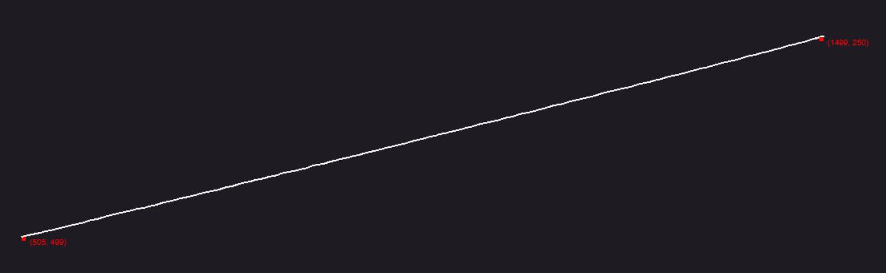
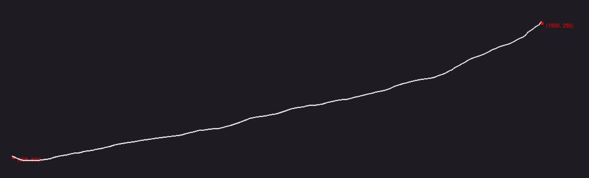

# Smooth a mouse move

To make the cursor travel visibly toward a point, choose **Mouse Move smoothing algorithm**. EyeAuras replaces a direct move with intermediate positions and delays. A click is a separate event.

Smoothing changes the path and its duration; it does not identify a control or guarantee that an application treats the input as physical.

## Compare a direct move and a smooth move

Use your own open window with a clear, unused point inside it. Choose an absolute Mouse Move with Windows Input: relative offsets use a different movement path.

1. In **Send Sequence → Advanced input settings**, select the window and **Input Simulator = Windows Input**. Turn off **Restore after Action is completed → Mouse position** and set **Randomize Mouse Movement X/Y = 0**.
2. Add **Mouse → Move**. Turn off **Relative movement** in the step's properties.
3. Under **Mouse position**, use **Pick mouse position** to select a free point inside that window. Add no mouse-button events.
4. Set **Mouse Move smoothing algorithm = Disabled** and use **Execute**. The cursor should move directly to the point.
5. Start farther away, choose **Linear Normal** and execute again. Intermediate movements should end at the same target.
6. Compare **Randomized Normal**. Try Fast for a shorter transition or Slow for a more visible one, checking the endpoint as well as the path.

For a useful comparison, start at the same location and avoid moving the mouse manually during playback.

## Available algorithms

| Algorithm | How the path is made |
| --- | --- |
| Disabled | One target point without an intermediate route; the default choice |
| Linear Fast / Normal / Slow | WindMouse-family paths with strong attraction and small deviations. “Linear” does not promise a mathematically straight line |
| Randomized Fast / Normal / Slow | The same family with greater random deviation; variants differ in waits and route segmentation |
| ML Human Move | MlHumanMouseV1 uses a local ML.NET FastTree model pack to predict movement parameters, then creates a bounded Bezier/easing path to the exact target, with a 2x runtime speed multiplier |
| ML Human Move Fast | MlHumanMouseFastV1 uses the same model-backed planner with a 4x runtime speed multiplier |

Linear and Randomized need no ML model. The ML variants need their local model pack; a selector entry alone does not establish readiness. They are separate from AI Search. The action editor selects an algorithm, rather than exposing Gravity, Wind or a protection-bypass probability.

These older GIFs illustrate a nearly straight path and a more varied one. They do not measure timing on your computer or promise an identical route.

What else affects the result

| Setting or context | What to check |
| --- | --- |
| Target Window | Absolute movement uses a point relative to the selected window; without a target, the point is in screen coordinates |
| Relative movement | An offset from the current cursor; this path does not apply the selected absolute-move smoother |
| Randomize Mouse Movement | Changes the endpoint itself. Leave it at 0 for precise positioning |
| Restore → Mouse position | Can return the cursor immediately after the operation, hiding its final position |
| Windows Message API | Sends window messages instead of a visible system-cursor trajectory; this implementation does not apply smoothing |
| Duration and cancellation | Distance, algorithm waits and delivery all matter. Smoothing is not a fixed-duration scheduler, and cancellation does not undo movement already sent |

If the endpoint is wrong, correct the [coordinate system](/en/features/coordinate-system) and window source first. A different curve cannot fix a screen/window coordinate mismatch. The action manages its input controller for each operation; selecting a smoother does not create a separate running script or a window you must keep alive.
