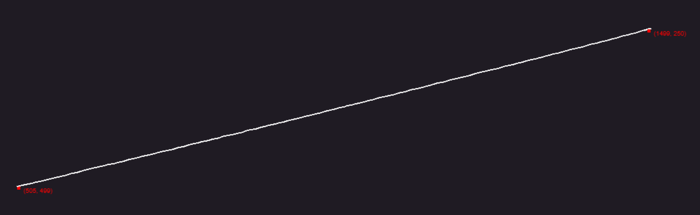
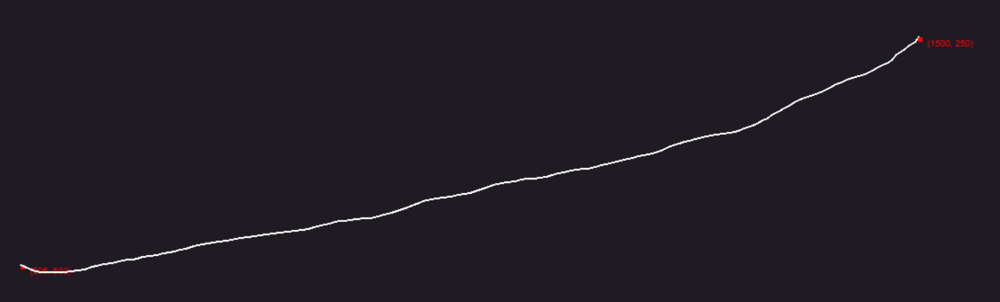

# Smooth a mouse move

Normally the cursor jumps straight to the target point. If you choose a **Mouse Move smoothing algorithm**, EyeAuras moves it along a path of intermediate points with pauses. This is handy when you want to see the cursor travel to an element. A click is added separately.

## Compare a direct move and a smooth move

You need an ordinary open window with a free, easy-to-see point inside it. Use an absolute Mouse Move with Windows Input: with a relative offset the algorithm does not build the same kind of path.

1. In **Send Sequence → Advanced input settings**, select the window and set **Input Simulator** to **Windows Input**. Turn off **Restore after Action is completed → Mouse position** and leave **Randomize Mouse Movement X/Y** at 0.
2. Click **Mouse → Move**. In the properties of the new step, turn off **Relative movement**.
3. Under **Mouse position**, click **Pick mouse position** and choose a free point inside the window. Do not add mouse buttons to the sequence.
4. Set **Mouse Move smoothing algorithm** to **Disabled** and click **Execute**. The cursor jumps straight to the point.
5. Move the cursor farther away, choose **Linear Normal** and execute again. Now the cursor passes through intermediate points and stops at the same target.
6. Try **Randomized Normal** for comparison. Try Fast if you want it quicker, or Slow if you want it easier to see. Watch the end point as well as the path.

The length of the path depends on where the cursor starts. For a fair comparison, start from the same place and do not touch the mouse while it moves.

## Available algorithms

| Algorithm | How the path is made |
| --- | --- |
| Disabled | Straight to the target point with no path in between. This is the default. |
| Linear Fast / Normal / Slow | The WindMouse family: the cursor is pulled strongly toward the target and drifts only a little. The line is not perfectly straight. |
| Randomized Fast / Normal / Slow | The same family with more random drift. The variants differ in pauses and in how the path is split up. |
| ML Human Move | MlHumanMouseV1: a local ML.NET FastTree model pack predicts the movement parameters, then a bounded Bezier/easing path is built to the exact target. Runs at 2x speed. |
| ML Human Move Fast | MlHumanMouseFastV1: the same model-based planner at 4x speed. |

Linear and Randomized work without an ML model. The ML variants need their local model pack. Seeing the name in the list does not mean the pack is ready.

What else affects the result

| Setting or context | What to check |
| --- | --- |
| Target Window | If a window is selected, the point is relative to it. If Target Window is empty, it is a point on the screen. |
| Relative movement | An offset from where the cursor is now. Smoothing for absolute moves is not applied in this case. |
| Randomize Mouse Movement | Changes the target point itself, not just the shape of the path. Leave it at 0 for a precise hit. |
| Restore → Mouse position | Can move the cursor back right away, so you will not see where it ended up. |
| Windows Message API | Sends messages to the window and does not move the system cursor along a visible path. Smoothing is not applied with this input method. |
| Duration and cancellation | The total time depends on the distance, the algorithm's pauses and the input method. You cannot set a move duration in milliseconds with smoothing. Cancelling does not undo movement already sent. |

If the cursor ends up in the wrong place, fix the [coordinates](/en/features/coordinate-system) and the window source first.
