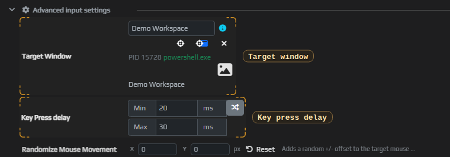
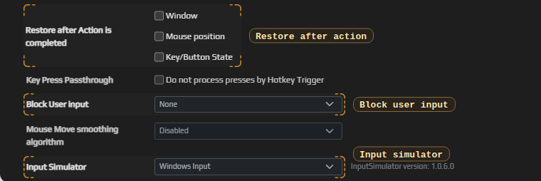

# Common input options

**Advanced input settings** set where and how Send Sequence sends its events. If a shortcut opens search in the wrong document, check **Target Window** and the focus inside that window first. Target Window picks only the window, not a text field, button or tab inside it.

## Check the recipient with one shortcut

Say you already have a short Send Sequence with the Down/Up pair for **Ctrl+F**. Your document viewer has a test document open where that shortcut opens search.

1. Open **Advanced input settings → Target Window** and select the document window. If several windows match, narrow the [window expression](/en/features/window-matching-expressions).
2. Set **Input Simulator** to **Windows Input**. Leave **Block User input** at **None**, **Randomize Mouse Movement X/Y** at 0 and **Mouse Move smoothing algorithm** at **Disabled**: a keyboard shortcut needs no mouse movement.
3. Turn on **Restore after Action is completed → Key/Button State**. Leave window and mouse restoration off for the first check, so you can see where the command landed.
4. Put the focus in the document and click **Execute**. The window should get the input and open its search panel. If the shortcut landed in another field, fix the window or the focus inside it, not the delay.

Windows Input and the simulators of a physical or virtual keyboard normally activate the target window and send ordinary input. They share the cursor and focus with the desktop. **Target Window is not a universal background-input channel.**

## Main settings

| Setting | Meaning and limits |
| --- | --- |
| Target Window | The window that receives the input. If an expression is set and no window matches, the input fails with an error. An empty field does not pin a recipient: the input goes to the current context. |
| Key Press delay | Delay between Down and Up. Send Sequence uses this shared value when Use default Key Down / Key Up delay is on. |
| Randomize for a delay | Picks a random time between the lower and upper values. |
| Randomize Mouse Movement X / Y | Shifts the target point randomly, by up to plus or minus the given number of pixels. Leave both at 0 for an exact position. |
| Restore after Action is completed → Mouse position | Moves the cursor back after each input operation that has a coordinate. In a Move → Click chain the cursor can return before the click, so start with it off for that pattern. |
| Restore after Action is completed → Key/Button State | At the end of Send Sequence, tries to release the sequence's keys that are still down. You still need explicit Up events. |
| Restore after Action is completed → Window | The checkbox is still in the editor, but the current Send Sequence does not restore focus with it. If you need a specific window after the input, add a separate Win Activate action. |
| Key Press Passthrough → Do not process presses by Hotkey Trigger | Hotkey Trigger does not see the presses this action sends, so the action cannot trigger itself through it. Windows shortcuts keep working as usual. |
| Mouse Move smoothing algorithm | Adds intermediate points to an absolute move. |
| Input Simulator | How the input is delivered. A name in the list does not mean its driver or device is installed. |

[Win Activate](/en/actions/win-activate) brings you back to a known window. For the shape of the path and the time it takes, see [mouse smoothing](/en/actions/sendinput/mouseinputsmoothing).

Block user input

| Block User input | What is blocked while the action runs |
| --- | --- |
| None / Disabled | Nothing |
| All / Block All Input | Keyboard, mouse buttons and movement |
| Keyboard / Block Keyboard Input | Keyboard |
| Mouse / Block Mouse Input | Mouse buttons. You can still move the mouse. |
| MouseMove / Block Mouse Movement | Mouse movement. Buttons still work. |

Keep **None** while you set up a short sequence. Use blocking only when you really want to rule out manual input while the action runs.

## Choose a delivery method

| Input Simulator | How it delivers input |
| --- | --- |
| Windows Input | System SendInput. The usual starting point: keyboard and mouse in an active application. |
| Windows Message API | PostMessage to the selected window. It can work without activating the window if the application handles those messages. Many programs ignore them. Mouse coordinates are counted from the client area. |
| Granny's Send Input | Older system keyboard and mouse events. |
| TetherScript Driver | Virtual HID devices of the Tetherscript driver. Needs the [installed driver](/en/actions/sendinput/tetherscript). |
| Usb2Kbd device | Commands to a compatible physical USB HID device. Needs the [hardware and connection settings](/en/actions/sendinput/usb2kbd). |
| Input driver | A separate driver-based input method. Input does not work until its driver is installed and ready. |
| Low-level Windows Input / Low-level Input Injection | Separate low-level input methods. Use only one that is present in your installation and ready to work. |

Other input methods come with additional modules. **Install...** may open an installer, a website or a device settings window, depending on the selected method. Check its Status and its own guide.

If a group of auras needs the same settings, set them in **Folder Properties → Triggers/Actions/Overlays Defaults → Input Simulator**. For components that already exist, check their bindings and what **Apply to All** affects. See [default properties](/en/features/default-properties) for details.
