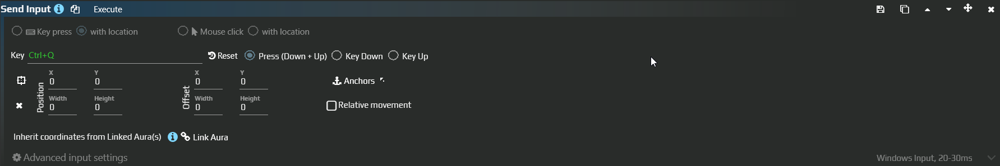

# Move an old Send Input action to Send Sequence

To keep an old one-key action working, recreate its events in [Send Sequence](/en/actions/sendinput/send-sequence). For example, a legacy **Ctrl+A** should select the contents of your test field once after migration.

**Send Input is a legacy action type.** Use Send Sequence for new input. The image shows its former WPF editor, rather than an extra mode of the current sequence editor.

## Migrate one Ctrl+A

You need an existing aura with the old action and your own text field containing sample text. Disable automatic execution while migrating so you can run one action at a time.

1. Note its **Key**, event type and [common options](/en/actions/sendinput/options), especially **Target Window** and **Input Simulator**. A complete legacy press uses **Press (Down+Up)**, rather than Key Down alone.
2. If the old editor opens, choose **Convert to Send Sequence**. It **inserts a new action after the original**; it does not replace it. Do not execute the whole aura with both enabled.
3. Open the new action. Check **Ctrl+A Key down → delay → Ctrl+A Key up** and its window and input method under **Advanced input settings**.
4. If the legacy editor is unavailable or says **This item type is not supported**, add Send Sequence manually. Add A through **Keyboard**, set **Hotkey = Ctrl+A** on both events, and retain their **Key down** and **Key up** directions. Put a delay such as **50 ms** between them.
5. Focus the sample field and use **Execute** on only the new action. Its text should become selected.
6. Remove the original action from that aura's list after checking the result. Another run should perform one selection.

## Map the old operation

| Legacy operation | Send Sequence equivalent |
| --- | --- |
| Key Press | A matching Key down / Key up pair, with a delay between them |
| Key Down | A Key down event. Add Delay and the matching Key up for a timed hold |
| Key Up | Release the same key or combination pressed earlier |
| Key Press with Location | Mouse Move followed by the key events |
| Mouse Click | Down and Up for the selected button, with modifiers if required |
| Mouse Click with Location | Mouse Move before the button pair |
| Mouse wheel | A Wheel up or Wheel down step; wheel scrolling is not a held button |
| Relative movement | An offset from the current cursor, rather than an absolute window point |
| Link Aura | Linked auras in Mouse Move properties supply a result region; check anchors and the action's target separately |

The old key field captured a combination; double-clicking it with a mouse button selected that button. In the current editor, use **Keyboard**, **Numpad**, **Fn**, **Mouse** and **Hotkey** properties. Text steps do not interpret descriptions of key actions.

Conversion carries the movement region, relative mode and related bindings into a separate Mouse Move. Legacy Send Input could obtain a target from that linked region. In Send Sequence, check **Target Window on the action itself**: the [region's coordinates](/en/features/coordinate-system) and input recipient must describe the same window.

Down without Up can leave a key held. Keep explicit release events and check **Restore after Action is completed → Key/Button State** as additional cleanup. Background delivery depends on the selected input method, not on the legacy action's name.
