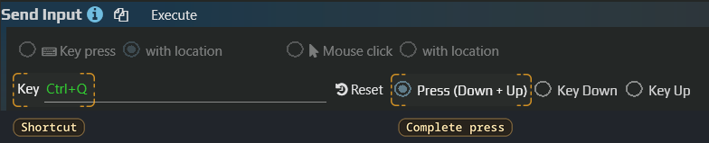

# Move an old Send Input action to Send Sequence

**Send Input is a legacy action type.** It sent one click or one key combination. Add new input with [Send Sequence](/en/actions/sendinput/send-sequence). You can move old actions there too. The result should stay the same: an old **Ctrl+A** still selects the contents of the field and does not fire twice.

The legacy type had its own WPF editor.

## Migrate one Ctrl+A

You need an aura with the old action and an ordinary text field with some sample text. Turn off automatic execution of the aura while you migrate, so you can test one action at a time.

1. Write down its **Key**, event type and [common options](/en/actions/sendinput/options), above all **Target Window** and **Input Simulator**. For a full press the old action must use **Press (Down+Up)**, not Key Down alone.
2. If the action opens in the old editor, click **Convert to Send Sequence**. It **inserts a new action after the original** and leaves the old one in place. Do not run the whole aura while it contains both.
3. Open the new Send Sequence. For Ctrl+A it should contain **Ctrl+A Key down → delay → Ctrl+A Key up**. Check the window and input method under **Advanced input settings**.
4. If the old editor is unavailable or says **This item type is not supported**, add Send Sequence by hand. Add A through **Keyboard** and set **Hotkey** to Ctrl+A in the properties of both events. Keep their **Key down** and **Key up** directions and put a delay between them, for example **50 ms**.
5. Put the focus in the sample field. Run only the new action with **Execute**. The text in the field should become selected.
6. After checking, remove the old action from the aura's list. On the next run the selection should happen once.

## Map the old operation

| Legacy operation | Send Sequence equivalent |
| --- | --- |
| Key Press | A Key down / Key up pair for the key or combination, with a delay between them |
| Key Down | Key down only. To hold the key for a while, add Delay and the matching Key up |
| Key Up | Release of the same key or combination pressed earlier |
| Key Press with Location | Mouse Move first, then the key events |
| Mouse Click | A press and release pair for the selected button. Modifiers are supported |
| Mouse Click with Location | Mouse Move before the button pair |
| Mouse wheel | A separate Wheel up or Wheel down step. It is scrolling, not a held button |
| Relative movement | An offset from where the cursor is now. Do not put an absolute window point here |
| Link Aura | The region link through Linked auras in the Mouse Move properties. Check the anchors and the window separately |

In the old key field you set a combination by pressing it. You picked a mouse button by double-clicking the field with that button. The current editor has **Keyboard**, **Numpad**, **Fn**, **Mouse** and the **Hotkey** properties for this.

Conversion moves the coordinates, relative mode and movement bindings into a separate Mouse Move. The old Send Input could take its target window from the linked region. In Send Sequence, check **Target Window on the action itself**: the coordinates of the found region and the window that gets the input must belong to the same window. See the [coordinate system](/en/features/coordinate-system) for details.

Key Down without a Key Up after it leaves the key held. In the new action, check **Restore after Action is completed → Key/Button State** and still keep an explicit release in the sequence.
