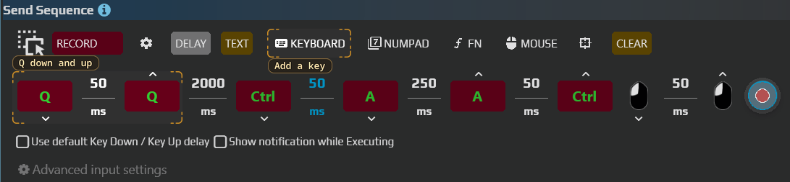
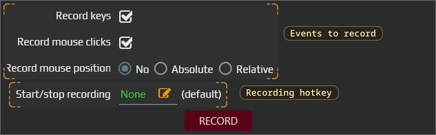

# Send Sequence

Send Sequence replays a list of events in order: keys, mouse buttons, mouse moves, text and pauses. For example, two shortcuts in a row, **Ctrl+Home** then **Shift+End**, select the first line of a draft. The action does not check what is happening in the application, so the field you need must be ready for input.

## Select the first line

Open an ordinary text editor and type two lines, such as “Draft” and “Check the attachments”. Ctrl+Home and Shift+End should work in it as usual.

1. Add **Send Sequence** to an aura. Under **Advanced input settings**, select the editor's **Target Window**, set **Input Simulator** to **Windows Input** and **Block User input** to **None**.
2. Add Home through **Keyboard**. You get **Key down**, a delay and **Key up**. Set **Hotkey** to **Ctrl+Home** on both key events and leave their directions as they are.
3. Add a **Delay** of **100 ms** after Home's release. Turn off Randomize for this pause if you want it fixed.
4. Add End the same way and set **Hotkey** to **Shift+End** on both events of the pair. Do not replace the pair with a single Press event.
5. Turn on **Use default Key Down / Key Up delay**. Set **Key Press delay** to **50 ms** with no random range. The 100 ms pause between the shortcuts stays separate.
6. Turn on **Restore after Action is completed → Key/Button State**. Put the focus in the draft text and click the action's **Execute** button.
7. The first line becomes selected. Try again from another cursor position: Ctrl+Home first takes it back to the start of the document.

The toolbar in the current editor has **Record**, **Delay**, **Text**, **Keyboard**, **Numpad**, **Fn** and **Mouse**. You can add items and reorder them by dragging.

## Build events, not a command string

| Item or setting | Meaning |
| --- | --- |
| Keyboard / Numpad / Fn | Ordinary, numeric-pad and function keys. For example, Esc is Escape, and NumPad1 is not the same as 1 in the main number row |
| Hotkey | A key with modifiers, such as Ctrl+A. For a shortcut, change both the Down and the Up of the pair |
| Event type → Key down | Press and hold until the matching Up |
| Event type → Key up | Release the key or button pressed earlier |
| Event type → Press | An option in the single-event editor. It does not replace the Down/Up pair: for a full press in the current Send Sequence, use an explicit pair with a delay |
| Delay | A pause between steps. You can set a range and Randomize |
| Mouse | Buttons, wheel and Mouse Move. A full click is also a press and a release |
| Text | Text as is, sent with the chosen delivery method. `{Enter}` and `\n` are not run as commands here |

To hold a key for 300 ms, build **Key down → Delay 300 ms → Key up**. When **Use default Key Down / Key Up delay** is on, delays marked **This delay is part of a keypress pair** use the shared value. For your own hold time, use an ordinary Delay without that mark.

One run goes through the list once. To repeat, duplicate the steps or set up repetition in the aura or macro that calls the action.

At the end of a run, including when it is cancelled, **Key/Button State** tries to release the sequence's keys that still count as pressed. It is a safety net and does not replace explicit Up events.

## Record a short operation

1. Click **Record** to open the recording panel. Choose which events to record.
2. Click **Record** inside the panel and do a short operation in your application. Stop with **Stop** or the configured **Start/stop hotkey**.
3. Review the result before you run it: remove stray clicks and check the Down/Up pairs, delays and coordinates.

| Recording option | What to choose |
| --- | --- |
| Record keys | Record the keyboard |
| Record mouse clicks | Record mouse buttons |
| Record mouse position → No / Absolute / Relative | Skip movement, save points, or save relative offsets |
| Sample every | How often mouse movement is recorded, 50–1000 ms in the current panel. A shorter interval gives more items |
| Start/stop hotkey | Starts and stops recording. The default comes from Settings → Start/Stop sequence recording. This key does not cancel playback |

Limits, progress and cancellation

| Setting or indicator | What it means |
| --- | --- |
| item(s), ms and max items | The size of the sequence and the editor's limits. The standard configuration is 120 seconds of recording and 500 items |
| Show notification while Executing | Shows a notification with the progress and the current step |
| Sequence Can Be Interrupted | Lets you cancel the running action |

Before you use a long sequence, check how to stop it in your version. Start with a short sequence with no held buttons.

To start a tested sequence with a key, add [Hotkey Is Active](/en/triggers/hotkey-is-active) to its aura and put this action in **On Enter**. If the shortcut should work only in your document window, that guide describes the window-specific setup.

To click a found object, first set up the [coordinates and the linked region](/en/features/coordinate-system). [Common options](/en/actions/sendinput/options) cover the limits of the window, focus, restoration and input methods. A recorded action does not wait for an element to appear by itself: the aura's triggers set that condition.
