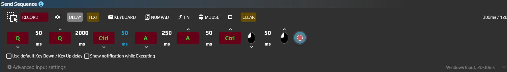

# Send Sequence

Select the first line of your own draft with **Ctrl+Home**, followed by **Shift+End**. Send Sequence replays an ordered list of key events, mouse events, text and delays. It does not inspect the document or wait for a control to appear.

## Select the first line

Open your own multiline draft with two lines, such as “Draft” and “Check the attachments”. Use an editor where Ctrl+Home and Shift+End normally work. This example selects text without deleting it.

1. Add **Send Sequence** to an aura. Under **Advanced input settings**, select the editor's **Target Window**, **Input Simulator = Windows Input** and **Block User input = None**.
2. Add Home through **Keyboard**. This creates **Key down**, a delay and **Key up**. Set **Hotkey = Ctrl+Home** on both key events, keeping their directions.
3. Add an ordinary **Delay = 100 ms** after Home's release. Turn off Randomize for this pause.
4. Add End in the same way, then set **Hotkey = Shift+End** on both events. Keep the explicit Down/Up pair rather than replacing it with one Press item.
5. Enable **Use default Key Down / Key Up delay**. Set **Key Press delay = 50 ms**, without a random range. The ordinary 100 ms pause between shortcuts remains separate.
6. Enable **Restore after Action is completed → Key/Button State**. Focus the draft text and use the action's **Execute** button.
7. The first line should become selected. Try again from another caret position: Ctrl+Home should first return it to the document start.

The older screenshot illustrates the event-list principle. Current toolbar entries include **Record**, **Delay**, **Text**, **Keyboard**, **Numpad**, **Fn** and **Mouse**; items can be added and reordered by dragging.

## Build events, not a command string

| Item or setting | Meaning |
| --- | --- |
| Keyboard / Numpad / Fn | Ordinary, numeric-pad and function keys. Esc corresponds to Escape; NumPad1 is different from 1 in the main number row |
| Hotkey | A key with modifiers, such as Ctrl+A. Change both Down and Up when editing a shortcut pair |
| Event type → Key down | Press and keep the key or button down until a matching Up |
| Event type → Key up | Release the previously pressed key or button |
| Event type → Press | An option in the single-item editor. For a complete press in current Send Sequence, use the explicit Down/Up pair with a delay; a single Press item does not replace it |
| Delay | A pause between steps, with an optional range and Randomize |
| Mouse | Buttons, wheel and Mouse Move. A complete button click also needs Down and Up |
| Text | Literal text with a delivery method; `{Enter}` and `\n` are not executable escape commands |

A 300 ms hold is **Key down → Delay 300 ms → Key up** for the same key. With **Use default Key Down / Key Up delay** enabled, delays marked **This delay is part of a keypress pair** use the common delay. For a custom hold, use an ordinary Delay without that marker.

One execution walks the saved list once. Duplicate the intended steps or configure repetition in the calling aura or macro; Text is not a repeat-expression language. Repetition does not wait for a target application to become ready.

At completion, including cancellation, **Key/Button State** attempts to release keys used by the sequence that still appear pressed. This supplements explicit Up events; it does not restore every physical key state. Cancellation is cooperative, so it cannot retract an event already delivered or instantly stop every backend operation.

## Record a short operation

1. Click **Record** to open the recording panel and choose the events to capture.
2. Click **Record** inside that panel, perform a short operation in your own application, then finish with **Stop** or the configured **Start/stop hotkey**.
3. Review before replaying: remove stray clicks, check Down/Up pairs, timing and coordinates.

| Recording option | What to choose |
| --- | --- |
| Record keys | Capture keyboard events |
| Record mouse clicks | Capture mouse buttons |
| Record mouse position → No / Absolute / Relative | Omit movement, record points, or record relative offsets. Review the resulting steps before replay |
| Sample every | Mouse sampling interval, 50–1000 ms in the current panel. Shorter intervals create more items |
| Start/stop hotkey | Controls recording; its default comes from Settings → Start/Stop sequence recording. It is separate from playback cancellation |

Limits, progress and cancellation

| Setting or indicator | What it means |
| --- | --- |
| item(s), ms and max items | Sequence size and editor limits. Standard configuration sets 120 seconds of recording and 500 items; check the values shown in your installation |
| Show notification while Executing | Shows execution progress and the current step |
| Sequence Can Be Interrupted | Allows cancellation of the running action; it does not select the recording hotkey |

Check how to stop playback in your version before using a long sequence. A recording shortcut is not a universal Escape-to-cancel promise. Start with a short list and explicit key releases. Recording duration is not an exact wall-clock bound for replay: backend operations, movements and application processing also take time.

For a move to a found object, first configure [coordinates and the linked region](/en/features/coordinate-system), then add the reaction separately. [Common options](/en/actions/sendinput/options) explain focus, target, restoration and delivery. A recorded sequence supplies events; an aura trigger supplies any condition for starting it.
