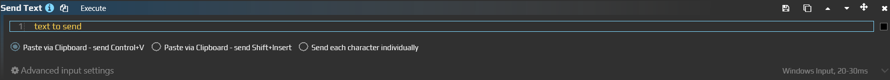

# Enter text from a legacy Send Text action

To insert a prepared note, add a **Text** step to [Send Sequence](/en/actions/sendinput/send-sequence). You can fill a draft with `Documents received. Check the attachments.` and leave submission to the reader.

The standalone **Send Text** action is legacy. Its old WPF editor and conversion command are separate from the current Text step. This image shows the former delivery options.

## Insert a note in your own draft

Use your own editable test form or draft that does not submit automatically. Selecting its window does not select the field inside it.

1. Add **Send Sequence** to an aura. Click **Text** in the sequence toolbar and select the new step.
2. Enter `Documents received. Check the attachments.` in **Text**, without surrounding quotes.
3. Set **Send method = Control+V**.
4. Under **Advanced input settings**, select that application's **Target Window** and **Input Simulator = Windows Input**. Do not add Enter or any submission steps.
5. Focus the draft field and run **Execute**. It should contain exactly the prepared note. Check it before submitting anything.

Control+V replaces the system clipboard contents and queues a paste keystroke. It does not restore the previous clipboard, and completion of the text step does not confirm that the receiving application has processed the paste.

## Choose delivery

| Send method | What it sends |
| --- | --- |
| Control+V | Copies the text to the clipboard, then sends Ctrl+V to a field that accepts paste |
| Shift+Insert | Uses the same clipboard with Shift+Insert; choose it when the target accepts that shortcut |
| Type characters | Converts characters to keys and modifiers. Available keyboard layouts must be able to represent them |

**Type characters** supports layout detection; this is not a guarantee for arbitrary mixed-language or Unicode text. For such text, first try clipboard paste. Choosing another method does not bypass an application's input restrictions.

The **Text** field contains literal text, not AutoHotkey commands or a C# string. `Ctrl+A`, `{Enter}` and `\n` do not become a shortcut, an Enter press or a line break. Enter an actual newline in the multiline field, or add a separate Enter key pair through Keyboard. Backslashes, plus signs and braces in ordinary text need no EyeAuras escape syntax.

## Convert an existing action

1. In the legacy editor, note **Text**, **Input Method**, target and simulator.
2. Choose **Convert to Send Sequence** if that editor is available. The new action appears **after** the old one.
3. Compare the entire new Text value and Send method. **Paste via Clipboard (Ctrl+V)**, **Paste via Clipboard (Shift+Insert)** and **Send Each Character Individually** map to the three options above.
4. Run only the new action in your test field. Remove the old one after checking, to avoid duplicate insertion. If its editor is unavailable, create Text manually using the first procedure.

[Common options](/en/actions/sendinput/options) select the recipient and delivery mechanism. Windows Input uses the activated window and its current internal focus; neither paste nor character typing guarantees background delivery.
