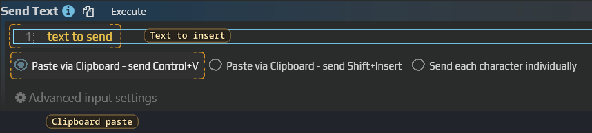

# Enter text from a legacy Send Text action

Prepared text is now entered by the **Text** step in [Send Sequence](/en/actions/sendinput/send-sequence). For example, it can put the note `Documents received. Check the attachments.` into a draft, and you submit it yourself.

The standalone **Send Text** action is legacy. What remains of it is the old WPF editor and a conversion command.

## Insert a note in your own draft

Use a test form or draft that does not submit automatically. The field you need must be open for editing. Selecting the window does not select the field inside it.

1. Add **Send Sequence** to an aura. Click **Text** in the sequence toolbar and select the new step.
2. In its **Text** field, enter `Documents received. Check the attachments.` with no quotes around it.
3. Set **Send method** to **Control+V**.
4. Open **Advanced input settings**, select the application's **Target Window** and set **Input Simulator** to **Windows Input**. Do not add Enter or other submission steps yet.
5. Put the focus in the draft field and click **Execute**. The field should contain exactly the prepared note. Check it before you submit anything.

Control+V puts the text on the system clipboard and sends the paste shortcut. The previous clipboard contents are not restored. The paste is queued as input, so the end of the text step does not yet mean the application has processed the text.

## Choose delivery

| Send method | What it sends |
| --- | --- |
| Control+V | Copies the text to the clipboard, then sends Ctrl+V. Works for fields that accept an ordinary paste |
| Shift+Insert | The same clipboard, but with Shift+Insert. Use it when the application accepts that shortcut |
| Type characters | Turns each character into a key with the right modifiers. Depends on the keyboard layout and on whether the character can be typed with keys |

**Type characters** detects the keyboard layout. It may still fail to type arbitrary mixed-language text or characters missing from the available layouts. Mixed text and Unicode are usually easier to paste from the clipboard.

The **Text** field holds text as is, not AutoHotkey commands or a C# string. `Ctrl+A`, `{Enter}` and `\n` do not turn into a shortcut, an Enter press or a line break. Type a real line break straight into the multiline field. Add a separate Enter press as key events through Keyboard. You do not need to escape backslashes, plus signs or braces.

## Convert an existing action

1. In the old Send Text, check **Text**, **Input Method**, the window and the simulator.
2. If the old editor is available, click **Convert to Send Sequence**. The new action appears **after** the old one, not in its place.
3. In the new Text step, compare the whole text and the Send method. The old **Paste via Clipboard (Ctrl+V)**, **Paste via Clipboard (Shift+Insert)** and **Send Each Character Individually** are the three options in the table.
4. Run only the new action in your test field. After checking, remove the old one from the list, or the aura will insert the text twice. If the old editor is unavailable, create Text by hand with the steps above.

[Common options](/en/actions/sendinput/options) set where and how the input is delivered. Neither paste nor character typing sends text to a background window: ordinary Windows Input works with the activated window and the current focus inside it.
