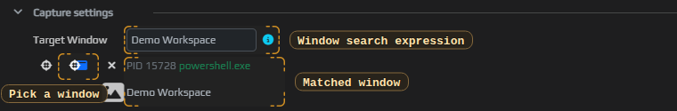

# Win Activate — bring an existing window forward

Win Activate brings a window that is already open to the foreground. For example, you can get Notepad back from under other windows without cycling through them with Alt+Tab.

Before you set this up, open Notepad and leave just one of its windows open, so there is no confusion.

## Bring Notepad to the foreground

1. Add **Win Activate** to an aura, for example in **On Enter**.
2. Open the window list in **Target Window** and select Notepad. Make sure the window shown next to the expression is the one you want.

   

3. If **Timeout** is available, set it to `1000` ms for the activation attempt.
4. Put another window over Notepad. Then go back to the action editor in EyeAuras and click **Execute** on Win Activate.

Notepad should come to the foreground. To call it with a key, add [Hotkey Is Active](/en/triggers/hotkey-is-active) to the same aura, choose an unused key and Hold mode.

## Settings

| Setting | Effect |
|---|---|
| Target Window | Chooses a window by a [window matching expression](/en/features/window-matching-expressions). To start, you can pick an existing window from the list. |
| Timeout | Time for the activation attempt, in milliseconds. It does not wait for a program to launch. |

Picking from the list may store the window handle, its temporary identifier. It changes when the program is restarted. For a lasting setup, use a title or process expression and check which windows it finds: an expression that is too broad may pick the wrong window.

Windows may not let you bring another program's window to the foreground. If the action did not work, check the selected target first. You can track whether the window exists with [Window Exists](/en/triggers/window-exists), and whether it is in the foreground with [Window Is Active](/en/triggers/window-is-active).
