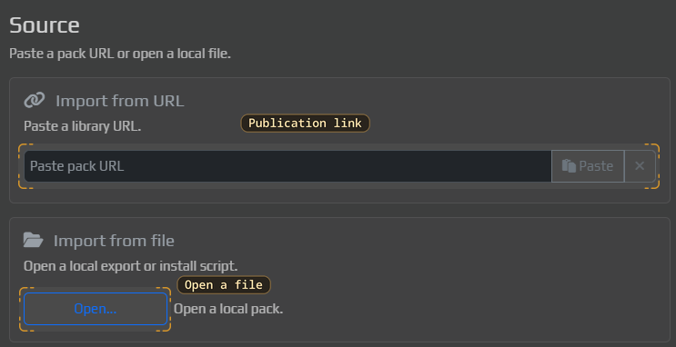

# Find a suitable pack in Aura Library

[Aura Library](https://eyeauras.net/library) on the [EyeAuras website](https://eyeauras.net/) is a catalog of packs that users have published. Find a pack for your task there and read its description first, so you do not have to build everything from scratch.

## Find and review a publication

A browser is enough to browse the library. To import, you need EyeAuras installed in a compatible version and access to the pack contents.

1. Open the [library](https://eyeauras.net/library). For example, to find learning materials, enter **Tutorial** under **by Tags** and click **Apply**.
2. If there are too many results, type words from the name or description into **Search**. Use **by User** to find packs by one author and **by Application/Game** to find packs for an application. **Reset** clears the filters.
3. Click the pack's title. Read the description and look at the author, revision and EyeAuras version. Check the requirements for windows, resolution, language, resources and external components.
4. If the pack fits, pick a way to get it from the table below.

| Library control | Purpose |
| --- | --- |
| Search | Searches the name, summary and description |
| by Application/Game / by Tags / by User | Filters by application tag, pack tag or author. The more tags you select, the narrower the result |
| Date DESC / Date ASC, Page size | Changes the order and the number of results per page |
| Pack title | Opens the publication page with its description and available actions |
| Import | Passes an `eyeauras:` link to the installed application. The browser may ask permission to open EyeAuras. This does not run the pack contents |
| Download pack | Opens the download of the prepared pack. Contents and access depend on the publication |

## Inspect the import before applying it

1. Copy the normal link from the publication page, or click **Import** on the site. If the app does not open, open **Import → Source** in EyeAuras and paste the link yourself.

   

   Paste the link into the upper Paste pack URL field. The Open… button below it opens a file you have already saved.
2. Click **Download** and look at **Preview**, **Overview** and **Pack Options**. Check the contents and the author's requirements before you click **Import**. For exported JSON already on disk, use **Source → Import from file → Open...**. You can also paste copied JSON into Source. A local file without a publication does not subscribe you to updates.
3. In **Import Options**, decide whether you want to subscribe to updates. If you already have the same items, choose **Copy**, **Replace** or skipping conflicts. Details are in [Export and Import](/en/features/export-import).
4. After the import, check your own windows, paths and external dependencies.

| Update choice | Result |
| --- | --- |
| One-time import | You keep the version you downloaded. Later author revisions do not replace it on their own |
| Subscribe to updates | The local folder is linked to its source. Updates arrive through synchronization |
| Clone locally with a subscription | Creates a copy with separate local IDs. The link to the source is kept |

A pack may depend on other auras, embedded resources, external files, a model or a separate license. A link to an external file does not install the file. Rights to run, edit and redistribute are set separately: see [Permissions](/en/features/permission-model) and [Packs](/en/features/packs).

List your own pack publicly

First [publish your pack](/en/features/export-import). Check the title, description and tags. State the required version, preparation, resolution and other conditions. Before publishing, check the contents and remove any secrets.

1. Open your publication with an account that is allowed to manage it.
2. Under **Danger Zone → Change visibility in Library**, choose **Change visibility to Public**. Now the pack can be found in the library.
3. Check that the pack can be found by your author name or by title. To undo this, use **Change visibility to Unlisted**.

| Visibility | Meaning |
| --- | --- |
| Public | The pack is visible in the public library |
| Unlisted | The pack is not in the public list. A direct link still works for people allowed to view it. This is not a password or source protection |

When you update a publication, the library shows its active revision. Copies that were already imported do not update because of that.

Do not upload someone else's work as your own. If you built on it within the permitted rights, credit the author. Upload limits are shown in the publication dialog and the service terms.

