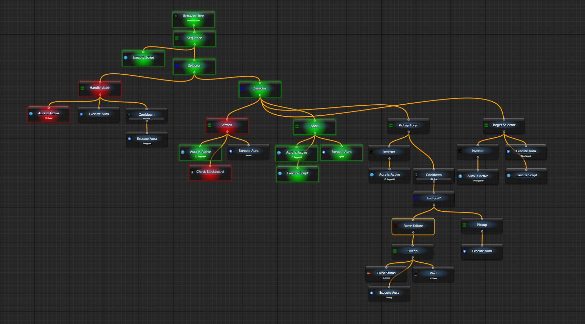
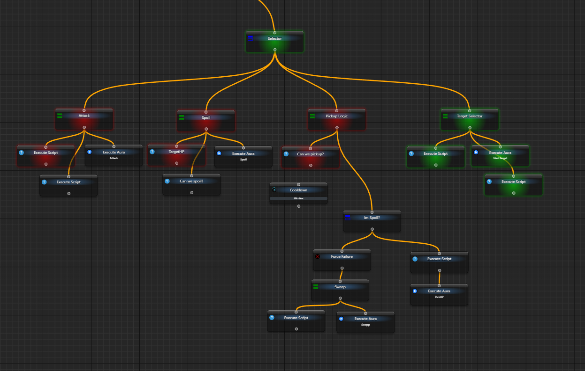

# Build and tick your first behavior tree

A behavior tree defines the order of checks and work, including which branch to take when a check fails. Start by observing a sequence, a delay and a final result, without sending input to another application.

You need EyeAuras with the behavior-tree editor available. Create a separate test tree; this example uses **Behavior Tree**, not a macro.

## Complete one controlled pass

1. In the aura tree's creation menu, select **New Behavior Tree** and open the new item. Its graph contains an entry named **My Tree**.
2. Select that entry. Enable **Activation → Is Loaded**, then set **Execution → When Activated → Do nothing**. Automatic execution is disabled; the loaded tree can still be ticked manually.
3. Use **Add new Node** to add **Sequence**, two **Fixed Status** nodes and **Wait**. Connect the entry to Sequence and Sequence to its three children. A card placed near a line is not yet connected. Arrange the children left to right as below.
4. Set both Fixed Status nodes to **General → Status → Success**. Set **Wait → General → Delay = 1500 ms**; turn randomisation off with the shuffle button if Min/Max are shown.

```text
My Tree
└─ Sequence
   ├─ Fixed Status: Success
   ├─ Wait: 1500 ms
   └─ Fixed Status: Success
```

5. Click the upper **Tick BT Once**. The first child succeeds; Wait and Sequence return **Running**. The last child has not run.
6. Wait at least two seconds, then click **the same Tick BT Once** again. Execution resumes at Wait, reaches the last child and returns **Success**.

The editor shows the last result and tick duration; [Event Viewer](/en/features/event-viewer) records manual execution. Another tick after completion starts a new pass. Earlier nodes' displayed colours can clear on the next tick without replaying their work.

| Result | Meaning |
| --- | --- |
| `Success` | This node completed successfully; its parent determines what follows. |
| `Failure` | This node completed with failure, often an unmet condition rather than a program error. |
| `Running` | Work is retained for continuation; a later tick may be required. |
| `not run yet` | No displayed result, or the display was cleared. It is not trigger `Unknown`. |

Cancellation and exceptions are separate events. Read the error or event message rather than treating every red result as an ordinary false condition. [Nodes](/en/behavior-trees/nodes) explains how parents use child results.

## Read the structure

Graph children are ordered horizontally, left to right; height alone does not set priority. An ordered tree view shows the corresponding nesting and order. [Sequence](/en/behavior-trees/nodes/sequence) requires successful steps, [Selector](/en/behavior-trees/nodes/selector) chooses the first successful alternative, and [IfThenElse](/en/behavior-trees/nodes/ifthenelse) separates one condition from its two branches.


The animation comes from [this Russian-language article](https://habr.com/ru/companies/cloud_mts/articles/306214/). Its colour legend is not an EyeAuras status legend. For broader theory, the earlier guide also provided a [behavior-tree search](https://letmegooglethat.com/?q=behavior+tree).

Aura triggers supply conditions; actions perform work. A tree gives that work an explicit route instead of requiring a growing web of **On Enter**, **While Active** and **On Exit** links. **Execute Aura** can call a configured aura's actions separately. The [dependency viewer](https://wiki.eyeauras.net/en/overlays/dependencies-viewer) remains useful for inspecting existing relationships; it is not the tree executor.

<details>
<summary>Replace the test nodes with real conditions and reactions</summary>

Once the route is clear, replace the first Fixed Status with **Aura Is Active** linked to your own tested aura, and the final node with the intended reaction. That aura could inspect your indicator through [Color Search](https://wiki.eyeauras.net/en/triggers/images/color-search) or an object through [AI Search](https://wiki.eyeauras.net/en/triggers/images/ai-search-trigger). A tree does not automatically obtain another application's HP.

The earlier tutorial assumed an already configured aura named `HP is low`:

The current picker below uses a separate benign aura, `BT signal`, with **Fixed Value → Is NOT Active**. Open **Aura Is Active → General → Links → Edit**, then select that aura. It appears highlighted in the picker and in its linked-items list. This test setup does not reproduce the historical HP or F1 workflow.


It then added **Key Press** for `F1`. This is a separate input action requiring the intended target window and delivery backend; it is not part of reading the condition.

The example used a 250 ms automatic period and an activation condition. Current groups are **Activation** and **Execution**; activation can link your own [Hotkey Is Active](https://wiki.eyeauras.net/en/triggers/hotkey-is-active) aura.

The current settings view below uses the same benign test setup. **Is Loaded** is checked and **When Activated → Do nothing** is selected. The capture shows the **Activation** and **Execution** groups and the upper **Tick BT Once** button; execution was not run for this capture.


A successful condition admitted the action; failure stopped that branch:

The current captures below use a separate benign manual example. **Sequence** has **Aura Is Active** linked to `BT signal` (must be Active), followed by **Fixed Status: Success**. With **Fixed Value → Is Active** observed on the signal, one upper **Tick BT Once** returned Success and reached the final child. No HP check or input action was reproduced.


For the second capture, a fresh equivalent tree had no previous results. `BT signal` was set to **Is NOT Active** and observed inactive before one **Tick BT Once**. The tree, Sequence and condition returned Failure; the selected final child still shows **not run yet**. Its **General → Status → Success** radio is configuration, not a result of execution.


[Cooldown](/en/behavior-trees/nodes/cooldown) before the reaction can limit its frequency, such as one execution per 10 seconds. It is a different requirement from waiting before the next step.

The separate current example below places **Fixed Status child** under **Cooldown**. Selecting the decorator shows **General → Cooldown = 10000 ms** and **Child = Fixed Status child**. This capture records placement and the interval setting only; timing and rate guarantees were not tested.


These alternatives need their own data source and input configuration. The first no-input example above needs neither. [Root](/en/behavior-trees/nodes/root) explains automatic MainTree execution and shared settings.

</details>

<details>
<summary>A larger historical configuration</summary>

The earlier Lineage 2 example combines configured aura checks and actions. It illustrates a larger decision structure, not built-in access to game data:



The other version delegates work to **Execute Script**. That requires [C# Script context and dependencies](/en/scripting/getting-started), plus the author's implementations of its checks.



</details>
