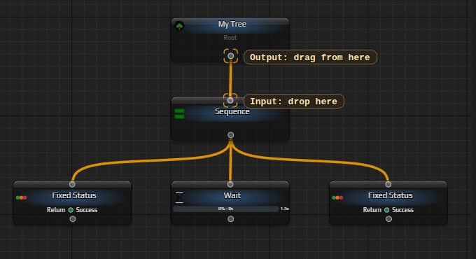
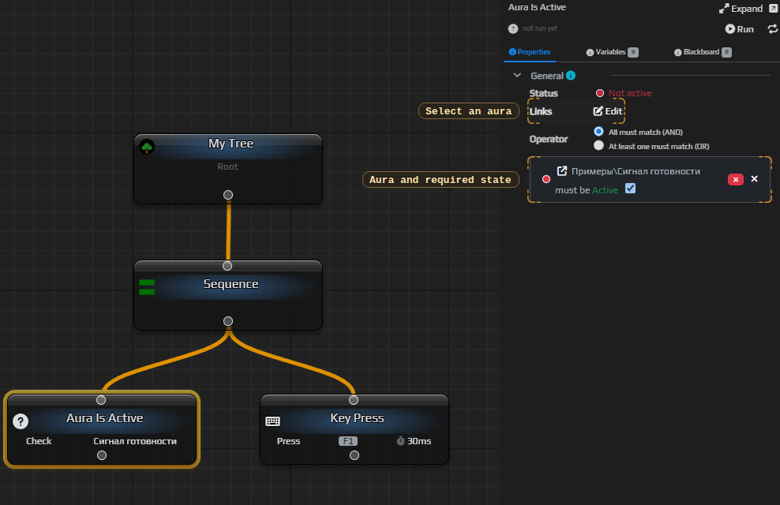
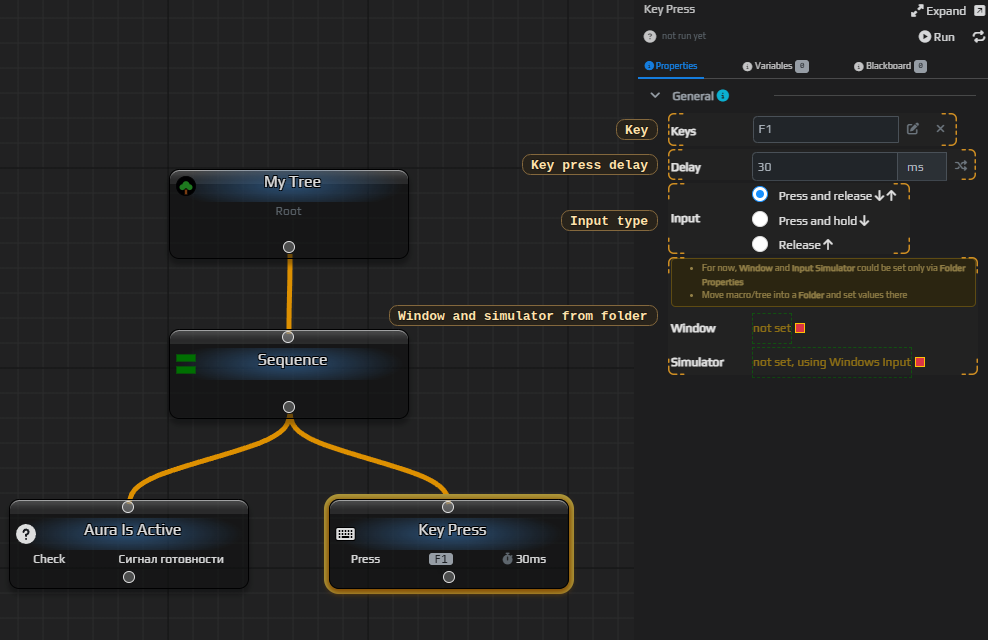
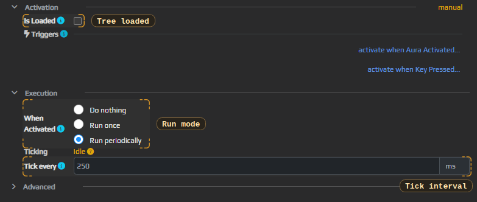
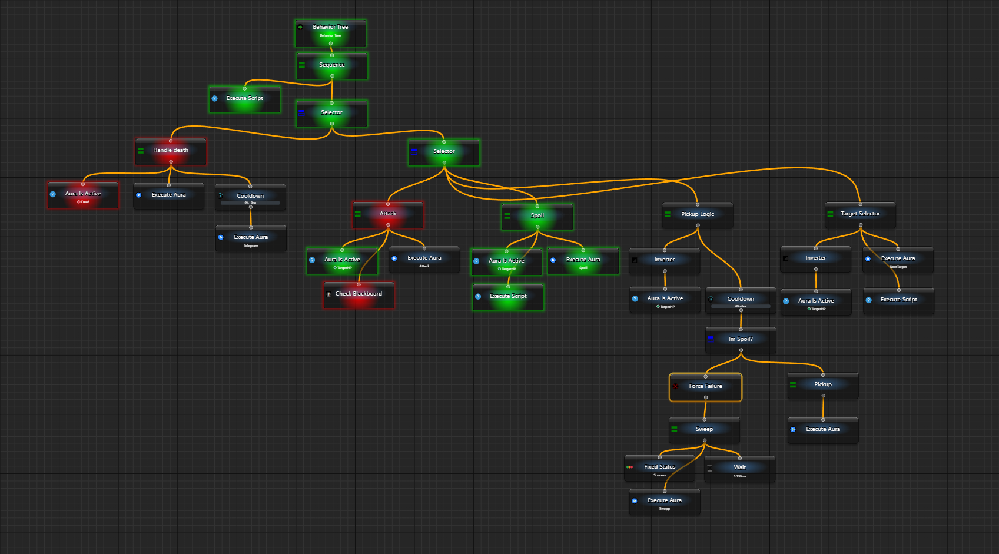
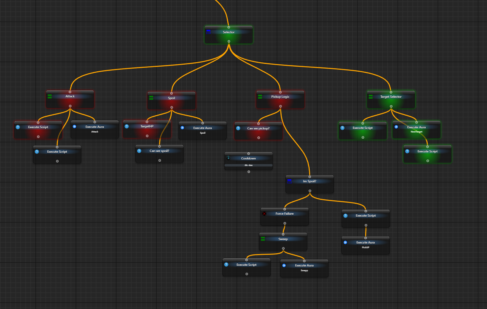

# Your first behavior tree

A behavior tree runs steps in order and stops when a condition is not met. Nodes check conditions and do the work. The links between them decide where to go next. This first example presses nothing: you just see the order of steps, a wait and the final status.

## Build it and run one pass

You need EyeAuras with the behavior-tree editor. Create a separate tree. A macro will not work for this example, it has to be a **Behavior Tree**.

1. In the aura tree's creation menu, select **New Behavior Tree** and open the new item. Its graph contains an entry named **My Tree**.
2. Select that entry. Enable **Activation → Is Loaded**, then set **Execution → When Activated → Do nothing**. Now the tree does not start on its own, but you can tick it manually.
3. Use **Add new Node** to add **Sequence**, two **Fixed Status** nodes and **Wait**. You can also drag them from the node palette onto the graph.

   

   New nodes do not run until you connect them. Connect the entry to Sequence, then Sequence to its three children. Arrange the children left to right, as in the diagram below.

   

4. Set both Fixed Status nodes to **General → Status → Success**. Set **Wait → General → Delay = 1500 ms**. If randomisation is on and you see Min/Max, turn it off with the shuffle button.

```text
My Tree
└─ Sequence
   ├─ Fixed Status: Success
   ├─ Wait: 1500 ms
   └─ Fixed Status: Success
```

5. Click the upper **Tick BT Once**. The first Fixed Status succeeds, and Wait and Sequence return **Running**. The last node has not run yet.
6. Wait at least two seconds, then click **the same Tick BT Once** again. The tree continues from Wait, reaches the last node and returns **Success**.

The editor shows the last result and how long the tick took. [Event Viewer](/en/features/event-viewer) records the manual run. Another tick after the tree has finished starts a new pass. On a new tick, the colour of a node that already ran can clear.

| Result | Meaning |
| --- | --- |
| `Success` | The node finished its task successfully. |
| `Failure` | The condition was not met, or the node finished its task with this result. |
| `Running` | The node is still working. It may need another tick to finish. |
| `not run yet` | No result yet. |

Red does not always mean a condition was not met, so read the error message. [Nodes](/en/behavior-trees/nodes) explains how parents use the results of their children.

## How to read a tree

Children run left to right. Vertical position does not affect the order. An ordered tree view shows the same nesting and order. [Sequence](/en/behavior-trees/nodes/sequence) goes through all the successful steps, [Selector](/en/behavior-trees/nodes/selector) picks the first option that succeeds, and [IfThenElse](/en/behavior-trees/nodes/ifthenelse) separates one condition from its two branches.


The animation comes from [this Russian-language article](https://habr.com/ru/companies/cloud_mts/articles/306214/).

A tree does not need the **On Enter**, **While Active** and **On Exit** links of your auras. It sets the order of nodes itself. If you need the actions of an aura you have already set up, call them with **Execute Aura**. This way one clear sequence replaces a tangled web of links. The [dependency viewer](https://wiki.eyeauras.net/en/overlays/dependencies-viewer) is still handy for looking at existing links.

<details>
<summary>Connect a real condition and a real action</summary>

Once the order is clear, replace the first Fixed Status with **Aura Is Active** linked to your own tested aura, and the last node with the reaction you need. A typical example: an aura named `HP is low` is the condition, and **Key Press** with F1 is the reaction. The aura does the checking itself. For example, it looks for the colour of an indicator through [Color Search](https://wiki.eyeauras.net/en/triggers/images/color-search) or for an object through [AI Search](https://wiki.eyeauras.net/en/triggers/images/ai-search-trigger).



To pick the aura, open **Aura Is Active → General → Links → Edit**.


The reaction comes after the aura check, for example **Key Press** with F1. Before you run such a node, set the window and the input simulator in the folder.



For the tree to start on its own, set up the **Activation** and **Execution** groups on the entry, for example a 250 ms period. You can link activation to your own [Hotkey Is Active](https://wiki.eyeauras.net/en/triggers/hotkey-is-active) aura.



And these are the settings of the test example with a manual start: **Is Loaded** is checked and **When Activated → Do nothing** is selected.


In the test example, **Sequence** has two children: **Aura Is Active** linked to `BT signal` (must be Active) and **Fixed Status: Success**. The signal is set to **Fixed Value → Is Active**, so the aura is Active. One **Tick BT Once** reached the last child and returned Success.


Now the same tree built from scratch, with no previous results. `BT signal` is set to **Is NOT Active**. After one **Tick BT Once** the tree, Sequence and the condition returned Failure, and the last child still shows **not run yet**.


To keep the reaction from firing too often, put [Cooldown](/en/behavior-trees/nodes/cooldown) before it, for example no more than once per 10 seconds.


[Root](/en/behavior-trees/nodes/root) explains automatic MainTree execution and shared settings.

</details>

<details>
<summary>What a large configuration looks like</summary>

This old Lineage 2 tree combined aura checks and action calls. It shows how big a tree can get.



In the other version, part of the work is moved to **Execute Script**. For that you need the [basics of C# scripts](/en/scripting/getting-started) and your own checks in code.



</details>
