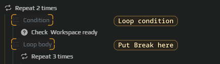

# Break — leave a macro loop or block

`Break` leaves a loop or block in a macro early. Put it in Loop body when you already have the result and the remaining iterations are not needed. After leaving Repeat, the macro goes on to the next step. If Break sits in a separately nested Block, it leaves only that Block.

## End Repeat on its first iteration

Create your own [macro](/en/macros/getting-started) with `Activation → Is Loaded` and `Execution → When Activated → Do nothing`.

1. Add `Repeat` to the initial Block, and a `Fixed Status` after it. Set that Fixed Status to `General → Status → Success`.
2. On Repeat choose `General → When Activated → Run N times`, `Repeat = 5`, `Delay = 0 ms`, randomization off. Repeat already contains the blocks `Condition` and `Loop body`.
3. Add a Fixed Status with Success and drag it into Condition. In Loop body, put these in order: `Wait` with `Delay = 500 ms`, `Break`, then a Fixed Status with Failure. Before you run it, check that the nodes sit in the right blocks.

   

```text
My Macro
└─ Block
   ├─ Repeat: 5 times
   │  ├─ Condition
   │  │  └─ Fixed Status: Success
   │  └─ Loop body
   │     ├─ Wait: 500 ms
   │     ├─ Break
   │     └─ Fixed Status: Failure
   └─ Fixed Status: Success
```

4. Click the upper `Run Macro Once`. One wait passes, then Break ends Repeat without waiting for the next iteration. The Fixed Status after Break does not run, but the last Fixed Status **after Repeat** does. The macro ends with Success. Repeat returns Success when it finishes normally.

| Placement or setting | Effect |
| --- | --- |
| Macro category | Break is available in a macro. It is not an ordinary BT decorator |
| Loop body → Break | The rest of the body and the later iterations are skipped. Execution continues after Repeat |
| IfThenElse inside Loop body | Break in the chosen branch passes through the branch's own block up to Repeat |
| Separately nested Block → Break | The rest of that Block is skipped. The loop or outer block around it can keep working |
| Break settings | You cannot choose a result. An ordinary Break exit returns Success |
| Children of Break | Not run as a continuation. Put the next step after the relevant Block or Repeat |

To leave on a condition, add a macro IfThenElse to Loop body. Put your check in Condition and Break in If matched, then. The condition can be [Aura Is Active](/en/behavior-trees/nodes/aura-is-active) linked to your aura.

<details>
<summary>Where Break stops and what it does not do</summary>

A sketch of a conditional exit. The action and condition names are placeholders:

```
Repeat (up to 5 times)
├── SomeAction
├── IfThenElse
│   ├── Condition: Enemy found
│   ├── If yes: Break
│   └── If no: (nothing)
└── Another action
```

Do not put Break in Repeat's Condition. It will not stop the loop there. The check block catches the exit itself, and its Success can let the next iteration in. Put Break in Loop body.

Break works only when execution reaches it. It will not interrupt an earlier stuck step, roll back actions or release held keys.

To end the whole current macro, use [Return](/en/behavior-trees/nodes/Return).

</details>
