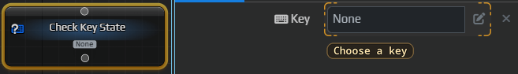

# Check Key State — check whether a key is held

`Check Key State` checks whether a key is down right now. Use it when a branch should run only while a key is held. It does not intercept input and does not remember a brief press between ticks.

## Check a key without sending input

Create your own [tree](/en/behavior-trees/gettings-started) with `Activation → Is Loaded` and `Execution → When Activated → Do nothing`. F8 works for the example if nothing is assigned to it in your window.

1. Use `Add new Node` to add `Sequence`, `Check Key State` and `Fixed Status`. Connect them left to right as below.
2. Set the check's `General → Key` to `F8`. Set Fixed Status to `General → Status → Success`.

```text
My Tree
└─ Sequence
   ├─ Check Key State: F8
   └─ Fixed Status: Success
```

3. Release F8 and click the upper `Tick BT Once`. The check and Sequence return `Failure`, and the last node does not run.
4. Hold F8 and click the same button with the mouse. The check returns `Success` and Sequence reaches Fixed Status. Then release the key.



| Setting or state | What is checked |
| --- | --- |
| Key | The main keyboard key. You cannot select the mouse or the wheel here |
| Key down | Success, if the node has no child |
| Key up or no key selected | Failure |
| Combination with Ctrl, Alt or Shift | Only the main key is checked, not the whole combination with modifiers |

The node reads the key state through the standard keyboard mechanism. The tree's Target Window and Input Simulator do not affect it. If you need a full hotkey with hold and toggle modes, make a separate [Hotkey Is Active](/en/triggers/hotkey-is-active) aura and check it through [Aura Is Active](/en/behavior-trees/nodes/aura-is-active).

<details>
<summary>Continuation and macros</summary>

A sketch of a check before work. `Hotkey` is the old name of the Key field, and the last name is a placeholder for your own work:

```
Sequence
├── CheckKeyState (Hotkey = F1)
├── DoSomethingWhileF1Pressed
```

You can connect a child to the check. It is called after Success, and its result becomes the result of the node. If the child returns Running, the next tick continues it and does not check the key again. So releasing the key will not stop the work on its own. That needs a separate way to interrupt.

The template is the same in BT and Macro. In a tree, Sequence stops when the check returns Failure. In a macro, an ordinary Block can run the following siblings even after Failure. To make work depend on the condition, put it in the check's child branch or in a suitable macro control node.

</details>
