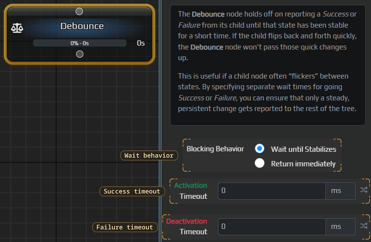

# Debounce — filter brief changes in a check

`Debounce` smooths out a check that flickers between `Success` and `Failure`. It passes the child's result on only after it has held for a set time. The time is set separately for Success and for Failure. What the parent sees while the wait is on depends on the `Behavior` mode.

## See the delay in both directions

Create your own tree with `Activation → Is Loaded` and `Execution → When Activated → Do nothing`, as in [Getting Started](/en/behavior-trees/gettings-started). Connect one Fixed Status to Debounce. You will switch the condition with it by hand, without an external sensor.

1. Add `Debounce` and `Fixed Status`. Connect the tree entry → Debounce → Fixed Status.
2. Set the child to `General → Status → Success`. On Debounce choose `General → Behavior → Wait until Stabilizes`, then set `Activation Timeout = 2000 ms` and `Deactivation Timeout = 3000 ms`. Turn randomization off for both.
3. Click the upper `Tick BT Once`. The child returns Success, and Debounce returns `Running`. Wait at least three seconds and tick again: Debounce returns `Success`.
4. Change the child to `Failure` and tick: Debounce returns Running again. Wait at least four seconds and tick again: the result becomes `Failure`.

In the screenshot the group is still called `Blocking Behavior`. Now it is `Behavior`.

| Setting | Effect |
| --- | --- |
| Behavior — Wait until Stabilizes | Until the time for the current Success or Failure is up, the node returns Running. Only this branch waits, auras do not stop |
| Behavior — Return immediately | Until the time is up, the node returns the opposite result. After that, the child's current result |
| Activation Timeout | Delay for Success, in milliseconds |
| Deactivation Timeout | Delay for Failure, in milliseconds |
| Random Min / Max | The value is picked once, at the start of the interval, not on every tick |
| Child | One child to check |

To smooth the state of an indicator you have already set up, connect [Aura Is Active](/en/behavior-trees/nodes/aura-is-active) as the child and link its aura. If you need a plain pause before the next step, use [Wait](/en/behavior-trees/nodes/wait). If you need a break after successful work, use [Cooldown](/en/behavior-trees/nodes/cooldown).

## What Return immediately means

In this mode the parent gets an answer right away and can move on. The node does not keep a "last confirmed state":

| Child result | Debounce result in Return immediately |
| --- | --- |
| Success, Activation still pending | Failure |
| Success, Activation elapsed | Success |
| Failure, Deactivation still pending | Success |
| Failure, Deactivation elapsed | Failure |
| Running | Running in either mode |

How the time is counted

The first Success starts the Activation countdown and clears Deactivation. The first Failure does the reverse. If the result repeats, the countdown that has started keeps going. With a zero interval the result passes right away.

Debounce does not watch the child between ticks. It will not notice a brief flicker that falls between two ticks. Running is passed on right away and does not clear the countdown: time keeps going.

If you change the duration during a countdown, the current interval is not recalculated. The new value applies the next time the countdown starts. A structural reset clears both timers. Clearing the colour and the last status does not. Without a child, the node works as if it got Success.

