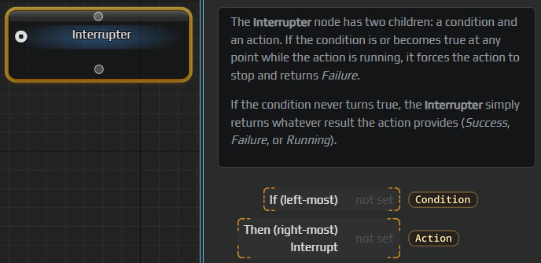

# Interrupter — stop a branch when a condition succeeds

`Interrupter` stops a branch when a separate check returns `Success`. It checks the condition first and lets the action run only if the condition did not fire. When it interrupts, it waits for the current work to finish, resets the state of its action and returns `Failure`.

## Interrupt a wait and start it again

You need your own tree with `Activation → Is Loaded` and `Execution → When Activated → Do nothing`. [Getting Started](/en/behavior-trees/gettings-started) shows how to make one.

1. Add `Interrupter`, `Fixed Status` and `Wait`. Connect the entry to Interrupter, then connect two children: Fixed Status on the **left**, Wait on the **right**.
2. Set Fixed Status to `General → Status → Failure`. Set Wait to `General → Delay = 5000 ms`, randomization off. In Interrupter's settings check the `General → If` and `Action` fields: the first must name Fixed Status, the second Wait.

```text
My Tree
└─ Interrupter
   ├─ If: Fixed Status — Failure
   └─ Action: Wait — 5000 ms
```

In the screenshot the `Action` field is still called Then Interrupt.



3. Click the upper `Tick BT Once`. The condition returns Failure and lets Wait run, and Wait returns `Running`. Interrupter returns Running too.
4. Set the condition to `Success` and tick again. Interrupter returns `Failure`, does not continue Wait and resets its countdown.
5. Set the condition back to `Failure` and tick. Wait starts a **full five seconds** again and returns Running. When this new interval is over, the next tick finishes with Success.

In this example the wait is interrupted **on the next tick**. Wait returns Running right away, so nothing checks the condition between manual ticks.

| Field or condition | Behavior |
| --- | --- |
| If | First enabled child, ordered by horizontal position. The interruption condition |
| Action | Second enabled child, the part that can be interrupted. For several steps, connect a Sequence |
| Initial If Success | Action is not called, its state is reset, Interrupter returns Failure |
| Initial If Running | Action is not called. The result is Running, with no interruption and no reset |
| Initial If Failure | Action runs |
| Action finishes its tick without interruption | Its Success, Failure or Running is returned |

For a real stop signal, put [Aura Is Active](/en/behavior-trees/nodes/aura-is-active) in **If**, link it to your condition aura and choose the expected state Active. You can connect a ready chain of actions as **Action** through [Run Aura](/en/behavior-trees/nodes/execute-aura).

## While the action call is still running

If Action is waiting for asynchronous work, Interrupter keeps checking If. It does this one check at a time, with a **100 ms pause between completed checks**. Success requests cancellation of Action. On Failure and Running the action keeps running. Keep the condition short: its side effects repeat on every check.

Interrupter waits for both the action and any check that has already started. A Success received while monitoring was still on is an interruption. A result that comes later does not change the outcome of the action. Cancellation is cooperative: code that ignores it cannot be stopped instantly. Actions that have already been done are not rolled back.

<details>
<summary>Reset, errors and links to other trees</summary>

The reset goes through all children of Action, including disabled ones. It clears the current step of composite nodes, timers and retained script iterators (with Dispose/finally). The graph, script project, blackboard and session stay. After an ordinary Running without interruption the state is kept, so the work can continue.

A tree that a SubTree links to does not become Interrupter's own just because of the link. The same goes for the state of third-party nodes.

After a reset error, the remaining children may not get cleared. If Action is not connected, Interrupter returns the If result directly. For normal work you need both children. If you disable one, their positions change.

The same mechanism as a sketch with mana. You need your own source for the condition and an action that responds to cancellation:

```
Interrupter
├── Condition: Mana drops below 10%
└── Action: Cast Meditate
```

</details>
