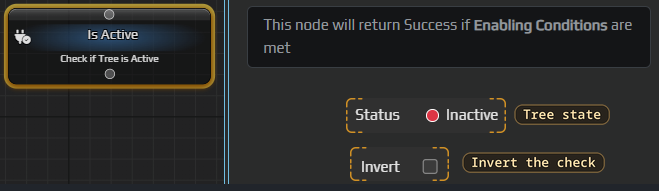

# Is Active — check activation of your own tree

`Is Active` checks whether the tree or macro it sits in is active right now. It looks at the state of the root of **this** tree. To check another aura, use [Aura Is Active](/en/behavior-trees/nodes/aura-is-active).

## Gate a step with your own switch

Create a loaded aura named `BT enabled` with one [Fixed Value](/en/triggers/fixed-value) and no actions. Select `Is NOT Active`. In a separate tree keep `Activation → Is Loaded` and `Execution → When Activated → Do nothing`.

1. At the tree entry, open `Activation → activate when Aura Activated...`. Under `Enabling Condition → Links`, select `BT enabled`. The expected state of the link is Active.
2. Add `Sequence`, `Is Active` and `Fixed Status` and connect them as below. Set Fixed Status to `General → Status → Success` and leave `General → Invert` off on Is Active.

```text
My Tree
└─ Sequence
   ├─ Is Active
   └─ Fixed Status: Success
```

3. Click the upper `Tick BT Once`. A loaded tree can be ticked manually even when its activation condition is not met. Is Active returns `Failure` and the last step does not run.
4. In your aura select `Is Active`. Wait for the link state to update, then go back to the tree. The node's `General → Status` shows Active. A new tick reaches the last Fixed Status and returns Success.
5. Enable `Invert`. The result of the check is now reversed. The root is still active, so the next tick returns Failure.



| Setting or root state | Check result without a child |
| --- | --- |
| Invert off, root active | Success |
| Invert off, root inactive | Failure |
| Invert on, root active | Failure |
| Invert on, root inactive | Success |
| Status | The state of the check after Invert is applied. It is not the last NodeStatus of a run |

`Is Loaded`, activation and automatic ticks are different things. A root without conditions or triggers has the state `manual`. For this check it is inactive, even though you can tick it manually. `Do nothing` turns off automatic execution, but it does not make a met activation condition false. Pause and loading conditions also affect the root state. See [Root](/en/behavior-trees/nodes/root).

## Where this check actually stops work

In a Sequence the check works only when execution **reaches it**. If a later child of Sequence returns Running, the next tick continues from that child and does not run Is Active again.

Is Active can have a child of its own. It runs if the check succeeds. While it returns Running, activation is not checked again. So work is not interrupted the instant the tree is deactivated.

In this older sketch `CheckIsActive` is the current `Is Active` template and `DoSomething` is your own work:

```
Sequence
 ├── CheckIsActive (Invert = false)   ← Checks that the tree is active
 ├── DoSomething                      ← Executes if the tree is active
```

The `Is Active` template exists in both trees and macros, but its surroundings differ. In a macro, Failure in an ordinary Block does not necessarily skip the following siblings. To end the whole macro you need the macro's own control flow, not just Is Active in the list of steps. If the node is not linked to a valid root and the state is unknown, the check returns Failure. Invert does not turn an unknown state into confirmed inactivity.
