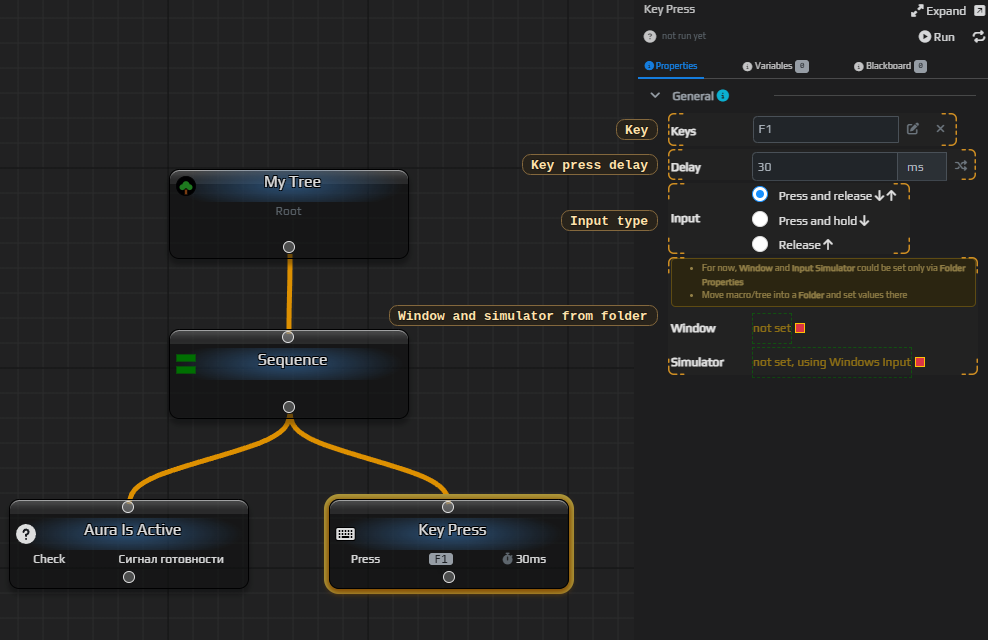

# Key Press — send one gesture to your own window

`Key Press` sends a key, a combination with modifiers, a mouse button or a supported wheel event. In the example below it selects text with one combination.

## Select text in your own draft

Open a local text editor in a separate window, with a draft that has no secrets in it. Type two lines and click in the text so the caret is there. Do not use a chat, a submission form or a command prompt for this example.

1. Create a separate folder and put your tree in it. In the folder's `Triggers/Actions/Overlays Defaults`, enable `Target Window` and choose exactly the draft window. Through `show more...`, enable `Input Simulator` and select `Windows Input`.
2. At the tree entry keep `Activation → Is Loaded` and `Execution → When Activated → Do nothing`. Check the [default properties](/en/features/default-properties): the tree's local `Settings` must not set a different window or input backend.
3. Add `Key Press` and connect it to the entry. Choose `General → Keys → Ctrl+A`, `Delay = 30 ms`, randomization off, and `Input → Press and release`.
4. At the bottom of the same group check the read-only `Window` and `Simulator` fields. They must show the draft window and Windows Input. Do not run the example if you see `not set`, `not found` or another window.
5. Click the upper `Tick BT Once` once. Windows Input brings the selected window to the front and sends the combination. The text in the editor becomes selected and the node finishes with Success. Before you repeat, make sure the window is still the same.



| Setting | Effect |
| --- | --- |
| Keys | One main key with the modifiers Ctrl, Alt, Shift. You can also choose a mouse button or the wheel. A long sequence does not fit here |
| Delay | Pause after each keyboard event that is sent. A normal Press has two: Down and Up. This is not a repeat period for the whole node |
| Random Min / Max | Pauses are picked at random between the two limits instead of one value |
| Input — Press and release | Press and release the main key. The selected modifiers are pressed and released too |
| Input — Press and hold | Send Down and leave the key and modifiers held |
| Input — Release | Send Up for the main key and modifiers |
| Window / Simulator | Show the inherited window and input backend. They cannot be edited on the node itself |

For the wheel, the Input group is hidden: the node sends a scroll in the chosen direction. Not every input backend supports the mouse and the wheel. For example, Windows Message API cannot scroll. A selected Target Window does not mean input always reaches a background window, because input methods work differently. See [input options](/en/actions/sendinput/options).

<details>
<summary>Holding, cancellation and several steps</summary>

To hold a key for a set time you need three steps with the same Keys, window and backend: `Press and hold → Wait → Release`. Delay inside Key Press does not set the hold duration. If the run stops before Release, that step does not happen. Stop, cancellation or disposing the object will not release the keys by themselves, so plan the release in your own tree. Even if a Press is interrupted between its events, some of the events have already been sent.

Build a longer sequence from several Key Press nodes in a [Sequence](/en/behavior-trees/nodes/sequence). Another way is [Run Aura](/en/behavior-trees/nodes/execute-aura) with a ready [Send Sequence](/en/actions/sendinput/send-sequence) action. To type text straight from a node, use [Send Text](/en/behavior-trees/nodes/SendText).

An older example. `Key Press Delay` is now `Delay`, and `Input Type` is now `Input`:

```
KeyPress

Keys: Ctrl + V
Key Press Delay: 30 ms
Input Type: Press and release
```

After a successful press, Key Press can run a connected child and return its result. If the child returns Running, the next tick continues it and does not press the key again. The template is the same in Macro, but there the macro sets the order of the next steps, not a BT Sequence. Success only means the input was sent. Look at the target window to see whether it worked.

</details>
