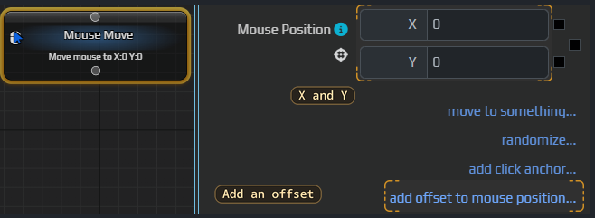
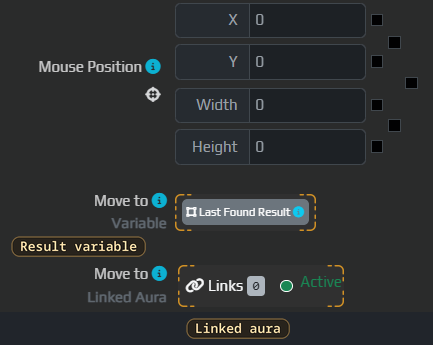
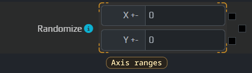
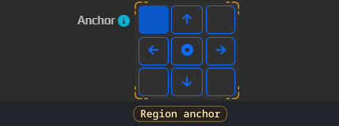
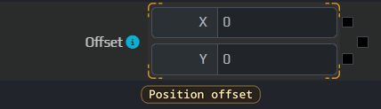

# Mouse Move — go to a specified point

`Mouse Move` puts the pointer at a set point. "Absolute" here means "to a specific point", not "this far from the current position". Where the coordinates are counted from depends on the window and the input backend. The node only moves the pointer. It does not click.

## Move to a point in your own window

Open your own text-editor window. Make it large enough: the point X=200, Y=150 from the top-left corner of the visible frame must lie inside the window.

1. Put a separate tree in your own folder. In the folder's `Triggers/Actions/Overlays Defaults`, enable `Target Window` and choose your window. Through `show more...`, enable `Input Simulator → Windows Input`. Do not set a different window in the tree's Settings.
2. At the tree entry keep `Activation → Is Loaded`, `Execution → When Activated → Do nothing`. Add `Mouse Move` and connect it to the entry.
3. Set `General → Mouse Position → X = 200`, `Y = 150`. Use a new node with no links, with randomization and offset at zero. At the bottom of the group check `Window` and `Simulator`: they must show your window and Windows Input.
4. Click the upper `Tick BT Once` once. The window comes to the front and the pointer moves to the set point inside it. There is no click. If everything went normally, the node returns Success.

| Setting | Purpose |
| --- | --- |
| Mouse Position — X / Y | The source point. If a region is set, Width / Height appear too |
| Crosshair button | Pick a point right on the screen, taking the current window into account |
| Window / Simulator | The inherited window and input backend. Check them before you run |
| Input Smoother | If set in the shared properties, the movement follows the chosen [smoothing](/en/actions/sendinput/mouseinputsmoothing) algorithm |

In the example, Windows Input adds the position of the window frame on the screen (`DwmFrameBounds`) to X/Y. This is the window frame, **not the origin of its client area**. Without a window the coordinates would be screen coordinates. The point X=0, Y=0 counts as empty here, and the pointer does not move.

Windows Message API works differently. It sends the window messages with client-area coordinates and does not move the real system pointer the way Windows Input does. Do not carry numbers from one method to the other without checking the [coordinate system](/en/features/coordinate-system).

Move to a found region or a linked source

Click `move to something...` to open the X/Y/Width/Height region and the sources:

| Choice | Where the position comes from |
| --- | --- |
| Move to — Variable → Last Found Result | From the variable with the last found region in the tree's context. The right search must run first |
| Move to — Linked Aura → Links | From the region given by a linked aura with a configured source, such as Image Search |
| Property binding indicator | From your own coordinate or region [binding](/en/features/bindings) |
| Unlink / Unbind | Removes the current link. Do this before going back to fixed coordinates |

For **Linked Aura**, first set up and test your own [Image Search](/en/triggers/images/image-search) aura. In a [Sequence](/en/behavior-trees/nodes/sequence), put [Aura Is Active](/en/behavior-trees/nodes/aura-is-active) before Mouse Move, linked to the same aura with the expected state Active. Then the pointer moves only if the search condition is met.

The search region must belong to the same window and the same coordinate system. First check the found bounds, the capture region and the processing scale, and only then connect the movement. Do not add the window position to coordinates that are already screen coordinates.

Randomization, anchor and offset

| Group | Effect |
| --- | --- |
| randomize... → Randomize — X ± / Y ± | The final point shifts at random within the range on each axis. Zeros turn it off |
| add click anchor... → Anchor | A point inside the source region: the center, a corner or an edge. Despite the button name, no click is added |
| add offset to mouse position... → Offset | Extra X/Y added to the calculated position. Region mode also has size offsets |

The point is first calculated from the region, the anchor and Offset, then Randomize is added. After a successful move a connected child can run. If it returns Running, the next tick continues it and does not move the pointer again. To move from the current position, use [Mouse Move Rel.](/en/behavior-trees/nodes/MouseMoveRel).

