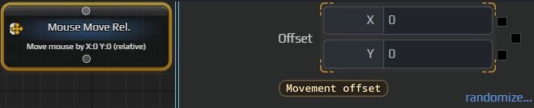
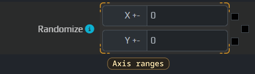

# Mouse Move Rel. — move by an offset

`Mouse Move Rel.` shifts the pointer by a set distance from where it is now. Each new call shifts it again. Absolute [Mouse Move](/en/behavior-trees/nodes/MouseMoveAbs), by contrast, sets the point anew every time.

## Set a start point, then move right

Open your own text-editor window with enough free room in it. Put the tree in a folder whose `Triggers/Actions/Overlays Defaults` has `Target Window` set to that window and, through `show more...`, `Input Simulator → Windows Input`. Check that the tree's Settings do not set a different window.

1. At the entry set `Activation → Is Loaded`, `Execution → When Activated → Do nothing`. Add `Sequence`, `Mouse Move` and `Mouse Move Rel.`, and connect Sequence's children left to right.
2. Set Mouse Move's `General → Mouse Position → X = 200`, `Y = 150`. This point is counted from the visible frame and must lie inside your window. Set Mouse Move Rel.'s `General → Offset → X = 40`, `Y = 0`. Leave Randomize at zero on both.
3. Check `Window` and `Simulator` on both nodes: the same window of yours and Windows Input. The tree must not contain nodes that press anything.

```text
My Tree
└─ Sequence
   ├─ Mouse Move: X=200, Y=150
   └─ Mouse Move Rel.: X=40, Y=0
```

4. Click the upper `Tick BT Once` once. The window comes to the front. The pointer first goes to the set point, then gets a command to shift right. There is no click. [Event Viewer](/en/features/event-viewer) shows the move requests `To` and `By`, and Sequence returns Success after a normal finish.

The real length of the shift depends on the input backend and the system mouse settings, so it is not necessarily exactly 40 physical pixels.



| Setting | Effect |
| --- | --- |
| Offset — X | Horizontal shift: positive is right, negative is left |
| Offset — Y | Vertical shift: positive is down, negative is up |
| randomize... → Randomize — X ± / Y ± | Adds a random part to the shift. With zeros the shift is always the same |
| Window / Simulator | The inherited window and input backend. With Windows Input the system pointer moves |



With Windows Message API, relative movement is counted from the last position sent to **that window** through the same backend, not from the system pointer. So first make an absolute move through the same backend to the same window. It sends a window message, and the application has to support it.

You cannot choose a smoothing algorithm on this node. If you need a configurable path, use absolute Mouse Move. After a successful shift the node can run its child and return the child's result. If the child returns Running, the next tick continues it without a new shift. The template is shared by BT and Macro.
