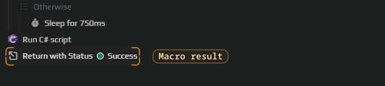

# Return — finish a macro with a chosen result

`Return` ends the current macro and skips the remaining steps. It returns Success or Failure to whoever called the macro. Unlike [Break](/en/behavior-trees/nodes/Break), it leaves the whole macro, not just a nested Block or Repeat.

## Finish before the final wait

Create a separate [macro](/en/macros/getting-started) with `Activation → Is Loaded` and `Execution → When Activated → Do nothing`.

1. In the initial Block add, in order, `Wait`, `Return`, another `Wait` and `Fixed Status`.
2. Set the first Wait's `General → Delay = 500 ms` and the second to `5000 ms`, randomization off. Set Fixed Status to Failure. On Return choose `General → Return → Success`.

   

```text
My Macro
└─ Block
   ├─ Wait: 500 ms
   ├─ Return: Success
   ├─ Wait: 5000 ms
   └─ Fixed Status: Failure
```

3. Click the upper `Run Macro Once`. The first wait passes and the macro finishes with Success. The five-second wait and the last Fixed Status do not run.
4. Set Return to `Failure` and run again. The same steps are skipped, but now the macro result is Failure.

| Setting or boundary | Effect |
| --- | --- |
| General → Return → Success | Finish the macro successfully |
| General → Return → Failure | Finish the macro with Failure |
| Macro category | The node is available in macros. It is not an ordinary BT node |
| Inside Block, an IfThenElse branch or Repeat | The exit passes through these constructs to the macro boundary |
| Macro called through Run Macro | The called macro ends. The caller gets its result and follows its own rules |
| Return children | Not run after the exit. Put the caller's next steps after its Run Macro node |

For example, if the called macro returns Success, a BT Sequence goes on to the next step, and on Failure it stops. An ordinary Block in a calling macro, however, can run the following siblings even after Failure.

## Return only when a condition matches

To leave only on a condition, use a macro IfThenElse. Put your check in Condition and Return with the result you need in If matched, then. For example, [Aura Is Active](/en/behavior-trees/nodes/aura-is-active) can read your Fixed Value aura. A sketch:

```text
IfThenElse
├── Condition: No mana
├── If yes: Return (Result = Failure)
└── If no: Continue with other actions
```

Return works only when execution reaches it. What is already done is not rolled back, separately started work is not cancelled, and a held key is not released by itself.
