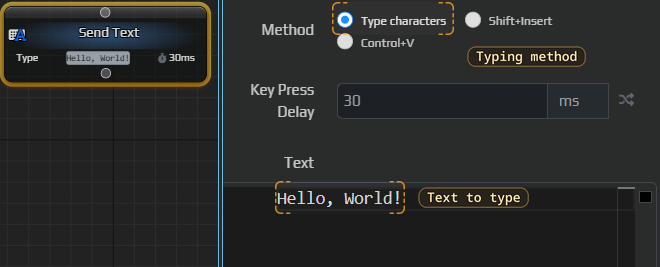

# Send Text — type a string into your own draft

`Send Text` enters a string into a window. It either types it key by key, or puts it on the clipboard and sends a paste combination.

## Type a line without clipboard paste

Open a local text editor in a separate window, with an empty draft that has no secrets in it. Click in the text and make sure the caret is visible. The string `alpha beta` needs an installed English keyboard layout.

1. Put a separate tree in a folder. In `Triggers/Actions/Overlays Defaults`, enable `Target Window` with the draft window, and through `show more...` enable `Input Simulator → Windows Input`. The tree's Settings must not set a different window.
2. At the entry keep `Activation → Is Loaded`, `Execution → When Activated → Do nothing`. Add `Send Text` and connect it to the entry.
3. Choose `General → Method → Type characters`, enter `alpha beta` without quotes in `Text`, and set `Delay = 30 ms`, randomization off.
4. Check `Window` and `Simulator`. Click the upper `Tick BT Once` once. Windows Input activates the selected window, and `alpha beta` appears in the draft. If everything went normally, the node returns Success.

In the screenshot the `Delay` field is still called `Key Press Delay`:

[Full Send Text node panel](https://s3.eyeauras.net/media/2025/08/EyeAuras_ea1jBx1plw.png).

| Setting | Effect |
| --- | --- |
| Text | The string to enter. It is plain text, not a C# string: quotes and a backslash followed by n stay as text |
| Method — Type characters | Types the characters with keys. The layout is detected automatically. Unsupported characters or a mix of layouts may fail to type |
| Method — Shift+Insert | Puts Text on the clipboard and queues a paste with Shift+Insert. Ctrl is not added to the combination |
| Method — Control+V | Puts Text on the clipboard and queues Ctrl+V |
| Delay | Pause after each keyboard event. It is not the interval between whole characters or the time until the whole string appears |
| Random Min / Max | Random pauses within the set limits instead of one value |
| Window / Simulator | The inherited window and input backend. Windows Input activates the selected window |

To go to a new line, put a real line break in the Text field. In Type characters mode it becomes a press of the newline key. In another application that key can run a command, so try it in your own text draft first.

## Paste a whole string

If the text cannot be typed in one layout, choose Control+V or Shift+Insert, if your editor supports that combination. The paste goes through the shared system clipboard, and its previous contents are **not restored automatically**.

In these two modes Success means the text is on the clipboard and the paste is queued. The node does not wait for the editor to process it, so the next node can start earlier. Check the result by the text in the window.

For a different way of delivery, choose a supported [input backend](/en/actions/sendinput/options) and test it on your own window. After sending successfully, Send Text can run a connected child. If the child returns Running, the next tick continues it and does not send the string again. The template is available in both BT and Macro.
