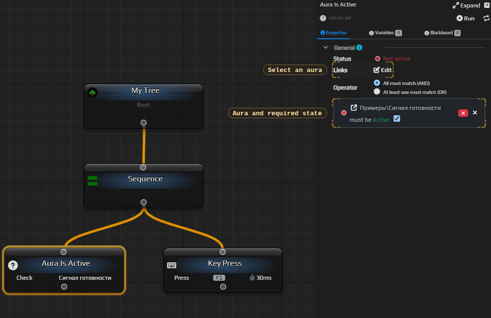

# Aura Is Active — use your aura's state in a tree

`Aura Is Active` checks the state of an aura you have already set up. Link the node to an aura, and the tree branch will run only in the state you need. The condition itself stays in the aura. It can be Fixed Value for a first test, or Image, Color, Text or AI Search.

## Control a branch with your own switch

Create a loaded aura named `BT signal` with one [Fixed Value](/en/triggers/fixed-value) and no actions. Select `Is NOT Active`. Create a separate tree with `Activation → Is Loaded` and `Execution → When Activated → Do nothing`.

1. Through `Add new Node`, add `Aura Is Active` and connect it to the tree entry. Do not add a child yet: first look at the result of the check itself.
2. In the node's settings open `General → Links → Edit`. Select your `BT signal` aura and confirm. The list must show exactly this aura.
3. Keep `must be Active` for it and choose `Operator → All must match (AND)`. Click the upper `Tick BT Once`. The aura is inactive, so it does not match, and the node returns `Failure`.
4. In the aura, switch Fixed Value to `Is Active`. Wait until the aura shows Active, then go back to the tree. `General → Status` shows Active, and a new manual tick finishes with `Success`.
5. To check the opposite, clear the expected-state checkbox in the link row. It now says `must be Not Active`. Success now means the aura is known to be inactive.

| Setting | Effect |
| --- | --- |
| Links → Edit | Select one or more existing auras. The navigation button in a row opens the aura, the cross removes the link |
| must be Active / Not Active | Compare the known state of this aura with the expected one |
| All must match (AND) | Every link must match. If the state of even one is unknown, the overall result is Unknown |
| At least one must match (OR) | One matching link is enough. If a nonempty list has none, the overall result is Not active |
| Status | The current overall result of the links: Active, Not active or Unknown. It is not the node's last execution result |

If the node has no child, Active becomes `Success` and Not active becomes `Failure`. An overall Unknown is a check error, not an ordinary Failure. Check that the auras are loaded and read the error message.

## Continue after a successful check

You can attach one [Wait](/en/behavior-trees/nodes/wait) or a whole [Sequence](/en/behavior-trees/nodes/sequence) to Aura Is Active. The child is called when the condition returns Success, and its result becomes the result of the node. For example, with a 2000 ms Wait the first successful tick returns Running, and the next tick after the delay returns Success.

If the child has already returned Running, the next tick continues **the child first** and does not check the aura again. So a change in the aura at that moment does not interrupt the work. To interrupt on a separate condition, use [Interrupter](/en/behavior-trees/nodes/Interrupter).

Unknown links and an empty list

In AND mode, one link with Unknown makes the overall result unknown, even if another link has already failed to match. In OR mode, a nonempty list with no match gives a negative result, even when the state of some links is unknown.

If a saved link has no expected value, the editor can show `must be Undefined`. Such a link passes on the aura's own state. It does not check for "equals Unknown". For normal work, choose Active or Not Active explicitly. An empty list checks nothing and can let a branch through, so always check that the link you need is in place.

