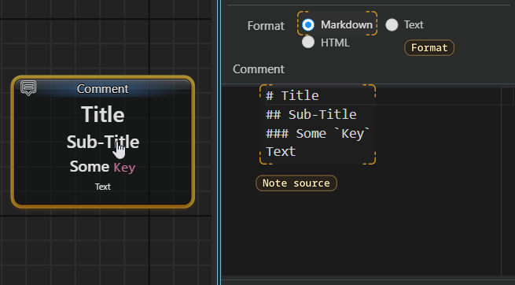

# Comment — explain a part of your tree

`Comment` is a note card that sits beside a branch. It presses nothing, checks nothing and runs nothing. It is there so that a month from now you remember why the branch exists.

## Label a practice delay

Take a separate tree with `Activation → Is Loaded` and `Execution → When Activated → Do nothing`. Connect one `Wait` to the entry, with `General → Delay = 1500 ms` and randomization off.

1. Through `Add new Node`, add `Comment` and place it beside Wait. Do not connect it. The card has no input or output connector.
2. In `General → Format`, choose `Markdown`. Enter this in `Comment`:

```text
**Practice delay**
The first tick starts the timer; a later tick after the delay completes Wait.
```

3. The card shows the note with a bold first line. If you switch to `Format → Text`, the asterisks stay as plain characters. That is handy for writing down exact expressions.
4. Click the upper `Tick BT Once`. Wait returns Running. After two seconds, click again and Wait returns Success. The note did not change the branch's delay or route.



| Setting | Display |
| --- | --- |
| Comment | Note text. It is saved with the tree |
| Format — Markdown | Markdown formatting: emphasis, links, lists and other supported elements |
| Format — Text | Plain text. HTML characters do not turn into markup |
| Format — HTML | The text is shown as HTML. Markdown or Text is enough for an ordinary note |
| Empty text | No comments |

Comment is available in BT and Macro. If you tick Comment itself by hand, it returns `Success` and does nothing.
